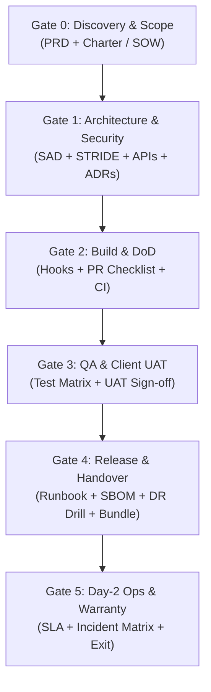

# How to Use This SDLC Framework: Complete Practitioner's Guide

> **Audience:** Product Managers, Technical Leads, Software Engineers, QA Leads, DevOps/SREs, Client Sponsors  
> **Purpose:** Practical, step-by-step instruction manual for adopting, scaffolding, governing, and delivering software using this repository.  

---

## 1. Executive Overview & Mental Model

### What is this?
This repository is an **all-in-one, enterprise-grade SDLC Operating System**. It bridges the gap between **rapid prototype/MVP delivery** and **strict compliance/audit readiness (SOC 2, ISO 27001, HIPAA, PCI DSS)**.

Instead of treating compliance, security, and documentation as bureaucratic afterthoughts ("ClickOps" or last-minute panic before an audit), this system embeds **Doc-as-Code** directly into your Git workflow.

### The 3 Core Pillars
1. **Standardized Role Playbooks & RACI:** Crystal-clear boundaries for 6 key project roles.
2. **30 Production Deliverable Templates:** Fill-in-the-blank markdown templates pre-mapped to compliance standards.
3. **Automated Tooling & Verification CLI:** Automated pre-flight healthchecks, stage-gate compliance auditors, SBOM generators, and milestone sign-off certificates.



---

## 2. Quickstart: 5-Minute Simulation

If you are new to the repository and want to see the entire framework in action without changing any files:

```bash
# Run the interactive live lifecycle simulation in an ephemeral sandbox:
make demo
```

In ~2 seconds, `make demo`:
1. Scaffolds an enterprise MVP in `/tmp`.
2. Runs the compliance auditor across all 6 stage-gates (24/24 checks passed).
3. Generates a 1-page weekly client flash status report from Git history.
4. Generates a cryptographically stamped client milestone sign-off certificate with Git commit SHA.
5. Bundles a compressed, audit-ready client handover archive (`.tar.gz`).
6. Cleans up the temporary sandbox cleanly.

---

## 3. Scenario A: Bootstrapping a Brand New Product (0 to 1)

> ⚡ **Need to launch in 2 weeks with $0 infrastructure costs?**  
> Read the [**2-Week Fast-Track Product Delivery Playbook**](./docs/playbooks/TWO_WEEK_FAST_TRACK_PRODUCT_PLAYBOOK.md) for a pre-formalized stack (Next.js, Supabase, Cloudflare R2, Resend, Stripe) mapped day-by-day to all 30 SDLC deliverables.

Follow these exact steps when starting a brand new project, client engagement, or SaaS platform.

### Step 3.1: Choose a Scaffolding Profile & Initialize

From this framework repository root, execute `make scaffold` targeting your desired new project path:

```bash
# Profile 1: Standard MVP (PRD, Charter, SAD, IDD, API Spec, Runbook, Deployment, UAT)
make scaffold TARGET=../my-new-app PROFILE=--standard

# Profile 2: Regulated Enterprise (Adds STRIDE, VPAT Accessibility, GLRR, Sign-off Matrix, Cryptographic Plan, Vendor Risk)
make scaffold TARGET=../my-new-app PROFILE=--enterprise

# Profile 3: AI / Generative LLM Product (Adds Model Card, Token Budget, RAG Guardrails)
make scaffold TARGET=../my-new-app PROFILE=--ai

# Profile 4: Complete Enterprise & AI Suite (Everything pre-configured)
make scaffold TARGET=../my-new-app PROFILE=--all
```

### Step 3.2: Set Up the Developer Workstation

Navigate into your newly created project directory:

```bash
cd ../my-new-app

# 1. Run the workstation doctor to verify toolchains (Git, Node, Python, Docker, Make)
make doctor

# 2. Install pre-commit Git hooks (enforces Conventional Commits and blocks secret leaks)
make hooks
```

### Step 3.3: Progressive Stage-Gate Workflow

Follow the lifecycle sequentially as your product matures:

#### Gate 0: Scoping & Commercial Alignment (Sprint 0)
- **Files to complete:** `docs/PRD.md` and `docs/PROJECT_CHARTER.md`.
- **Action:** Define scope, personas, commercial milestones, and out-of-scope boundaries.
- **Audit clearance:**
  ```bash
  ./scripts/sdlc-cli.sh audit 0 .
  ```

#### Gate 1: Architecture, Security & Contract Review
- **Files to complete:** `docs/architecture/SAD.md`, `docs/architecture/IDD.md`, `docs/api/API_SPECIFICATION.md`, and `docs/security/SECURITY_REVIEW.md`.
- **Enterprise additions:** `docs/security/THREAT_MODEL.md` and `docs/security/VENDOR_ASSESSMENT.md`.
- **Action:** Record architecture decisions in `docs/adr/ADR-001-initial-architecture.md`.
- **Audit clearance:**
  ```bash
  ./scripts/sdlc-cli.sh audit 1 .
  ```

#### Gate 2: Development & Sprint Cadence
- **Day-to-Day Execution:** Developers write code on feature branches (`feat/user-auth`, `fix/payment-retry`).
- **Commit Format:** Use [Conventional Commits](https://www.conventionalcommits.org/) (`feat(...)`, `fix(...)`, `docs(...)`). The Git hook will automatically reject non-compliant commit messages.
- **Pull Requests:** Open a PR. The template `.github/pull_request_template.md` automatically enforces the **Definition of Done (DoD)**.
- **Automated CI:** The workflow `.github/workflows/ci-compliance.yml` runs automated linting, test coverage, and security checks on every PR.
- **Client Communication:** Every Friday, generate an executive 1-page status report directly from Git:
  ```bash
  make report DAYS=7
  ```
- **Audit clearance:**
  ```bash
  ./scripts/sdlc-cli.sh audit 2 .
  ```

#### Gate 3: QA Verification & Client UAT Sign-Off
- **Files to complete:** `docs/testing/TEST_PLAN_AND_UAT.md` and `docs/testing/VPAT.md` (if accessibility is in scope).
- **Client Sign-Off:** Once the client approves UAT, generate a formal acceptance certificate:
  ```bash
  make signoff MILESTONE="M3-Client-UAT" CLIENT="Acme Corporation"
  ```
- **Audit clearance:**
  ```bash
  ./scripts/sdlc-cli.sh audit 3 .
  ```

#### Gate 4: Production Release & Operations Handover
- **Files to complete:** `docs/ops/OPERATIONS_RUNBOOK.md`, `docs/ops/DEPLOYMENT_GUIDE.md`, and `docs/ops/SERVICE_TRANSITION.md`.
- **Disaster Recovery Proof:** Execute an automated Point-in-Time Recovery drill:
  ```bash
  make dr-drill SYSTEM="Production-Database"
  ```
- **Automated Artifacts:** Generate release notes and software bill of materials (SBOM):
  ```bash
  make release FROM=v0.9.0 TO=HEAD VERSION=v1.0.0
  make sbom
  ```
- **Formal Handover Bundle:** Package all deliverables into a client-ready `.tar.gz`:
  ```bash
  make package VER=v1.0.0
  ```
- **Audit clearance:**
  ```bash
  ./scripts/sdlc-cli.sh audit 4 .
  ```

#### Gate 5: Steady-State Support & Warranty Exit
- **Files to complete:** `docs/ops/SLA_MATRIX.md` and `docs/ops/SLA_SPECIFICATION.md`.
- **Final Master Audit:** Run a full repo compliance check:
  ```bash
  make audit GATE=all
  # Machine-readable JSON output for enterprise compliance portals:
  make audit GATE=all FORMAT=json
  ```

---

## 4. Scenario B: Retrofitting Governance onto an Existing Codebase

If you have an existing application or repository and want to elevate it to enterprise compliance standards:

1. **Run a Gap Analysis Audit:**
   From this framework repo, run the compliance checker against your existing codebase:
   ```bash
   ./scripts/sdlc-cli.sh audit all /path/to/existing-repo
   ```
   The auditor will output a precise list of missing or empty documents:
   ```text
   ❌ [FAIL] System Architecture Document (SAD) - Missing: docs/architecture/SAD.md
   ❌ [FAIL] Operations Runbook - Missing: docs/ops/OPERATIONS_RUNBOOK.md
   ```

2. **Selectively Adopt Missing Templates:**
   Browse the [`templates/`](./templates/) directory (or use the interactive filter in [`index.html`](./index.html)) and copy only the missing templates you need into your repository's `docs/` folder.

3. **Install CI/CD Compliance Gates:**
   Copy `.github/pull_request_template.md` and `.github/workflows/ci-compliance.yml` into your repository.

4. **Install Git Protection Hooks:**
   Copy `scripts/setup-git-hooks.sh` and run `./scripts/setup-git-hooks.sh` to prevent secret leaks.

---

## 5. Role-by-Role Cheat Sheet: "What do I do daily?"

| Role | Playbook Link | Primary Daily Deliverables & Actions | Key Terminal Commands |
| :--- | :--- | :--- | :--- |
| **Product Owner / PM** | [`01_PRODUCT_OWNER_PM.md`](./roles/01_PRODUCT_OWNER_PM.md) | • Maintain `docs/PRD.md` & user stories<br>• Manage scope trade-offs (1-in, 1-out)<br>• Review weekly flash reports with client | `make report DAYS=7`<br>`make signoff` |
| **Tech Lead / Architect** | [`02_TECH_LEAD_ARCHITECT.md`](./roles/02_TECH_LEAD_ARCHITECT.md) | • Maintain `docs/architecture/SAD.md` & `IDD.md`<br>• Record architectural decisions in `docs/adr/`<br>• Maintain STRIDE threat model & model cards | `make audit GATE=1`<br>`make sbom` |
| **Software Engineer** | [`03_SOFTWARE_ENGINEER.md`](./roles/03_SOFTWARE_ENGINEER.md) | • Commit code using Conventional Commits<br>• Follow PR Definition of Done checklist<br>• Ensure zero secrets committed to Git | `make doctor`<br>`make hooks` |
| **QA Automation Lead** | [`04_QA_AND_TEST_ENGINEER.md`](./roles/04_QA_AND_TEST_ENGINEER.md) | • Maintain `docs/testing/TEST_PLAN_AND_UAT.md`<br>• Execute automated E2E and regression tests<br>• Verify WCAG 2.2 AA accessibility (VPAT) | `make smoke`<br>`make audit GATE=3` |
| **DevOps / SRE Lead** | [`05_DEVOPS_SRE_AND_OPS_LEAD.md`](./roles/05_DEVOPS_SRE_AND_OPS_LEAD.md) | • Maintain `docs/ops/OPERATIONS_RUNBOOK.md`<br>• Execute semi-annual DR drills<br>• Package handover archives & CycloneDX SBOMs | `make dr-drill`<br>`make package`<br>`make sbom` |
| **Client Sponsor** | [`06_CLIENT_SPONSOR_AND_STAKEHOLDER.md`](./roles/06_CLIENT_SPONSOR_AND_STAKEHOLDER.md) | • Review Sprint Demos & Weekly Flash Reports<br>• Authorize Change Requests (`CHANGE_REQUEST_FORM.md`)<br>• Execute milestone sign-off certificates | `make signoff` |

---

## 6. Master Automation Shortcut Menu

You can run all operations via `make` or the unified `./scripts/sdlc-cli.sh`:

| Task | Make Command | Direct Script / CLI Command | Purpose |
| :--- | :--- | :--- | :--- |
| **Pre-Flight Healthcheck** | `make doctor` | `./scripts/sdlc-cli.sh doctor` | Checks developer machine dependencies (Git, Bash, Node, Python, Docker). |
| **Stage-Gate Audit** | `make audit` | `./scripts/sdlc-cli.sh audit all .` | Runs automated compliance checks across all stage-gates. |
| **JSON Audit Export** | `make audit FORMAT=json` | `./scripts/sdlc-cli.sh audit all . json` | Generates machine-readable JSON compliance report for CI or external tools. |
| **Scaffold Project** | `make scaffold TARGET=../app` | `./scripts/scaffold-new-project.sh ../app --enterprise` | Scaffolds a new project pre-populated with documentation and CI gates. |
| **Install Git Hooks** | `make hooks` | `./scripts/setup-git-hooks.sh` | Installs local pre-commit secret scanning and Conventional Commits hook. |
| **Weekly Flash Report** | `make report DAYS=7` | `./scripts/generate-weekly-report.sh [name] 7` | Generates an executive 1-page markdown status report from Git commit history. |
| **Milestone Sign-Off** | `make signoff` | `./scripts/generate-signoff-cert.sh M3 "Client" "App"` | Stamped client milestone acceptance certificate with Git SHA. |
| **Generate SBOM** | `make sbom` | `./scripts/generate-sbom.sh . ./dist/sbom.json` | Compiles CycloneDX v1.5 JSON Software Bill of Materials. |
| **DR Drill Simulation** | `make dr-drill` | `./scripts/simulate-dr-drill.sh "Core-DB"` | Simulates Point-in-Time Recovery drill and generates audit certificate. |
| **Synthetic Smoke Test** | `make smoke URL=http://localhost:8000` | `./scripts/run-smoke-tests.sh http://localhost:8000` | Probes live liveness, readiness, and API documentation endpoints. |
| **Package Handover** | `make package VER=v1.0.0` | `./scripts/package-client-handover.sh . ./dist v1.0.0` | Consolidates all required deliverables into a client-ready `.tar.gz` archive. |
| **Verify Markdown Links** | `make test-links` | *(Internal Python Link Checker)* | Verifies 100% relative link integrity across all markdown files. |
| **Interactive Simulation** | `make demo` | `./scripts/demo-walkthrough.sh` | Executes full 5-stage SDLC simulation in an ephemeral sandbox (~2s). |
| **Documentation Portal** | `make portal` | `./scripts/sdlc-cli.sh portal` | Launches local web preview of the Material for MkDocs portal. |

---

## 7. Interactive Portals & Executive Dashboards

### 1. Standalone Single-Page Application (`index.html`)
- Open [`index.html`](./index.html) directly in any modern browser (`open index.html`).
- **Features:**
  - **Live Gate Checklist Auditor:** Real-time calculator to evaluate project clearance with **Select All / Reset All** and **Export Audit Report (.md)**.
  - **30 Standard Deliverables Library:** Search and filter templates by category (Discovery, Architecture, Security, QA, Operations) with 1-click **Copy Path** buttons.
  - **RACI Governance Matrix:** Complete interactive responsibility chart for all 6 roles.
  - **CLI Command Reference:** Quick terminal copy snippets.

### 2. Searchable Material for MkDocs Portal (`mkdocs.yml`)
- Run `make portal` to launch the full static documentation site with full-text search, dark/light theme, and syntax highlighting.

---

## 8. Frequently Asked Questions (FAQ)

#### Q: Do I have to fill in all 30 templates for a simple prototype?
**No.** For a rapid prototype or MVP, use `--standard` profile. You only need 4 core files:
1. `docs/PRD.md` (What are we building?)
2. `docs/architecture/SAD.md` (How is it architected?)
3. `docs/testing/TEST_PLAN_AND_UAT.md` (How do we prove it works?)
4. `docs/ops/OPERATIONS_RUNBOOK.md` (How do we run it in production?)

As your product grows into an enterprise contract or regulated vertical (fintech, healthcare), adopt the additional compliance templates (`THREAT_MODEL.md`, `BIA.md`, `KEY_MANAGEMENT_PLAN.md`, `VENDOR_ASSESSMENT.md`).

#### Q: How do we pass client security audits (SOC 2, ISO 27001, SIG Lite)?
Use [`docs/compliance/ENTERPRISE_SECURITY_QUESTIONNAIRE_PLAYBOOK.md`](./docs/compliance/ENTERPRISE_SECURITY_QUESTIONNAIRE_PLAYBOOK.md). It contains pre-approved, audited answers across 12 infosec domains that directly reference the policies in this repository.

#### Q: How do we customize this framework for our organization?
1. Fork or clone this repository.
2. Edit `templates/` with your organization's logo, legal entity name, and default cloud providers.
3. Update `scripts/verify-stage-gate.sh` if your organization mandates additional specific files.
4. Distribute the repo to your engineering teams as their default project starter kit.
