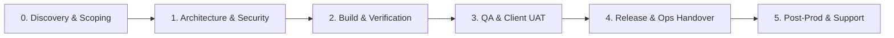

# Lean-Enterprise SDLC Operating Framework
## Fast-Paced Product & Prototype Development with Embedded Compliance, Client Deliverables, and Operational Readiness

> 🚀 **New to this repository?** Read the [**Practitioner's Guide: How to Use This Framework for Any New Product**](./HOW_TO_USE_THIS_FRAMEWORK.md) for step-by-step instructions on project scaffolding, day-to-day role workflows, and stage-gate audits.

---

## Executive Summary

When developing fast-paced products and prototypes, teams often fall into one of two traps:
1. **The Bureaucracy Trap:** Heavy waterfall documentation slows momentum, causing deadlines to slip.
2. **The Prototype Trap:** Moving fast with zero documentation leads to catastrophic delays during client acceptance, security audits, and production operational handover.

This framework introduces **Embedded Living Documentation (Doc-as-Code & Just-in-Time Deliverables)**. Each SDLC stage produces client-ready and operations-ready artifacts as a *natural byproduct of execution*, rather than an administrative afterthought.

---

## SDLC Lifecycle Stages & Artifact Matrix

| Stage | Primary Goal | Client-Facing Deliverable | Operations/Engineering Deliverable | Gate Check |
|---|---|---|---|---|
| **0. Discovery & Scoping** | Align vision, scope, and technical viability | Project Charter / Statement of Work (SOW), High-Level PRD | Scope Baseline, Risk Register, Feasibility Spike | Gate 0: Charter Sign-off |
| **1. Architecture & Security** | Formulate scalable, compliant system design | System Architecture Overview, Data Flow & Privacy Summary | Architecture Decision Records (ADRs), Security Threat Model, API Contract | Gate 1: Architecture & Sec Review |
| **2. Build & Continuous QA** | Rapid iterative delivery with automated gates | Sprint Demo Logs, Progress Reports, API Sandbox | Living README, OpenAPI/Swagger Docs, Automated CI/CD, Unit/Int Tests | Gate 2: Code Freeze / Feature Complete |
| **3. QA, Security & UAT** | Verify non-functional & functional compliance | Client UAT Test Plan & Formal Sign-Off Certificate | Security Scan (SAST/DAST/SCA), Performance Benchmark, QA Summary | Gate 3: Production Readiness (Go/No-Go) |
| **4. Release & Ops Handover** | Seamless rollout with zero-surprise operations | Release Notes, User Manual / Admin Guide | Operations Runbook, Deployment & Rollback Playbook, Infrastructure as Code | Gate 4: Operational Cutover & Handover |
| **5. Post-Prod & Warranty** | Guarantee stability, SLA adherence, and support | SLA Performance Report, Warranty Sign-Off | Monitoring & Alerting Dashboards, Incident Post-Mortem SOP, Maintenance Schedule | Gate 5: Steady-State Transition |

---

## RACI Accountability Matrix

* **R** = Responsible (Does the work)
* **A** = Accountable (Final approval/signer)
* **C** = Consulted (Provides input)
* **I** = Informed (Kept updated)

| Artifact / Milestone | Product Owner / PM | Lead Architect / Tech Lead | Engineering Team | QA / Security | Client Stakeholder | DevOps / IT Ops |
|---|---|---|---|---|---|---|
| **PRD & Scope Baseline** | **A / R** | C | C | C | **C / Sign-off** | I |
| **Architecture (HLD/LLD) & ADRs** | C | **A / R** | R | C | I | C |
| **API Contract & Schemas** | C | A | **R** | C | I | I |
| **Security & Privacy Review** | I | C | R | **A / R** | I | C |
| **Definition of Done (DoD)** | C | A | **R** | R | I | I |
| **Client UAT & Acceptance** | **R** | C | I | R | **A / Sign-off** | I |
| **Operations Runbook** | I | C | R | I | I | **A / R** |
| **Deployment & Rollback Plan** | I | C | R | C | I | **A / R** |
| **Service Transition Sign-off** | **A** | C | C | C | **A** | **A** |

---

## Directory Layout in This Toolkit

* [`index.html`](./index.html): Standalone Executive Single-Page Application & Interactive Gate Auditor.
* [`docs/`](./docs/): In-depth process workflows for each stage detailing trigger conditions, entry/exit criteria, role interactions, and velocity tips.
  * [`01_Discovery_and_Scoping.md`](./docs/01_Discovery_and_Scoping.md)
  * [`02_Architecture_and_Design.md`](./docs/02_Architecture_and_Design.md)
  * [`03_Development_and_Build.md`](./docs/03_Development_and_Build.md)
  * [`04_Verification_and_UAT.md`](./docs/04_Verification_and_UAT.md)
  * [`05_Release_and_Operations_Handover.md`](./docs/05_Release_and_Operations_Handover.md)
  * [`06_Post_Production_and_Maintenance.md`](./docs/06_Post_Production_and_Maintenance.md)
  * [`DEVELOPER_ONBOARDING_AND_LOCAL_SETUP_GUIDE.md`](./docs/DEVELOPER_ONBOARDING_AND_LOCAL_SETUP_GUIDE.md): The "Day-1 First Commit in 4 Hours" local environment bootstrap guide.
  * [`PROTOTYPE_TO_PRODUCTION_MIGRATION_PLAYBOOK.md`](./docs/PROTOTYPE_TO_PRODUCTION_MIGRATION_PLAYBOOK.md): Architectural roadmap for transitioning prototypes into enterprise production.
  * [`architecture/ZERO_DOWNTIME_DATA_MIGRATION_PLAYBOOK.md`](./docs/architecture/ZERO_DOWNTIME_DATA_MIGRATION_PLAYBOOK.md): The Expand/Contract database migration pattern for zero downtime.
  * [`architecture/DATA_PRIVACY_AND_RETENTION_PLAYBOOK.md`](./docs/architecture/DATA_PRIVACY_AND_RETENTION_PLAYBOOK.md): GDPR/CCPA erasure workflows and staging data sanitization.
  * [`architecture/ARCHITECTURE_DIAGRAM_CATALOG.md`](./docs/architecture/ARCHITECTURE_DIAGRAM_CATALOG.md): Copy-paste Mermaid visual patterns (BFF, Event-Driven, Multi-Tenant SaaS, OAuth2).
  * [`architecture/MULTI_TENANT_SAAS_DATA_ISOLATION_STANDARDS.md`](./docs/architecture/MULTI_TENANT_SAAS_DATA_ISOLATION_STANDARDS.md): Multi-tenant SaaS data isolation, PostgreSQL Row-Level Security (RLS), and cross-tenant leak prevention.
  * [`architecture/TWELVE_FACTOR_APP_AND_CONFIG_STANDARDS.md`](./docs/architecture/TWELVE_FACTOR_APP_AND_CONFIG_STANDARDS.md): Cloud-native Twelve-Factor App methodology, stateless architecture, and graceful shutdown standards.
  * [`architecture/IAC_AND_GITOPS_STANDARDS.md`](./docs/architecture/IAC_AND_GITOPS_STANDARDS.md): Infrastructure as Code (Terraform/OpenTofu) and GitOps (ArgoCD) state management standards.
  * [`adr/README.md`](./docs/adr/README.md): Architecture Decision Record (ADR) living registry and lifecycle index.
  * [`compliance/SOC2_TYPE_II_READINESS_GUIDE.md`](./docs/compliance/SOC2_TYPE_II_READINESS_GUIDE.md): Continuous SOC 2 Type II compliance controls, evidence collection, and PR audits.
  * [`compliance/HIPAA_COMPLIANCE_PLAYBOOK.md`](./docs/compliance/HIPAA_COMPLIANCE_PLAYBOOK.md): Health data (ePHI) security safeguards, 18 identifiers Safe Harbor, and BAA protocols.
  * [`compliance/PCI_DSS_SAQ_D_CHECKLIST.md`](./docs/compliance/PCI_DSS_SAQ_D_CHECKLIST.md): Cardholder Data Environment (CDE) isolation, tokenization patterns, and v4.0 controls.
  * [`ops/TELEMETRY_AND_MONITORING_STANDARDS.md`](./docs/ops/TELEMETRY_AND_MONITORING_STANDARDS.md): JSON logging schemas, RED/USE metrics, health checks, and tracing headers.
  * [`ops/DISASTER_RECOVERY_AND_BACKUP_DRILL_SOP.md`](./docs/ops/DISASTER_RECOVERY_AND_BACKUP_DRILL_SOP.md): Step-by-step PITR backup drill and DR sign-off certificate.
  * [`ops/ON_CALL_OPERATING_PROCEDURE.md`](./docs/ops/ON_CALL_OPERATING_PROCEDURE.md): Sustainable 24/7 on-call rotations, shift handoffs, and rest policies.
  * [`ops/CLOUD_COST_AND_FINOPS_GOVERNANCE.md`](./docs/ops/CLOUD_COST_AND_FINOPS_GOVERNANCE.md): Cloud cost governance, auto-shutdowns, and resource tagging.
  * [`ops/CHAOS_ENGINEERING_AND_FAILOVER_TESTING.md`](./docs/ops/CHAOS_ENGINEERING_AND_FAILOVER_TESTING.md): Controlled fault injection, pod termination, and failover verification.
  * [`ops/INCIDENT_WAR_ROOM_COMMUNICATIONS_PLAYBOOK.md`](./docs/ops/INCIDENT_WAR_ROOM_COMMUNICATIONS_PLAYBOOK.md): War room roles, client broadcast templates, and status updates.
  * [`ops/POST_MORTEM_AND_CAPA_GOVERNANCE.md`](./docs/ops/POST_MORTEM_AND_CAPA_GOVERNANCE.md): Blameless root cause analysis, 5-Whys, and CAPA lifecycle tracking.
  * [`ops/SLO_AND_ERROR_BUDGET_POLICY.md`](./docs/ops/SLO_AND_ERROR_BUDGET_POLICY.md): SLI/SLO/SLA definitions, error budget burn rate alerting, and automated feature freeze rules.
  * [`ops/BUSINESS_CONTINUITY_AND_BIA_POLICY.md`](./docs/ops/BUSINESS_CONTINUITY_AND_BIA_POLICY.md): ISO 22301 Business Continuity Management System (BCMS), BIA methodology, and Crisis Management Team (CMT) activation.
  * [`governance/SCOPE_CREEP_AND_BUDGET_MANAGEMENT_PLAYBOOK.md`](./docs/governance/SCOPE_CREEP_AND_BUDGET_MANAGEMENT_PLAYBOOK.md): Triple constraint control, 1-in 1-out scope trade-offs, and commercial change guardrails.
  * [`api/API_VERSIONING_AND_SUNSET_POLICY.md`](./docs/api/API_VERSIONING_AND_SUNSET_POLICY.md): URI versioning, breaking change prevention, and RFC 8594 sunset headers.
  * [`security/VULNERABILITY_DISCLOSURE_AND_INCIDENT_SOP.md`](./docs/security/VULNERABILITY_DISCLOSURE_AND_INCIDENT_SOP.md): Vulnerability response SLAs and disclosure policies.
  * [`security/SBOM_AND_OPEN_SOURCE_LICENSE_POLICY.md`](./docs/security/SBOM_AND_OPEN_SOURCE_LICENSE_POLICY.md): Software Bill of Materials (SBOM) and open-source license governance.
  * [`security/SUPPLY_CHAIN_SECURITY_AND_SLSA_STANDARDS.md`](./docs/security/SUPPLY_CHAIN_SECURITY_AND_SLSA_STANDARDS.md): Software supply chain security, SLSA Level 1-3 attestation, and Cosign container signing.
  * [`security/SECRET_MANAGEMENT_AND_DLP_POLICY.md`](./docs/security/SECRET_MANAGEMENT_AND_DLP_POLICY.md): Zero-plaintext commit policy, Gitleaks pre-commit hooks, KMS/Vault rotation, and leaked credential revocation.
  * [`security/CONTAINER_HARDENING_AND_DISTROLESS_STANDARDS.md`](./docs/security/CONTAINER_HARDENING_AND_DISTROLESS_STANDARDS.md): Non-root execution (UID 65532), Distroless base images, read-only root filesystems, and Trivy scans.
  * [`security/CRYPTOGRAPHY_AND_KEY_MANAGEMENT_POLICY.md`](./docs/security/CRYPTOGRAPHY_AND_KEY_MANAGEMENT_POLICY.md): FIPS 140-3 approved ciphers (AES-256-GCM, RSA >=3072, ECC P-384), automated KMS envelope rotation, and Post-Quantum Cryptography (PQC) transition plan.
  * [`compliance/VENDOR_RISK_MANAGEMENT_AND_SUBPROCESSOR_POLICY.md`](./docs/compliance/VENDOR_RISK_MANAGEMENT_AND_SUBPROCESSOR_POLICY.md): Third-party vendor due diligence, sub-processor registry, DPA safeguards, and annual re-assessment cadence.
  * [`compliance/ENTERPRISE_SECURITY_QUESTIONNAIRE_PLAYBOOK.md`](./docs/compliance/ENTERPRISE_SECURITY_QUESTIONNAIRE_PLAYBOOK.md): Standardized pre-approved answers for SIG Lite, CAIQ, and enterprise client infosec questionnaires.
  * [`accessibility/WCAG_ACCESSIBILITY_AND_INCLUSION_STANDARDS.md`](./docs/accessibility/WCAG_ACCESSIBILITY_AND_INCLUSION_STANDARDS.md): WCAG 2.2 Level AA accessibility standards, automated axe-core testing, and screen reader SOPs.
  * [`ai/AI_LLM_ENGINEERING_GOVERNANCE.md`](./docs/ai/AI_LLM_ENGINEERING_GOVERNANCE.md): Generative AI & LLM engineering standards, OWASP LLM top 10, RAG triad benchmarks, and cost controls.
* [`templates/`](./templates/): Standardized, fill-in-the-blank markdown templates that can be used immediately in git repositories.
  * `PRD_TEMPLATE.md`: Product Requirement Document.
  * `PROJECT_CHARTER_AND_SOW.md`: Scope, milestone, and commercial alignment.
  * `SYSTEM_ARCHITECTURE_DOCUMENT_SAD.md`: Combined HLD & LLD.
  * `INFRASTRUCTURE_DESIGN_DOCUMENT_IDD.md`: Cloud infrastructure topology, VPC subnet planning, and capacity sizing.
  * `ARCHITECTURE_DECISION_RECORD_ADR.md`: Lightweight decision tracking.
  * `STRIDE_THREAT_MODEL_TEMPLATE.md`: Architecture-level STRIDE threat assessment.
  * `SECURITY_AUDIT_REPORT_EXECUTIVE_SUMMARY.md`: Client CISO executive security audit assurance report.
  * `SECURITY_AND_DATA_PRIVACY_CHECKLIST.md`: Threat assessment and vulnerability posture.
  * `API_CONTRACT_AND_INTEGRATION_SPEC.md`: Client & partner integration interface.
  * `API_INTEGRATION_TEST_REPORT.md`: Third-party and vendor integration verification report.
  * `DEFINITION_OF_DONE_AND_CODE_REVIEW.md`: Developer quality guardrails.
  * `TEST_PLAN_AND_UAT_SIGNOFF.md`: Client acceptance test matrix and sign-off document.
  * `OPERATIONS_RUNBOOK.md`: Day-2 operations, failover, disaster recovery, and monitoring.
  * `DEPLOYMENT_AND_ROLLBACK_GUIDE.md`: Zero-downtime release procedures.
  * `SERVICE_TRANSITION_CHECKLIST.md`: Formal gate between development and ops.
  * `GO_LIVE_READINESS_REVIEW_GLRR.md`: Production Go-Live Readiness Review (GLRR) voting and rollback authorization record.
  * `INCIDENT_MANAGEMENT_AND_SLA_MATRIX.md`: Severity tiers, escalations, and post-mortems.
  * `CHANGE_REQUEST_FORM.md`: Scope change request form for client alignment.
  * `CHANGE_ORDER_ESTIMATION_WORKSHEET.md`: Commercial impact and timeline worksheet for change requests.
  * `DELIVERABLES_SIGN_OFF_MATRIX.md`: Master milestone approval matrix, sign-off registry, and IP transfer terms.
  * `MODEL_CARD_AND_AI_RISK_ASSESSMENT.md`: AI model evaluation benchmarks, data lineage, ethical safeguards, and token budget worksheet.
  * `WEEKLY_STEERING_COMMITTEE_SLIDES.md`: 5-slide Marp executive presentation for weekly client steering committees and blocker escalations.
  * `VPAT_ACCESSIBILITY_CONFORMANCE_REPORT.md`: VPAT 2.4 WCAG Edition accessibility conformance reporting template.
  * `VULNERABILITY_ASSESSMENT_AND_REMEDIATION_LOG.md`: CVSS 3.1 security vulnerability tracker, SLA countdown, and CISO sign-off log.
  * `DATA_CLASSIFICATION_AND_INVENTORY_MATRIX.md`: GDPR Art. 30 data processing inventory, classification tiers (Public to Restricted), and DPIA triggers.
  * `CRYPTOGRAPHIC_INVENTORY_AND_KEY_MANAGEMENT_PLAN.md`: Cryptographic asset register, key rotation schedules, and post-quantum readiness audit log.
  * `THIRD_PARTY_VENDOR_SECURITY_ASSESSMENT.md`: Standardized vendor risk assessment questionnaire, sub-processor security controls audit, and CISO sign-off.
  * `BUSINESS_IMPACT_ANALYSIS_BIA.md`: Critical business functions register, financial outage loss schedule, and RTO/RPO/MTD justification.
  * `CLIENT_SECURITY_ASSURANCE_PACK.md`: Consolidated customer security attestation, sub-processor disclosure, and compliance crosswalk.
  * `SERVICE_LEVEL_AGREEMENT_SPECIFICATION.md`: Availability commitments (99.9%–99.99%), monthly service credit schedule, and maintenance exclusions.
* [`roles/`](./roles/): Detailed standard role playbooks, KPIs, and daily/stage responsibilities.
  * [`01_PRODUCT_OWNER_PM.md`](./roles/01_PRODUCT_OWNER_PM.md): Product Owner / Project Manager playbook.
  * [`02_TECH_LEAD_ARCHITECT.md`](./roles/02_TECH_LEAD_ARCHITECT.md): Technical Lead & System Architect playbook.
  * [`03_SOFTWARE_ENGINEER.md`](./roles/03_SOFTWARE_ENGINEER.md): Software Engineer playbook.
  * [`04_QA_AND_TEST_ENGINEER.md`](./roles/04_QA_AND_TEST_ENGINEER.md): QA & Test Automation Engineer playbook.
  * [`05_DEVOPS_SRE_AND_OPS_LEAD.md`](./roles/05_DEVOPS_SRE_AND_OPS_LEAD.md): DevOps, SRE & Operations Lead playbook.
  * [`06_CLIENT_SPONSOR_AND_STAKEHOLDER.md`](./roles/06_CLIENT_SPONSOR_AND_STAKEHOLDER.md): Client Sponsor & Business Stakeholder playbook.
* [`ceremonies-and-handshakes/`](./ceremonies-and-handshakes/): Agile operational rhythms and inter-role transitions.
  * [`SPRINT_AND_RELEASE_CADENCE.md`](./ceremonies-and-handshakes/SPRINT_AND_RELEASE_CADENCE.md): 2-week sprint rhythm, DoR, daily standups, and demos.
  * [`HANDSHAKE_PROTOCOLS.md`](./ceremonies-and-handshakes/HANDSHAKE_PROTOCOLS.md): The 6 explicit transition protocols between teams.
* [`checklists/`](./checklists/): Quick-reference gate review checklists and standards.
  * [`STAGE_GATES_QUICK_REFERENCE.md`](./checklists/STAGE_GATES_QUICK_REFERENCE.md): 15-minute stage gate checklists (Gate 0 to Gate 5).
  * [`SDLC_FRAMEWORK_ONE_PAGE_CHEAT_SHEET.md`](./checklists/SDLC_FRAMEWORK_ONE_PAGE_CHEAT_SHEET.md): 1-page printable desk reference for developers and leads.
  * [`NFR_STANDARDS_CATALOG.md`](./checklists/NFR_STANDARDS_CATALOG.md): Non-functional requirements benchmarks for Prototype vs MVP vs Enterprise.
* [`automation-and-tooling/`](./automation-and-tooling/): Fast-track Doc-as-Code automation playbooks and testing scaffolds.
  * [`FAST_TRACK_AUTOMATION_PLAYBOOK.md`](./automation-and-tooling/FAST_TRACK_AUTOMATION_PLAYBOOK.md): Automated OpenAPI, ERD diagrams, Conventional Commits, and CI compliance pipelines.
  * [`mock-server/`](./automation-and-tooling/mock-server/): Instant containerized mock API server (Stoplight Prism) for contract-first parallel development.
  * [`testing/playwright.config.ts`](./automation-and-tooling/testing/playwright.config.ts): CI-ready Playwright end-to-end testing configuration.
  * [`testing/smoke.spec.ts`](./automation-and-tooling/testing/smoke.spec.ts): Synthetic Production Verification Test (PVT) smoke test suite.
  * [`testing/k6-load-test.js`](./automation-and-tooling/testing/k6-load-test.js): k6 load and stress test benchmark script.
* [`scripts/`](./scripts/): Project scaffolding and automation tooling.
  * [`sdlc-cli.sh`](./scripts/sdlc-cli.sh): Unified master CLI runner (scaffold, audit, release, hooks, portal, package).
  * [`scaffold-new-project.sh`](./scripts/scaffold-new-project.sh): CLI script to scaffold a new project with all templates in seconds.
  * [`verify-stage-gate.sh`](./scripts/verify-stage-gate.sh): Automated audit script to verify whether a project satisfies gate requirements.
  * [`generate-release-notes.sh`](./scripts/generate-release-notes.sh): Automatic release notes generator from Conventional Commits.
  * [`generate-weekly-report.sh`](./scripts/generate-weekly-report.sh): Client 1-page weekly flash status report generator from Git history.
  * [`setup-git-hooks.sh`](./scripts/setup-git-hooks.sh): Local Git hook installer for secret scanning and Conventional Commits.
  * [`run-smoke-tests.sh`](./scripts/run-smoke-tests.sh): Synthetic PVT smoke test runner against target endpoints.
  * [`package-client-handover.sh`](./scripts/package-client-handover.sh): Client and operational handover package consolidator & archiver.
  * [`generate-signoff-cert.sh`](./scripts/generate-signoff-cert.sh): Client milestone acceptance & sign-off certificate generator.
  * [`demo-walkthrough.sh`](./scripts/demo-walkthrough.sh): Interactive 30-second live simulation of the full SDLC in an ephemeral sandbox.
  * [`simulate-dr-drill.sh`](./scripts/simulate-dr-drill.sh): Automated Disaster Recovery PITR drill simulator and audit certificate generator.
  * [`generate-sbom.sh`](./scripts/generate-sbom.sh): CycloneDX v1.5 JSON Software Bill of Materials (SBOM) generator from dependency manifests.
  * [`doctor.sh`](./scripts/doctor.sh): Workstation pre-flight healthcheck and toolchain diagnostics runner.
  * [`build-docs-portal.sh`](./scripts/build-docs-portal.sh): Static HTML documentation portal compiler.
* [`Makefile`](./Makefile): Master developer automation shortcut menu (`make audit`, `make scaffold`, `make signoff`, etc.).
* [`Brewfile`](./Brewfile): macOS Homebrew bundle for developer workstation toolchain setup.
* [`.devcontainer/`](./.devcontainer/): VS Code & GitHub Codespaces zero-install container configuration.
* [`client-collateral/`](./client-collateral/): Client-facing governance documentation.
  * [`SDLC_GOVERNANCE_ONE_PAGER.md`](./client-collateral/SDLC_GOVERNANCE_ONE_PAGER.md): Executive assurance overview to present to enterprise clients.
  * [`EXECUTIVE_HANDOVER_SLIDE_DECK.md`](./client-collateral/EXECUTIVE_HANDOVER_SLIDE_DECK.md): Marp-compatible 16:9 executive presentation slide deck for Gate 4 cutover.
  * [`UAT_KICKOFF_PRESENTATION_KIT.md`](./client-collateral/UAT_KICKOFF_PRESENTATION_KIT.md): Day-1 Client UAT briefing slides and defect logging rules.
  * [`CLIENT_HANDOVER_WORKSHOP_AGENDA.md`](./client-collateral/CLIENT_HANDOVER_WORKSHOP_AGENDA.md): 2-hour formal operational and client service transition workshop agenda.
  * [`STEERING_COMMITTEE_AND_REPORTING_CHARTER.md`](./client-collateral/STEERING_COMMITTEE_AND_REPORTING_CHARTER.md): Executive reporting charter and 1-page weekly flash report template.
  * [`CLIENT_FEEDBACK_AND_NPS_SURVEY.md`](./client-collateral/CLIENT_FEEDBACK_AND_NPS_SURVEY.md): Post-launch client satisfaction and NPS evaluation survey.
* [`mkdocs.yml`](./mkdocs.yml): Interactive documentation portal configuration (Material for MkDocs).
* [`.github/`](./.github/): GitHub Native PR templates, issue templates, and CI compliance workflows.
  * `pull_request_template.md`: Definition of Done PR checklist.
  * `ISSUE_TEMPLATE/`: Standardized feature request and defect triage issue forms.
  * `workflows/ci-compliance.yml`: Production GitHub Actions CI/CD compliance workflow.
  * `workflows/pr-labeler.yml`: Automated PR labeling and reviewer assignment based on modified paths.
  * `workflows/stage-gate-audit.yml`: Automated Stage-Gate compliance auditing and PR comment bot.
* [`CONTRIBUTING.md`](./CONTRIBUTING.md): Standards contribution, Conventional Commits, and PR governance.
* [`LICENSE`](./LICENSE): Apache 2.0 Open Source & Enterprise License.
  * `workflows/stage-gate-audit.yml`: Automated Stage-Gate compliance auditing and PR comment bot.
* [`CONTRIBUTING.md`](./CONTRIBUTING.md): Standards contribution, Conventional Commits, and PR governance.
* [`LICENSE`](./LICENSE): Apache 2.0 Open Source & Enterprise License.

