# Agile Ceremonies & Fast-Paced Release Cadence

To maintain extreme prototype velocity without sacrificing documentation and quality gates, the team operates on a lightweight **2-Week Sprint Cadence** embedded with just-in-time compliance checks.

---

## 1. Bi-Weekly Sprint Rhythm Overview

```mermaid
flowchart TD
    subgraph Week 1
        D1["Mon: Sprint Planning & Backlog Lock"] --> D2["Tue: Daily Standup (15m)"]
        D2 --> D3["Wed: Mid-Sprint Architecture Sync"]
        D3 --> D4["Thu: Daily Standup (15m)"]
        D4 --> D5["Fri: Backlog Refinement (DoR Check)"]
    end

    subgraph Week 2
        D6["Mon: Daily Standup (15m)"] --> D7["Tue: Defect Triage & QA Sync"]
        D7 --> D8["Wed: Daily Standup (15m)"]
        D8 --> D9["Thu: Sprint Review & Client Demo"]
        D9 --> D10["Fri: Retrospective & Gate Review"]
    end
```



---

## 2. Standard Ceremonies Breakdown

### 2.1 Sprint Planning (Day 1 - Monday, 60 Mins)
- **Attendees:** PO, Tech Lead, Software Engineers, QA Engineer, DevOps Lead.
- **Objective:** Commit to sprint backlog items that strictly meet the **Definition of Ready (DoR)**.
- **Output:** Sprint goal locked; user stories assigned; technical tasks broken down with sub-tasks < 1 day.

### 2.2 Daily Standup (Daily, 15 Mins Strict)
- **Attendees:** Engineering Team, Tech Lead, QA, PO.
- **Format:** Focus on blockers, not status reports:
  1. *What did I complete yesterday that moved us toward the sprint goal?*
  2. *What will I complete today?*
  3. *Are there any blockers, security questions, or external dependency delays?*
- **Rule:** Architectural discussions taken offline into an ad-hoc 10-minute huddle immediately following standup.

### 2.3 Backlog Refinement & DoR Grooming (Week 1 - Friday, 45 Mins)
- **Attendees:** PO, Tech Lead, QA Lead.
- **Objective:** Review candidate stories for the *next* sprint.
- **Gate Check (Definition of Ready):**
  - [ ] Acceptance criteria in Gherkin (`Given/When/Then`).
  - [ ] UI/UX designs attached and reviewed.
  - [ ] Non-functional requirements (NFRs) specified.
  - [ ] Story estimated in Fibonacci story points.

### 2.4 Sprint Review & Live Client Demo (Week 2 - Thursday, 45 Mins)
- **Attendees:** PO, Tech Lead, Delivery Director, Client Sponsor, End-User Leads.
- **Format:**
  - 5 mins: Sprint goal review and metrics.
  - 30 mins: Live working software demonstration (no slide decks!).
  - 10 mins: Q&A and immediate structured feedback collection.
- **Output:** Sprint Demo Log published within 2 hours; client feedback categorized into backlog items or formal change requests.

### 2.5 Sprint Retrospective & Quality Audit (Week 2 - Friday, 30 Mins)
- **Attendees:** Internal Engineering Team, QA, DevOps, PO.
- **Format:** What went well, what slowed us down, and what 1–2 actionable improvements will we implement next sprint?
- **Audit Check:** Review sprint compliance metrics (test coverage, linting warnings, undocumented API endpoints).

---

## 3. Fast-Paced Release Cadence (Milestone Schedule)

For a standard 6-to-8 week prototype/MVP delivery:

```
Week 1: Stage 0 (Discovery) & Stage 1 (Architecture & API Contracts) -> Gates 0 & 1
Week 2–3: Sprint 1 (Core Foundation, DB Migrations, Mock APIs)
Week 4–5: Sprint 2 (Business Logic, Third-Party Integrations, Preview Sandbox) -> Gate 2
Week 6: Sprint 3 (Hardening, Load Testing, Client UAT) -> Gate 3
Week 7: Stage 4 (Production Deployment & Operations Handover) -> Gate 4
Weeks 8–10: Stage 5 (Hypercare Warranty, Telemetry, Steady-State Transition) -> Gate 5
```
