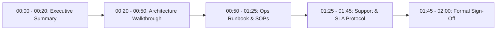

# Client & Operations Handover Workshop Agenda (Gate 4 Cutover)

| Meeting Details | Value |
|---|---|
| **Workshop Title** | Production Service Transition & Operational Handover |
| **Duration** | 2 Hours (Virtual or On-Site) |
| **Chair / Facilitator** | Delivery Project Director & Technical Lead |
| **Required Attendees** | Client Sponsor, Client IT Lead, Receiving SRE/Ops Lead, QA Lead, Support Desk Lead |
| **Target Outcome** | Execution of the formal **Service Transition Checklist** & cutover clearance |

---

## Workshop Schedule & Time Breakdown

---

### Part 1: Executive Summary & Project Acceptance (20 Mins)
- **Presenter:** Product Owner & Delivery Director
- **Agenda:**
  1. Review of initial business goals vs final delivered scope (PRD & SOW review).
  2. Presentation of the **Signed Client UAT Sign-Off Certificate**.
  3. Review of QA test summary metrics (100% pass rate, zero open P1/P2 defects).
  4. Client Sponsor opening remarks and formal acceptance comments.

---

### Part 2: Architecture, Security & Secrets Walkthrough (30 Mins)
- **Presenter:** Technical Lead / System Architect
- **Agenda:**
  1. High-Level Architecture walkthrough (C4 Context & Container diagrams).
  2. Data flow, database schema, and third-party integration dependencies.
  3. Security posture review (SAST/DAST scan results, RBAC model, PII encryption at-rest/in-transit).
  4. Secrets management handover (verification of AWS Secrets Manager / Vault paths).
  5. Infrastructure-as-Code repository walkthrough (Terraform modules).

---

### Part 3: Operational Runbook, Observability & Recovery SOPs (35 Mins)
- **Presenter:** DevOps / SRE Lead
- **Agenda:**
  1. **Runbook Review ([`OPERATIONS_RUNBOOK.md`](../templates/OPERATIONS_RUNBOOK.md)):**
     - Service inventory and topology.
     - Liveness (`/health/live`) and readiness (`/health/ready`) probe behavior.
  2. **Live Observability Walkthrough:**
     - Datadog / CloudWatch central dashboard inspection (Traffic, Latency, Errors, Saturation).
     - Log aggregation and trace correlation demonstration.
     - Alerting routing and PagerDuty notification drill.
  3. **Disaster Recovery & Maintenance:**
     - Review of automated database snapshot policy and PITR restore dry-run evidence.
     - Walkthrough of common incident troubleshooting playbooks (OOM container restart, DB connection pool starvation).

---

### Part 4: Incident Management, Support Model & Hypercare Charter (20 Mins)
- **Presenter:** Operations Lead & Account Manager
- **Agenda:**
  1. **Severity Tiers & SLA Commitments ([`INCIDENT_MANAGEMENT_AND_SLA_MATRIX.md`](../templates/INCIDENT_MANAGEMENT_AND_SLA_MATRIX.md)):**
     - P1 Critical (<15m response, <2h resolution).
     - P2 Major (<30m response, <4h resolution).
  2. **Escalation Roster:**
     - Tier 1 (Helpdesk) -> Tier 2 (SRE On-Call) -> Tier 3 (Engineering Escalation).
  3. **Hypercare Schedule:**
     - Daily 15-minute operational sync for the first 14 business days.
     - Dedicated engineering bug-fixing capacity allocation.

---

### Part 5: Formal Handover Sign-Off & Cutover Authorization (15 Mins)
- **Presenter:** All Leads
- **Agenda:**
  1. Line-by-line verification of the **Service Transition Checklist**.
  2. Resolution of any outstanding conditional action items.
  3. Formal digital signature execution by:
     - Delivering Technical Lead
     - Receiving Operations / SRE Lead
     - Client Authorized Sponsor
  4. Authorization of the production deployment window.

