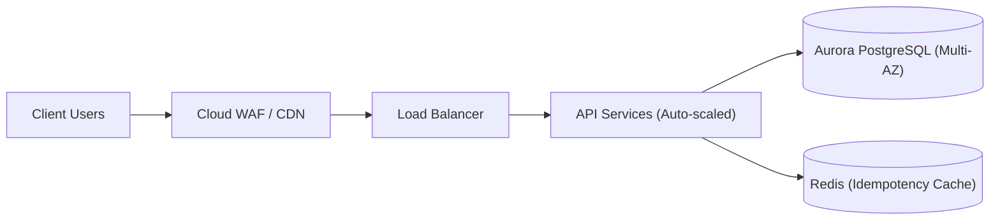

# Production Service Transition & Client Handover
### High-Velocity Delivery & Turnkey Operational Readiness

**Presenter:** Engineering & Delivery Leadership  
**Client:** [Client Enterprise Name]  
**Release:** v1.0.0 &bull; 2026-11-10

---

## Executive Agenda (2-Hour Handover)

1. **Project Review & Acceptance:** PRD, Scope Baseline & UAT Sign-off
2. **System Architecture & Security:** C4 Model, Zero-Trust & Secrets
3. **Operations Runbook & SOPs:** Day-2 Playbook, Health & Backups
4. **Support & SLA Governance:** Severity Matrix, Escalation & Hypercare
5. **Formal Transition Sign-Off:** Execution of Handover Checklist

---

## 1. Project Scoping & Acceptance Summary

- **Delivered Scope:** 100% of Must-Have requirements implemented.
- **Client UAT Results:**
  - 48 User Acceptance test cases executed.
  - **100% Pass Rate** achieved.
  - **0 Open P1 (Critical) or P2 (Major) Defects.**
- **Formal Sign-Off:** UAT Sign-off Certificate executed by Client Sponsor.

---

## 2. System Architecture & Resilience

- **Zero Single Points of Failure:** Multi-AZ database failover verified (< 35s).
- **Stateless Compute:** Autoscaling container fleet with zero-downtime Canary deployments.

---

## 3. Security, Privacy & Compliance Verification

- **Vulnerability Posture:** SAST, DAST, and container scans confirm **0 Critical / 0 High CVEs**.
- **Data Protection:** All customer data encrypted in-transit (TLS 1.3) and at-rest (AES-256).
- **Software Bill of Materials (SBOM):** 100% permissive open-source licenses (MIT/Apache 2.0). Zero copyleft (GPL) risks.
- **Secret Management:** Zero hardcoded credentials in source code.

---

## 4. Turnkey Operations Runbook (Day-2 Playbook)

Your Operations & IT Support teams receive:
- **Central Telemetry:** Real-time dashboards (Traffic, Latency, Errors, Saturation).
- **Automated Health Probes:** `/health/live` and `/health/ready` monitored continuously.
- **Emergency SOPs:** Documented step-by-step procedures for secret rotation, cache clearing, and hanging query termination.
- **Disaster Recovery Certified:** Point-in-Time Recovery drill verified: **RTO < 18m, RPO < 3m**.

---

## 5. Support Model & Hypercare Charter

| Severity Level | Response SLA | Target Resolution | War Room? |
|---|:---:|:---:|:---:|
| **P1 - Critical Outage** | **< 15 Mins** | **< 2 Hours** | Yes (Instant Bridge) |
| **P2 - Major Degradation** | **< 30 Mins** | **< 4 Hours** | Optional |
| **P3 - Minor Defect** | **< 4 Hours** | Next Sprint | No |

- **Hypercare Period:** First 14 business days post-launch.
- **Daily Operational Sync:** 15-minute morning standup with dedicated Tier-3 engineering capacity.

---

## 6. Formal Handover Execution

### Cutover Authorized:
1. Operations team confirms receipt of credentials and runbooks.
2. Production deployment scheduled and smoke test verified.
3. **Service Transition Checklist formally executed and signed.**

*Thank you for a successful delivery partnership!*
