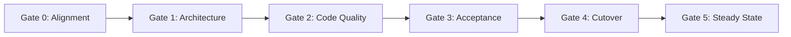

# Client Assurance One-Pager: Rapid Prototype & Delivery Governance Model

## High Velocity Delivery with Enterprise-Grade Quality and Operational Readiness

---

### Executive Overview
Our software delivery approach combines **rapid, iterative prototyping** with **continuous, embedded compliance**. Clients often face a difficult trade-off: traditional enterprise consulting takes months to deliver documentation before coding begins, whereas startup dev shops hack together prototypes with zero documentation, leaving internal operations teams with unmaintainable software.

We eliminate this trade-off using **Living Documentation (Doc-as-Code)**. Every stage of our SDLC automatically produces formal, client-ready deliverables and operational runbooks as a natural byproduct of development.

---

### The 5 Stage-Gates & What You Receive

| Lifecycle Gate | What Happens | What You (The Client) Receive |
|---|---|---|
| **Gate 0: Scoping & Alignment** | Scope bounded using MoSCoW; technical feasibility spiked. | **Signed Project Charter & Statement of Work (SOW)** with clear deliverables and non-functional requirements. |
| **Gate 1: Architecture & Security** | System modeled using C4; threat assessment and data privacy review completed. | **System Architecture Document (SAD)**, data flow diagrams, and **API Sandbox Mock Server** for early integration. |
| **Gate 2: Build & Continuous Demos** | Bi-weekly agile sprints; 80%+ automated test coverage; SAST/SCA security scans on every commit. | **Live Working Demos every 2 weeks** on preview environments; transparent sprint progress notes. |
| **Gate 3: Quality & Client UAT** | End-to-end regression testing, penetration testing, performance load testing under peak simulated volume. | **Structured UAT Test Scripts**, transparent defect triage (P1–P4 SLA), and **Formal UAT Sign-Off Certificate**. |
| **Gate 4: Release & Ops Handover** | Zero-downtime production deployment (Canary / Blue-Green) and operational handover. | **Operations Runbook (Day-2 Playbook)**, Release Notes, Admin Manual, and **Signed Service Transition Checklist**. |
| **Gate 5: Hypercare & Steady State** | Dedicated Tier-3 engineering support for 14–30 days post-launch; 24/7 incident monitoring. | **Monthly SLA Compliance Reports**, blameless 5-Whys root-cause analyses (RCAs), and steady-state maintenance handover. |

---

### Our Quality & Security Commitments to You
1. **Zero Critical Vulnerabilities:** Every build is scanned with automated static analysis (SAST) and container vulnerability scanning (SCA).
2. **Defect SLA Guarantee:** Severity 1 (Critical) defects reported during UAT or Hypercare are responded to within **15 minutes** with a targeted fix or workaround in **< 2 hours**.
3. **Turnkey Operational Handover:** Your internal IT/Operations team receives complete Infrastructure-as-Code (Terraform), disaster recovery failover procedures, and monitoring dashboards before we exit.
4. **Contractual Transparency:** All code, documentation, and architectural decisions are version-controlled in Git, providing complete auditability for corporate governance and regulatory compliance.

