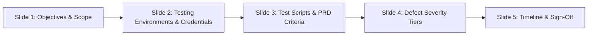

# Client UAT Kickoff & Tester Onboarding Kit (Stage 3 Kickoff)

| Briefing Details | Value |
|---|---|
| **Session Title** | User Acceptance Testing (UAT) Kickoff & Orientation |
| **Duration** | 45 Minutes |
| **Presenter** | Product Owner & QA Test Lead |
| **Audience** | Designated Client Business Testers & Client Project Sponsor |
| **Goal** | Equip client testers to execute test scenarios efficiently and achieve Gate 3 sign-off |

---

## 1. Kickoff Presentation Outline (Slide-by-Slide)

### Slide 1: Welcome & UAT Objectives
- **What is UAT?** Verification that the software satisfies the agreed business requirements (PRD acceptance criteria).
- **What UAT is NOT:** A venue for brand-new feature brainstorming or uncontracted scope additions (new requests follow the Change Request process).

### Slide 2: Environment Access & Seed Data
- **UAT Portal URL:** `https://uat.clientdomain.com`
- **Dedicated Test Accounts:** Pre-loaded test credentials distributed to each tester.
- **Realistic Seed Data:** Sanitized catalogs, sample orders, and test credit card numbers provided.

### Slide 3: How to Execute Test Scripts
- Use the **Client UAT Test Register** ([`templates/TEST_PLAN_AND_UAT_SIGNOFF.md`](../templates/TEST_PLAN_AND_UAT_SIGNOFF.md)).
- Execute step-by-step instructions.
- Mark each test case clearly as **PASS** or **FAIL**.

### Slide 4: How to Report Defects (Severity Rules)
To ensure rapid bug fixes, classify issues accurately:
- **P1 - Blocker:** Core feature dead; cannot continue testing. *(Dev team fixes in < 24h)*.
- **P2 - Major:** Feature broken, but workaround exists. *(Dev team fixes in < 48h)*.
- **P3 - Minor:** Minor functional flaw or cosmetic inconsistency. *(Deferred to post-launch sprint)*.
- **P4 - Trivial:** Typos, color shade preference. *(Backlog)*.

*Tip for Testers:* Always include a screenshot, URL, and the exact steps taken to reproduce!

### Slide 5: Testing Timeline & Daily Cadence
- **Day 1:** Guided Walkthrough & Core Happy Path Testing.
- **Days 2–3:** Independent Negative & Edge Case Testing.
- **Day 4:** Re-testing resolved bug fixes.
- **Day 5:** Review final test results & execute **UAT Sign-off Certificate**.

---

## 2. Daily UAT Sync Standup (15 Mins, Days 2–5)
- **Time:** 09:30 AM daily during UAT week.
- **Agenda:**
  1. Testers report test cases completed yesterday.
  2. QA Lead reviews triaged defects and bug fix deployments.
  3. Address any blockers or access questions immediately.
