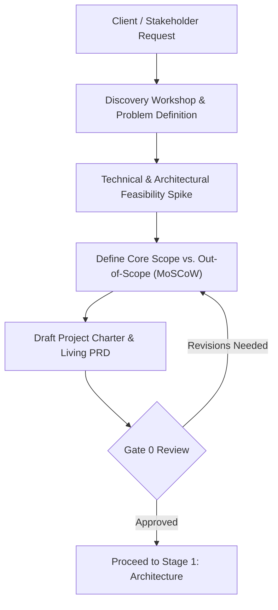

# Stage 0: Discovery, Ideation & Scoping

## Objective
Establish unambiguous business alignment, technical feasibility, project scope, and client expectations before a single line of production code is written.

---

## 1. Trigger & Entry Criteria
- A business need, client request, or prototype mandate is initiated.
- High-level business goal or problem statement is formulated.

---

## 2. Process Workflow & Activities

### Step 2.1: Problem Definition & User Personas
- Formulate the primary customer problem, business value metric (ROI, time savings, user growth), and target audience.
- Identify primary client stakeholders, approving authorities, and operational owners.

### Step 2.2: Technical Feasibility Spike (Prototype Phase)
- Conduct a 2-3 day time-boxed technical investigation on high-risk dependencies (e.g., third-party APIs, legacy integrations, performance limits, cloud costs).
- Capture findings in a mini-spike log to prevent architectural roadblocks later.

### Step 2.3: Scope Definition (MoSCoW Prioritization)
- Categorize requirements:
  - **Must-Have:** Non-negotiable for release/prototype success.
  - **Should-Have:** Important, but workaround exists.
  - **Could-Have:** Nice-to-have if time permits.
  - **Won't-Have:** Explicitly out of scope for this milestone (prevents scope creep).

### Step 2.4: Fast-Paced Documentation Integration
To ensure documentation does not slow down velocity:
- **Do not write 100-page specifications.**
- Use the markdown **`PRD_TEMPLATE.md`** and **`PROJECT_CHARTER_AND_SOW.md`**.
- Keep PRD in the git repository (`/docs/specs/PRD.md`) so developers, architects, and stakeholders work from a single source of truth.

---

## 3. Required Formalities & Artifacts

| Artifact Name | Target Audience | Source Template | Storage Location |
|---|---|---|---|
| **Product Requirements Document (PRD)** | Client, Dev, QA, Design | [`templates/PRD_TEMPLATE.md`](../templates/PRD_TEMPLATE.md) | `docs/PRD.md` |
| **Project Charter & SOW** | Client, Leadership, Operations | [`templates/PROJECT_CHARTER_AND_SOW.md`](../templates/PROJECT_CHARTER_AND_SOW.md) | `docs/SOW.md` |
| **Initial Risk & Dependency Log** | Tech Lead, PM, Ops | Embedded in Charter | `docs/SOW.md#Risks` |

---

## 4. Exit Criteria & Gate 0 Sign-Off
- [ ] PRD core user flows and acceptance criteria documented.
- [ ] Client or Executive Stakeholder has approved the Project Charter / SOW.
- [ ] Technical feasibility confirmed; external blockers identified.
- [ ] Deliverable milestones and target dates agreed upon.

