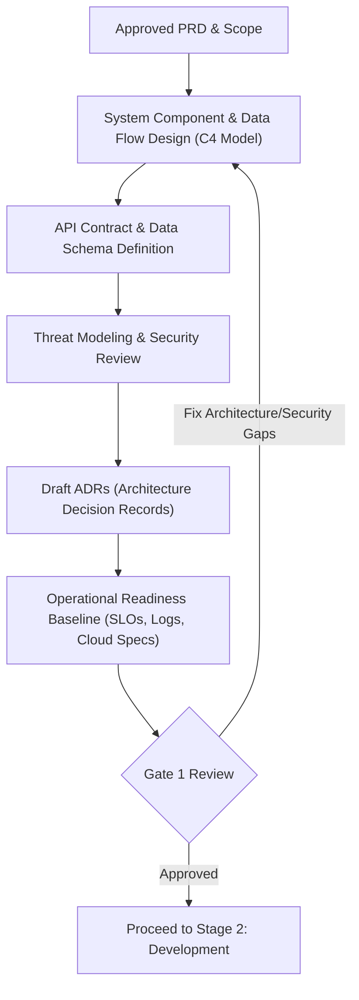

# Stage 1: Architecture, Security & System Design

## Objective
Design a robust, scalable, and secure architecture that meets functional requirements, non-functional requirements (NFRs), and operational standards, without delaying prototype momentum.

---

## 1. Trigger & Entry Criteria
- Stage 0 signed off (Approved Project Charter / PRD).
- Must-have scope clearly delineated.

---

## 2. Process Workflow & Activities

### Step 2.1: Technical Architecture & C4 Model
- Produce High-Level Design (HLD) showing system context and container boundaries.
- Produce Low-Level Design (LLD) specifying database schemas, caching, queues, and integration flows.
- Structure using the lightweight **System Architecture Document (SAD)**.

### Step 2.2: Contract-First API & Data Modeling
- Define API contracts (OpenAPI / Swagger 3.0 or Protobuf / GraphQL schema) **before** coding starts.
- This allows frontend and backend teams (or client teams) to work concurrently against mocks, cutting delivery time by up to 40%.

### Step 2.3: Architecture Decision Records (ADR)
- Any critical architectural choice (e.g., PostgreSQL vs DynamoDB, Next.js vs Vite, AWS Lambda vs ECS) must be documented in a 1-page markdown ADR.
- Keeps history transparent for client audits and new engineers.

### Step 2.4: Security, Compliance & Data Privacy by Design
- Assess compliance needs (GDPR, HIPAA, SOC 2, ISO 27001, local regulations).
- Perform Threat Modeling (STRIDE or OWASP Top 10 evaluation).
- Identify data retention rules, encryption standards (in-transit & at-rest), and PII boundaries.

### Step 2.5: Operations Pre-Alignment
- Define Service Level Objectives (SLOs) such as 99.9% uptime, <200ms latency.
- Determine telemetry requirements: structured JSON logging format, metric naming, distributed tracing headers.

---

## 3. Required Formalities & Artifacts

| Artifact Name | Target Audience | Source Template | Storage Location |
|---|---|---|---|
| **System Architecture Document (SAD)** | Client Tech Reviewers, Ops, Dev | [`templates/SYSTEM_ARCHITECTURE_DOCUMENT_SAD.md`](../templates/SYSTEM_ARCHITECTURE_DOCUMENT_SAD.md) | `docs/architecture/SAD.md` |
| **Architecture Decision Records (ADRs)** | Devs, Tech Lead, Ops | [`templates/ARCHITECTURE_DECISION_RECORD_ADR.md`](../templates/ARCHITECTURE_DECISION_RECORD_ADR.md) | `docs/adr/ADR-001-xxx.md` |
| **API Contract & Schema** | Client Integrators, Frontend, QA | [`templates/API_CONTRACT_AND_INTEGRATION_SPEC.md`](../templates/API_CONTRACT_AND_INTEGRATION_SPEC.md) | `docs/api/openapi.yaml` |
| **Security & Privacy Checklist** | Infosec, Compliance, Client Sec | [`templates/SECURITY_AND_DATA_PRIVACY_CHECKLIST.md`](../templates/SECURITY_AND_DATA_PRIVACY_CHECKLIST.md) | `docs/security/review.md` |

---

## 4. Exit Criteria & Gate 1 Sign-Off
- [ ] System architecture, data flow diagrams, and tech stack finalized.
- [ ] API schema published and shared with dependent teams.
- [ ] Security threat model and data classification completed with no unmitigated critical risks.
- [ ] Cloud infrastructure estimation and hosting topology approved by Ops.

