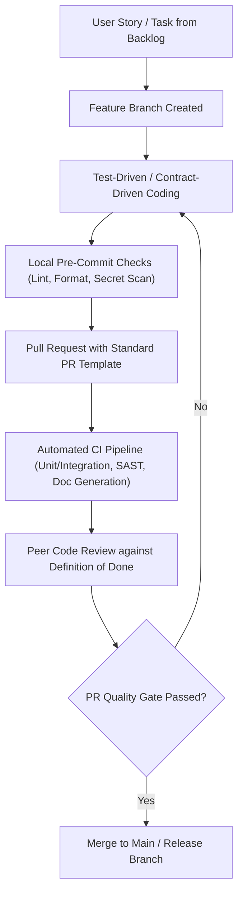

# Stage 2: Development & Continuous Verification

## Objective
Accelerate coding velocity while embedding quality, security, and documentation generation directly into the developer workflow and CI/CD pipeline.

---

## 1. Trigger & Entry Criteria
- Stage 1 Architecture & API contracts approved.
- Repositories, branch protections, and CI/CD pipelines initialized.
- Backlog populated with user stories having clear acceptance criteria.

---

## 2. Process Workflow & Activities

### Step 2.1: Documentation-as-Code (Automated Documentation)
Never ask developers to write separate documentation in word processors at the end of a sprint. Instead, embed documentation generation into the codebase:
- **API Documentation:** Generate Swagger / Redoc dynamically from annotated code or OpenAPI specs.
- **Database Schema:** Generate ER diagrams and schema documentation automatically from migration scripts (e.g., Prisma, Flyway, Alembic, SchemaSpy).
- **Environment & Setup:** Maintain an always-tested, self-executing `README.md` and Docker Compose setup.
- **Changelogs:** Generate release notes automatically using Conventional Commits (`feat:`, `fix:`, `docs:`, `perf:`).

### Step 2.2: The "Definition of Done" (DoD) Gate
A task is NOT done when code merely runs on the developer's laptop. Every Pull Request must satisfy the Definition of Done:
1. Code adheres to style guides, passes linter and type-checker without warnings.
2. Unit tests and integration tests written and passing (minimum 80% coverage on core business logic).
3. Public functions, APIs, and configuration options documented inline with docstrings / JSDoc.
4. No hardcoded secrets, tokens, or credentials (automated git-secrets / TruffleHog scanner).
5. All database migrations are reversible (up/down scripts tested).
6. Operational logs implemented with correlation/request IDs.

### Step 2.3: Automated CI/CD Pipeline Gates
Every commit and PR automatically triggers:
- **Linting & Formatting:** ESLint, Prettier, Black, Flake8, GoFmt.
- **Static Analysis & Security (SAST):** SonarQube, Semgrep, CodeQL.
- **Software Composition Analysis (SCA):** Snyk, Dependabot, Trivy (license & CVE check).
- **Automated Test Suite Execution.**

### Step 2.4: Continuous Client Demonstrations
- Deploy each merged PR or sprint artifact to an ephemeral preview environment or Staging sandbox.
- Capture brief screencasts (Loom/GIF) or demo notes to keep client stakeholders aligned, preventing surprise rejections at UAT.

---

## 3. Required Formalities & Artifacts

| Artifact Name | Target Audience | Source Template | Storage Location |
|---|---|---|---|
| **Definition of Done & PR Checklist** | Developers, Tech Leads | [`templates/DEFINITION_OF_DONE_AND_CODE_REVIEW.md`](../templates/DEFINITION_OF_DONE_AND_CODE_REVIEW.md) | `.github/pull_request_template.md` |
| **Living Technical README** | Devs, Onboarding Engineers, Ops | Auto-maintained | `README.md` |
| **Interactive API Documentation** | Client Devs, QA, Integrators | Auto-generated from spec | `/docs/swagger` or hosted portal |
| **Automated Changelog / Release Notes** | Client, PM, Ops | Auto-generated via Git hooks | `CHANGELOG.md` |

---

## 4. Exit Criteria & Gate 2 Sign-Off
- [ ] All scoped feature tickets implemented and merged to staging/release branch.
- [ ] Automated test suites green; code coverage threshold met.
- [ ] Zero critical/high vulnerabilities from SAST and dependency audits.
- [ ] Living documentation, schemas, and API specs up to date with code changes.
- [ ] Feature freeze declared for formal QA and Client UAT.

