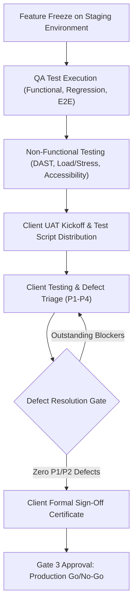

# Stage 3: Quality Assurance, Security & Client UAT

## Objective
Validate that the solution functions flawlessly under real-world conditions, meets rigorous non-functional requirements (performance, load, security), and obtains formal, legally binding client acceptance.

---

## 1. Trigger & Entry Criteria
- Stage 2 Feature Freeze achieved.
- Solution deployed to a production-equivalent Staging/UAT environment with sanitized or realistic seed data.
- Initial smoke test passed.

---

## 2. Process Workflow & Activities

### Step 3.1: Structured Testing Layers
1. **Functional Testing:** Automated End-to-End (E2E) suites (Playwright, Cypress) covering critical user journeys.
2. **Regression Testing:** Automated verification that new features did not break existing capabilities.
3. **Dynamic Application Security Testing (DAST) & Pen-Testing:** OWASP ZAP, Burp Suite, or third-party penetration testing.
4. **Performance & Load Testing:** k6, Gatling, or JMeter runs to ensure latency and throughput meet SLOs under peak load.
5. **Cross-Platform / Cross-Browser / Accessibility (WCAG 2.1 AA):** Verification across targeted devices and viewports.

### Step 3.2: Defect Severity & Classification Standard
To prevent endless debate during client UAT, enforce explicit defect severity definitions:
- **Severity 1 (Blocker/Critical):** System crash, data corruption, security vulnerability, primary workflow completely blocked with no workaround. *Must fix before production release.*
- **Severity 2 (Major):** Core feature failing, but a documented workaround exists. *Must fix before production release unless written client waiver is signed.*
- **Severity 3 (Minor):** Non-critical feature bug, cosmetic defect with functioning workaround. *Add to post-launch backlog.*
- **Severity 4 (Trivial/Enhancement):** Typos, alignment discrepancies, suggested improvements. *Post-launch backlog.*

### Step 3.3: Client UAT (User Acceptance Testing) Execution
- Provide the client with clear, step-by-step UAT Test Scripts linked to the PRD acceptance criteria.
- Conduct a live guided walk-through session on Day 1 of UAT.
- Maintain a shared real-time defect tracker with agreed turnaround times (e.g., P1 turnaround < 24h).
- Obtain an authorized digital signature on the **UAT Sign-Off Certificate**.

---

## 3. Required Formalities & Artifacts

| Artifact Name | Target Audience | Source Template | Storage Location |
|---|---|---|---|
| **Master Test Plan & QA Summary** | QA Lead, PM, Tech Lead | [`templates/TEST_PLAN_AND_UAT_SIGNOFF.md`](../templates/TEST_PLAN_AND_UAT_SIGNOFF.md) | `docs/testing/test_plan.md` |
| **Client UAT Script & Execution Log** | Client Testers, PM, QA | Section 3 of Test Plan | `docs/testing/uat_scripts.md` |
| **Formal Client Sign-Off Certificate** | Client Sponsor, Executive Team | Section 5 of Test Plan | `docs/testing/UAT_SIGNOFF_SIGNED.pdf` |
| **Security & Vulnerability Assessment Report** | Infosec, Client Audit, Ops | Export from DAST/Snyk/Audit | `docs/security/audit_report.pdf` |

---

## 4. Exit Criteria & Gate 3 Sign-Off (Go/No-Go)
- [ ] 100% of P1 and P2 defects resolved and verified.
- [ ] Non-functional performance and security tests successfully executed and within tolerance.
- [ ] Formal Client UAT Sign-Off received in writing or digital signature.
- [ ] Go/No-Go decision formally voted and recorded by PM, Tech Lead, Ops Lead, and Client Sponsor.

