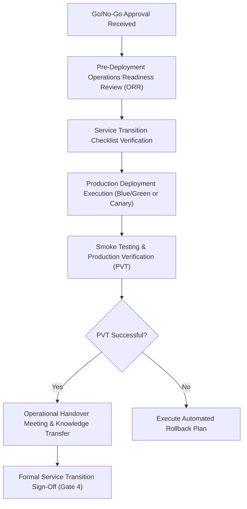

# Stage 4: Release & Operations Handover

## Objective
Execute a seamless, zero-downtime production deployment and transition the product to the Operations / SRE / IT Support team with comprehensive runbooks, observability, and failover safeguards.

---

## 1. Trigger & Entry Criteria
- Stage 3 signed off (Client UAT Sign-off and Go/No-Go approval).
- Target production release window scheduled and communicated to all stakeholders.
- Operations and support personnel identified and briefed.

---

## 2. Process Workflow & Activities

### Step 2.1: Pre-Deployment Operations Readiness Review (ORR)
Two to three days prior to release:
- Ops and Engineering leads review the **Deployment & Rollback Guide**.
- Verify production infrastructure provisioning (Infrastructure-as-Code: Terraform, Helm, Pulumi).
- Validate environment variables, secrets manager access (e.g., AWS Secrets Manager, HashiCorp Vault), and SSL certificates.
- Ensure database migration dry-run completed on production replica.

### Step 2.2: Production Deployment Strategy
- **Deployment Mode:** Prefer automated blue/green or canary deployments to eliminate downtime.
- **Rollback Triggers:** Pre-agreed, objective rollback triggers (e.g., error rate > 1% for 3 consecutive minutes, p99 latency > 2000ms, or failed health checks).
- **Communication Bridge:** Active war room (Slack/Teams/Zoom) with timestamped status logs.

### Step 2.3: Production Verification Testing (PVT / Smoke Test)
- Designated QA and Lead Engineer run automated or manual smoke tests against production endpoints.
- Verify real transaction flows (with test payment gateway or synthetic test accounts).
- Verify third-party webhook receivers and outbound integrations.

### Step 2.4: Formal Handover to Operations / SRE Team
The dev team cannot simply "throw code over the wall". Handover requires:
1. **The Operations Runbook:** Clear instructions on system topology, service dependencies, routine maintenance, backup/restore steps, and troubleshooting.
2. **Observability Walkthrough:** Review of production Datadog/Grafana/CloudWatch dashboards, log aggregators (ELK/Loki), and configured alerts.
3. **Escalation & On-Call Schedule:** PagerDuty/Opsgenie rotation with defined Primary, Secondary, and Executive escalations.
4. **Sign-off on Service Transition Checklist:** Both Dev Lead and Ops Lead sign.

---

## 3. Required Formalities & Artifacts

| Artifact Name | Target Audience | Source Template | Storage Location |
|---|---|---|---|
| **Deployment & Rollback Plan** | DevOps, SRE, Tech Lead | [`templates/DEPLOYMENT_AND_ROLLBACK_GUIDE.md`](../templates/DEPLOYMENT_AND_ROLLBACK_GUIDE.md) | `docs/ops/deployment_plan.md` |
| **Comprehensive Operations Runbook** | Ops, SRE, Tier-2/3 Support | [`templates/OPERATIONS_RUNBOOK.md`](../templates/OPERATIONS_RUNBOOK.md) | `docs/ops/RUNBOOK.md` |
| **Service Transition Checklist** | Dev Lead, Ops Lead, Client PM | [`templates/SERVICE_TRANSITION_CHECKLIST.md`](../templates/SERVICE_TRANSITION_CHECKLIST.md) | `docs/ops/service_transition.md` |
| **Client Release Notes & Admin Manual** | Client Ops, End Users | Section in Runbook / Doc | `docs/release/Release_Notes_v1.0.md` |

---

## 4. Exit Criteria & Gate 4 Sign-Off
- [ ] Production deployment executed and smoke test verified.
- [ ] Monitoring dashboards active; alert notifications verified.
- [ ] Disaster recovery and backup automations verified.
- [ ] Operations team confirms receipt of credentials, runbooks, and architecture walk-through.
- [ ] Signed **Service Transition Checklist** on file.

