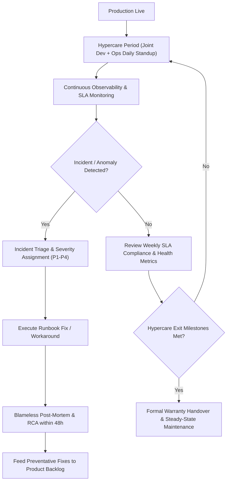

# Stage 5: Post-Production Support, Hypercare & Maintenance

## Objective
Safeguard post-launch stability during the initial warranty/hypercare period, enforce strict Service Level Agreements (SLAs), resolve incidents effectively, and establish continuous feedback loops for product iterations.

---

## 1. Trigger & Entry Criteria
- Stage 4 completed (Production deployment live and operational handover signed).
- Hypercare period officially initiated (typically 14 to 30 days post-launch).

---

## 2. Process Workflow & Activities

### Step 2.1: Hypercare Period Management
- Daily 15-minute operational sync between Dev Lead, Ops Lead, and Client Account Manager.
- Dev team provides dedicated Tier-3 bug-fixing bandwidth (e.g., 20-30% sprint capacity) to address teething issues without requiring contract changes.

### Step 2.2: Incident Management & Escalation Framework
- When an alert triggers or a client logs an incident:
  - **Severity 1 (P1):** Immediate response (< 15 mins), hourly client updates, war room engaged until resolution.
  - **Severity 2 (P2):** Response < 1 hour, workaround or fix < 4 hours.
  - **Severity 3 (P3):** Response < 8 hours, resolved in upcoming sprint.
  - **Severity 4 (P4):** General inquiry / minor cosmetic bug.

### Step 2.3: Blameless Post-Mortem & Root Cause Analysis (RCA)
- For every P1 or severe P2 incident:
  - Conduct a blameless post-mortem within 48 hours of resolution.
  - Apply the "5 Whys" methodology to find systemic and process causes, not individual blame.
  - Produce immediate backlog action items (monitoring alert improvements, circuit breakers, automated tests).

### Step 2.4: Continuous Feedback to Product Backlog
- Production telemetry (frequently failed API calls, drop-off funnels, resource spikes) is fed directly back into Stage 0/1 for future iterations and prototype evolution.

### Step 2.5: Transition from Hypercare to Steady-State Maintenance
- Once the application achieves stability (e.g., 14 consecutive days with zero P1/P2 incidents and SLA >= 99.9%):
  - Hold the Hypercare Exit Review.
  - Development team steps down from daily on-call to standard advisory support.
  - Operations team assumes 100% steady-state management under the agreed SLA.

---

## 3. Required Formalities & Artifacts

| Artifact Name | Target Audience | Source Template | Storage Location |
|---|---|---|---|
| **Incident Management & SLA Escalation Matrix** | Support, SRE, Client Stakeholders | [`templates/INCIDENT_MANAGEMENT_AND_SLA_MATRIX.md`](../templates/INCIDENT_MANAGEMENT_AND_SLA_MATRIX.md) | `docs/ops/SLA_MATRIX.md` |
| **Blameless Post-Mortem / RCA Template** | Engineering, Ops, Client Leadership | Embedded in Incident Template | `docs/post-mortems/YYYY-MM-DD-rca.md` |
| **Monthly SLA & System Health Report** | Client Executive Sponsor, Operations | Exported from Datadog/CloudWatch | `docs/reports/monthly_sla.pdf` |
| **Final Hypercare Exit & Warranty Sign-Off** | Client Sponsor, Operations Director | Section in Transition Checklist | `docs/ops/warranty_signoff.pdf` |

---

## 4. Exit Criteria & Gate 5 Sign-Off
- [ ] System operates within agreed SLA targets (uptime, latency, error rates) throughout hypercare.
- [ ] All post-launch defects triaged and prioritized.
- [ ] No open P1 or P2 incidents.
- [ ] Final sign-off on steady-state support agreement.

