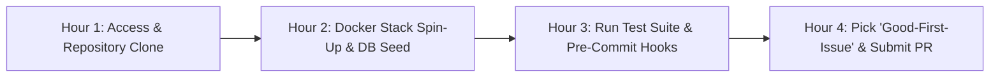

# Developer Onboarding & Environment Bootstrap Guide
## The "Day-1 First Commit in 4 Hours" Fast-Track Engineering Playbook

In fast-paced product development, every day spent wrestling with local dependencies, incompatible versions, and undocumented environment variables drains velocity. 

This playbook provides a standardized **Zero-Friction Onboarding Framework** designed to take a newly onboarded software engineer from cloning the repository to submitting their first verified pull request within their first 4 hours on the team.

---

## 1. Prerequisites Baseline (The Standard Workstation Stack)

Before cloning any project repository, the engineer's local machine must have the following core toolchain installed:

- **Operating System:** macOS (Sonoma+) or Linux (Ubuntu 22.04+) or Windows 11 with WSL2.
- **Container Runtime:** Docker Desktop / OrbStack / Rancher Desktop (>= 4.25).
- **Version Control:** Git (>= 2.40) with SSH key configured and GitHub/GitLab access verified.
- **Package Managers:** Homebrew (macOS) / `apt` (Linux), `asdf` or `nvm` / `pyenv` for runtime version switching.

---

## 2. The 4-Hour Onboarding Timeline



---

## 3. Step-by-Step Environment Setup

### Step 3.1: Repository Clone & Git Hooks Installation
```bash
# 1. Clone repository
git clone git@github.com:organization/project-name.git
cd project-name

# 2. Install SDLC compliance git hooks (Secret scanning & Conventional Commits)
./scripts/sdlc-cli.sh hooks
```

### Step 3.2: Environment Configuration (The `.env.example` Standard)
Never pass environment variables via unencrypted Slack or chat messages. All non-secret configuration options must be defined with sensible local defaults in `.env.example`:

```bash
# Copy baseline configuration
cp .env.example .env.local
```

### Step 3.3: Single-Command Containerized Stack Spin-Up
Local development must never require manually installing PostgreSQL, Redis, or Kafka onto the host OS:

```bash
# Spin up local database, cache, and mock services in background
docker compose up -d

# Verify all containers are healthy
docker compose ps
```

### Step 3.4: Automated Database Migration & Seed Data
```bash
# Run latest schema migrations
npm run db:migrate # or: alembic upgrade head / go run migrate.go

# Populate realistic development seed data (users, catalogs, orders)
npm run db:seed
```

### Step 3.5: Execute Automated Test Suite Verification
Confirm that your local environment passes all unit, integration, and liveness checks:
```bash
# 1. Run unit test suite (Must pass 100%)
npm test

# 2. Verify local API documentation is live
curl -i http://localhost:8000/health/live
# Expected: HTTP 200 OK {"status": "ok"}
```

---

## 4. Submitting Your First Pull Request (DoD Compliance)

1. Pick an assigned ticket labeled `good-first-issue` or sprint user story.
2. Create a standardized feature branch:
   ```bash
   git checkout -b feat/PROJ-101-add-user-avatar-upload
   ```
3. Commit using Conventional Commits:
   ```bash
   git commit -m "feat(user): add S3 presigned URL generator for avatar uploads"
   ```
4. Push and open a Pull Request using the pre-populated [Pull Request Template](file:///Users/nihaljangave/Documents/sdlc-std-roles/.github/pull_request_template.md).
5. Verify that the GitHub Actions CI Compliance workflow passes all status checks.

