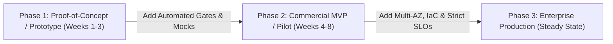

# Prototype-to-Production Evolution Playbook
## How to Scale Fast-Paced Prototypes into Enterprise Production Without Rewriting Code

The primary danger of fast-paced prototyping is the "throwaway prototype" trap—where code hacked together in weeks must be scrapped and rewritten for enterprise production. 

This playbook provides a **deliberate evolutionary architecture path** so your prototype code forms the solid foundation of the final production release.

---

## 1. The 3 Evolutionary Phases

---

## 2. Technical Component Evolution Roadmap

| Architectural Tier | Phase 1: Prototype | Phase 2: Commercial MVP | Phase 3: Enterprise Production |
|---|---|---|---|
| **Architecture Pattern** | Modular Monolith (Single repo, clean domains) | Modular Monolith + Worker Queue | Distributed Microservices (Only if team/load requires) |
| **Database** | PostgreSQL (Single instance / Supabase) | Managed RDS PostgreSQL (Single-AZ + Auto Backups) | Multi-AZ Aurora PostgreSQL + Read Replicas + Connection Pooling |
| **API & Contracts** | OpenAPI 3.0 + Prism Mock Server | Contract-First API with Zod/Pydantic validation | Versioned API Gateway + Rate Limiting + WAF |
| **Authentication** | Simple JWT / Auth0 Free Tier | OAuth2 / OIDC + Role-Based Access Control (RBAC) | Enterprise SSO (SAML/Okta) + MFA + SCIM User Provisioning |
| **Hosting & Compute** | Platform-as-a-Service (Vercel / Railway / Render) | Containerized ECS / Cloud Run (Docker) | EKS / Kubernetes Multi-Zone Fleet with HPA Auto-scaling |
| **Secrets Management**| `.env.local` (Local) / Cloud Provider UI | AWS Secrets Manager / Vault | Dynamic Secret Rotation via HashiCorp Vault / AWS Secrets |
| **Observability** | Console stdout + Sentry Free | Structured JSON logging + CloudWatch Alerts | OpenTelemetry Distributed Tracing + Datadog / Grafana |
| **CI/CD & Delivery** | Manual deploy or basic GitHub Action | Automated CI (Lint, Test, SAST, Preview envs) | Multi-stage CD with Blue/Green or Canary automated cutovers |

---

## 3. Deliberate Shortcuts Permitted in Prototypes (And How to Pay Them Down)

### Permitted Shortcut 1: Simplified Mock Integrations
- **In Prototype:** Use mock stubs or sandbox accounts for third-party systems (payment gateways, ERPs, SMS).
- **Hardening for Production:** Implement an **Adapter / Ports-and-Adapters Pattern**. The business domain talks to an `IPaymentGateway` interface. Swapping the mock adapter for Stripe or Adyen requires zero changes to core business logic.

### Permitted Shortcut 2: Synchronous Processing over Complex Queues
- **In Prototype:** Process emails or report exports in-process using background threads or simple timers.
- **Hardening for Production:** Move tasks to an asynchronous message broker (AWS SQS, RabbitMQ, Kafka) with a Dead Letter Queue (DLQ) and exponential backoff retry policies.

### Permitted Shortcut 3: Basic Role Flags over Complex Permission Matrices
- **In Prototype:** Simple `role: 'ADMIN' | 'USER'` column on user table.
- **Hardening for Production:** Adopt granular permission-based RBAC (e.g., `orders:read`, `orders:create`, `orders:refund`) or policy-as-code (Open Policy Agent / Casbin) without altering database primary keys.

---

## 4. The 5-Point Hardening Gate (Pre-Production Transition)

Before promoting an MVP to full enterprise production:
1. **Security Vulnerability Clearance:** Pass automated SAST, DAST, and third-party penetration testing with zero High/Critical CVEs.
2. **Disaster Recovery Drill:** Verify a real database Point-in-Time Restore (PITR) within 30 minutes.
3. **Load & Stress Certification:** Validate that system handles 3x peak anticipated volume while maintaining p95 latency < 300ms.
4. **Operations Runbook Verification:** Ops team must successfully resolve a simulated high-CPU and DB connection exhaustion incident using the Runbook SOPs.
5. **Formal Handover Sign-Off:** Execute the **Service Transition Checklist** signed by Dev and Ops leadership.

