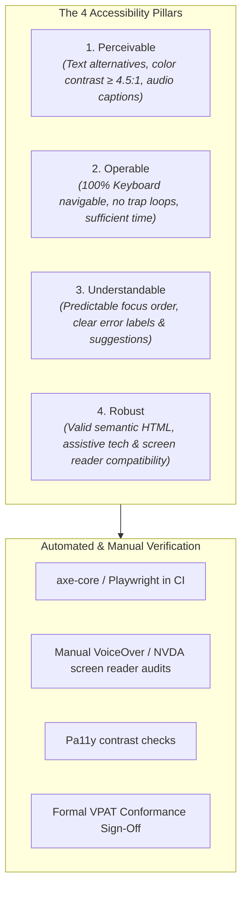

# Web Content Accessibility Guidelines (WCAG 2.2 AA) Standard

> **Engineering Standard & QA SOP**  
> **Audience:** Frontend Engineers, UI/UX Designers, QA Automation Engineers, Compliance Officers  
> **Target Standard:** W3C WCAG 2.2 Level AA & Section 508 Rehabilitation Act Compliance

---

## 1. Statutory Context & The POUR Principles

Enterprise, healthcare, public-sector, and financial clients require verified digital accessibility compliance prior to commercial sign-off. Accessibility is evaluated against the 4 foundational POUR principles:



---

## 2. Core WCAG 2.2 Level AA Engineering Requirements

| Ref | Requirement | Frontend Implementation Guardrail | Automated CI Test |
| :--- | :--- | :--- | :--- |
| **1.1.1** | Non-text Content | All `` tags must have descriptive `alt` text. Decorative icons use `aria-hidden="true"`. | ESLint `jsx-a11y/alt-text` |
| **1.4.3** | Contrast (Minimum) | Text contrast ratio ≥ 4.5:1 for normal text (<18pt); ≥ 3:1 for large text (≥18pt or bold ≥14pt). | axe-core `color-contrast` |
| **2.1.1** | Keyboard Navigation | 100% of interactive elements (buttons, links, inputs, dropdowns) reachable via `Tab` and operable via `Enter` / `Space`. | Playwright keyboard traversal test |
| **2.4.3** | Focus Order | Logical DOM tab order matching visual layout. Modal dialogs trap focus inside until dismissed. | Focus-trap-react / manual audit |
| **2.4.7** | Focus Visible | Never set `outline: none` without providing an alternative high-contrast `:focus-visible` ring (min 2px solid). | axe-core `focus-visible` |
| **2.5.8** | Target Size (Minimum) | Interactive touch targets must have an area of at least **24×24 CSS pixels** (WCAG 2.2 new criterion). | axe-core `target-size` |
| **3.3.1** | Error Identification | Form validation errors must be announced to screen readers using `aria-invalid="true"` and `aria-describedby="error-id"`. | Playwright a11y audit |
| **3.3.8** | Accessible Authentication | Cognitive function tests (CAPTCHAs, memorizing passwords) must not be mandatory; support password managers and WebAuthn/Passkeys (WCAG 2.2 new). | Auth UX inspection |

---

## 3. Automated Accessibility Testing in CI/CD

Integrate `@axe-core/playwright` into the automated end-to-end testing pipeline:

```typescript
// tests/accessibility.spec.ts
import { test, expect } from '@playwright/test';
import AxeBuilder from '@axe-core/playwright';

test.describe('WCAG 2.2 Level AA Compliance Suite', () => {
  const routes = ['/', '/login', '/dashboard', '/checkout'];

  for (const route of routes) {
    test(`Route ${route} should pass automated WCAG AA checks`, async ({ page }) => {
      await page.goto(route);
      await page.waitForLoadState('networkidle');

      const accessibilityScanResults = await new AxeBuilder({ page })
        .withTags(['wcag2a', 'wcag2aa', 'wcag21a', 'wcag21aa', 'wcag22aa'])
        .exclude('#third-party-widget-container') // if externally managed
        .analyze();

      expect(accessibilityScanResults.violations).toEqual([]);
    });
  }
});
```

---

## 4. Manual Screen Reader & Keyboard Verification Matrix

Automated tools detect ~40%–57% of accessibility barriers. A manual audit using assistive technology is mandatory for Gate 3 sign-off:

```markdown
### Assistive Technology Test Protocol

1. **100% Keyboard-Only Navigation (No Mouse):**
   - [ ] Disconnect mouse. Tab through entire application end-to-end.
   - [ ] Verify visible focus indicator on every interactive control.
   - [ ] Verify modal dialogs trap keyboard focus until closed via `Escape` key.
   - [ ] Verify no "keyboard traps" where focus cannot escape a container.

2. **Screen Reader Verification (VoiceOver on macOS / NVDA on Windows):**
   - [ ] Enable screen reader (`Cmd + F5` on Mac).
   - [ ] Navigate through page landmarks (`<main>`, `<nav>`, `<header>`, `<footer>`).
   - [ ] Verify dynamic alerts, toast notifications, and form errors use `aria-live="polite"` or `role="alert"`.
   - [ ] Confirm table headers (`<th>`) and scope attributes read data columns accurately.

3. **Display Zoom & Responsiveness:**
   - [ ] Zoom browser to 200% and 400%: ensure no horizontal scrolling or overlapping text collisions occur.
```

---

## 5. Client Handover & Legal Assurance

Upon completing the audit, compile the verified results into the [VPAT Accessibility Conformance Report](../../templates/VPAT_ACCESSIBILITY_CONFORMANCE_REPORT.md) to serve as legal proof of compliance for client procurement.
