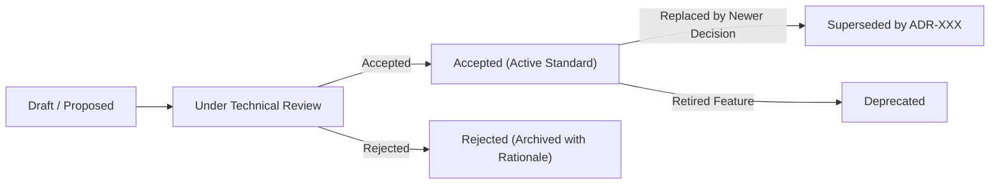

# Architecture Decision Record (ADR) Registry & Lifecycle Index

This directory serves as the living, version-controlled registry of all architectural decisions made across the lifecycle of the system.

---

## 1. ADR Lifecycle States



- **`Proposed`**: Under review by the Technical Lead, System Architect, and Engineering Team.
- **`Accepted`**: Approved and actively enforced in code reviews and CI gates.
- **`Rejected`**: Evaluated but not adopted; retained to document why candidate options were rejected.
- **`Superseded`**: Replaced by a newer decision record (always references the succeeding ADR ID).
- **`Deprecated`**: Technology or pattern retired from the codebase.

---

## 2. Active ADR Index Table

| ADR ID | Decision Title | Status | Date Accepted | Impacted Systems | Author |
|---|---|:---:|---|---|---|
| **[ADR-001](../../templates/ARCHITECTURE_DECISION_RECORD_ADR.md)** | Modular Monolith vs. Microservices Architecture | `Accepted` | 2026-11-10 | Core Backend, CI/CD | Lead Architect |
| **ADR-002** | Contract-First API Specification with OpenAPI 3.0 | `Accepted` | 2026-11-10 | API Gateway, Mocks | Tech Lead |
| **ADR-003** | PostgreSQL Multi-AZ with PgBouncer Connection Pooling | `Accepted` | 2026-11-10 | Database Tier | DBA Lead |
| **ADR-004** | Redis for Distributed Session Caching & Idempotency Keys | `Accepted` | 2026-11-10 | Ingress API, Redis | Senior Backend Dev |
| **ADR-005** | Asynchronous Outbound Webhooks via SQS and Dead Letter Queue | `Accepted` | 2026-11-10 | Integration Worker | SRE Lead |

---

## 3. How to Submit a New ADR
1. Copy the standard template:
   ```bash
   cp templates/ARCHITECTURE_DECISION_RECORD_ADR.md docs/adr/ADR-006-your-decision-title.md
   ```
2. Fill out the **Context**, **Options Considered**, and **Decision Outcome**.
3. Open a Pull Request labeled `adr`.
4. Review with the Technical Lead during the sprint Architecture Sync.
5. Once merged, update this registry table with status `Accepted`.
