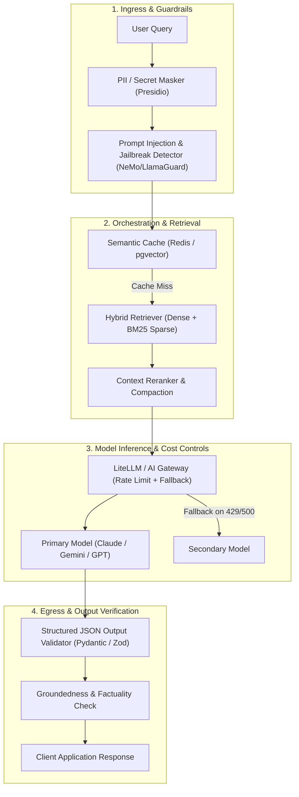
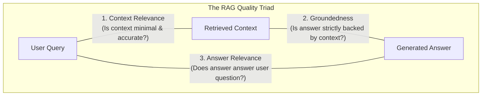

# AI & LLM Engineering Governance Standard

> **Technical & Operational Standard**  
> **Audience:** AI Engineers, Solution Architects, Tech Leads, Security Officers  
> **Applicability:** All systems incorporating Large Language Models (LLMs), RAG pipelines, autonomous agents, or generative AI APIs.

---

## 1. Executive Summary & The AI Engineering Stack

Generative AI unlocks extreme velocity in modern applications. However, deploying AI without guardrails introduces severe security vulnerabilities (prompt injection, data poisoning), hallucinations, erratic cost explosions, and regulatory non-compliance.

This standard establishes mandatory controls across the 4 layers of the AI Engineering Stack:

---

## 2. OWASP Top 10 for LLMs Defense Matrix

| OWASP Ref | Vulnerability Category | Production Defense Standard | Automated CI / Runtime Guard |
| :--- | :--- | :--- | :--- |
| **LLM01** | Prompt Injection | Strict delimiter separation (`<user_input>`, `<system>`); system instructions always placed after user context; adversarial canary tokens. | Prompt injection detector (e.g. Promptfoo in CI; NeMo Guardrails at runtime). |
| **LLM02** | Insecure Output Handling | Never execute LLM output directly in shells or raw SQL. Structured JSON outputs validated against strict schemas. | Pydantic / Zod schema validation; parameterized SQL queries. |
| **LLM03** | Training Data Poisoning | Fine-tuning datasets audited for PII, malicious injection strings, and unauthorized IP. | Automated data hash verification & lineage tracking in MLflow. |
| **LLM04** | Model Denial of Service | Hard request timeouts (max 15s), maximum output token limits (`max_tokens`), and sliding-window rate limiters per user. | API Gateway rate-limiting (e.g. Kong, Cloudflare, LiteLLM). |
| **LLM06** | Sensitive Information Disclosure | Zero Data Retention (ZDR) agreements with model vendors. Automated PII scrubbing before prompt assembly. | Microsoft Presidio / AWS Comprehend PII redaction pipeline. |
| **LLM07** | Insecure Plugin / Tool Design | Autonomous agents granted least-privilege tools only. Confirmation required for write, delete, or financial actions. | Human-in-the-Loop (HITL) authorization gates for mutations. |

---

## 3. RAG Pipeline Quality & Evaluation (The RAG Triad)

Every Retrieval-Augmented Generation (RAG) feature must be evaluated against the **RAG Triad** using automated synthetic benchmarks (e.g. Ragas / TruLens):

### Minimum Quality Gates for Production Cutover
- **Context Relevance Score:** ≥ 0.85
- **Groundedness / Faithfulness Score:** ≥ 0.95 (Zero tolerated hallucinations on critical entity facts)
- **Answer Relevance Score:** ≥ 0.88
- **Latency SLO:** P95 < 2.5 seconds end-to-end (streaming responses must output first token in < 800ms)

---

## 4. Cost Control & Token Quota Governance

1. **Semantic Caching:**
   - Repeated or semantically equivalent questions (cosine similarity ≥ 0.94) are served directly from vector cache without calling the model API.
   - Cost reduction target: 30%–50% reduction in external LLM API spend.
2. **Context Window Optimization:**
   - Compress retrieved chunks using context rerankers (e.g. Cohere Rerank) to trim prompt tokens by 60% before model ingestion.
3. **Hard Token Caps & Budgets:**
   - Every tenant/user has a daily and monthly token budget quota.
   - When quota reaches 80%, user receives a non-blocking alert; at 100%, user is throttled with HTTP 429 and graceful downgrade.

---

## 5. Production Pre-Release Checklist for AI Features

Before promoting any AI/LLM feature to production (Gate 3 & 4):

- [ ] **Vendor Data Privacy Agreement:** Signed Zero Data Retention (ZDR) agreement verifying client prompts are never used for model training.
- [ ] **Prompt Injection Red Teaming:** Suite of 50+ adversarial attack prompts executed with 100% defense success.
- [ ] **Fallback Mechanism Tested:** Verified that if primary LLM returns 429 or 500, gateway automatically fails over to backup model within 500ms.
- [ ] **Structured Output Validation:** 100% of API responses adhere strictly to JSON Schema (no free-form markdown responses when JSON is expected).
- [ ] **Observability & Tracing:** OpenTelemetry instrumentation enabled for all LLM calls (logging prompt tokens, completion tokens, latency, cost per call).
- [ ] **Human-in-the-Loop (HITL):** High-impact actions (financial transfers, data deletion, contract execution) require explicit user confirmation.

