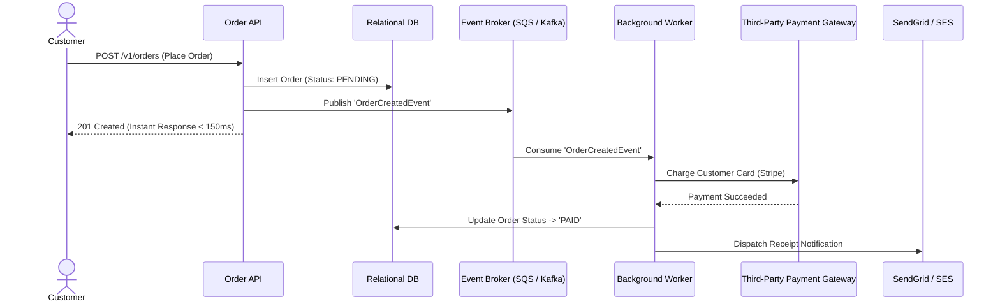
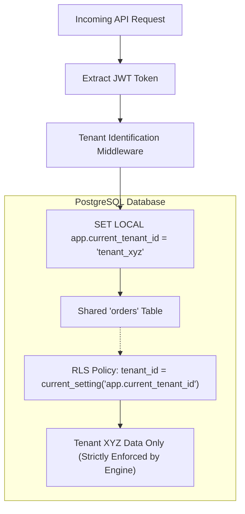
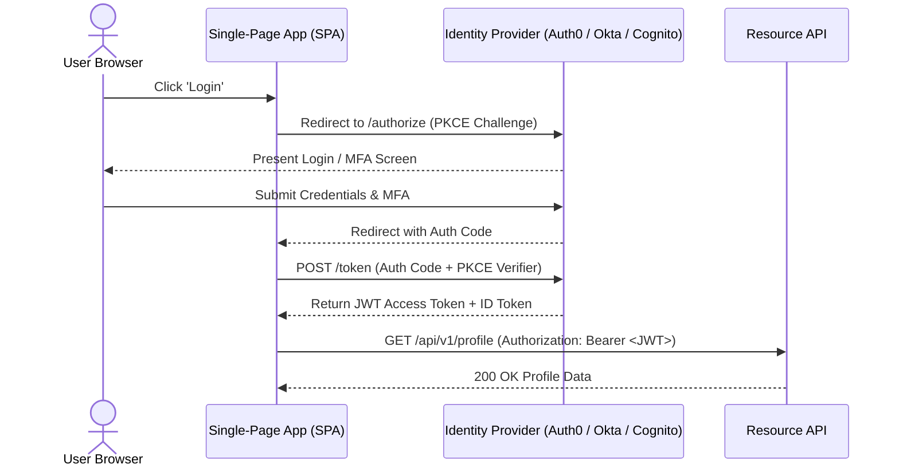

# Architecture Diagram Catalog & Patterns (Mermaid.js)
## Copy-Paste Visual System Models for System Architecture Documents (SAD)

Use these pre-tested, responsive Mermaid diagrams directly in your PRDs, Architecture Specs, and Client Presentations.

---

## 1. Pattern: Backend-for-Frontend (BFF) & Microservices

```mermaid
flowchart TD
    ClientWeb["Web Application (React / Next.js)"] -->|HTTPS / WSS| CDN["Cloudflare Edge"]
    ClientMobile["Mobile App (iOS / Android)"] -->|HTTPS| CDN

    CDN -->|In-Transit TLS 1.3| APIGW["API Gateway (Kong / AWS API GW)"]

    subgraph Core Services (Private Subnet)
        APIGW --> AuthSvc["Auth Service (OAuth2 / OIDC)"]
        APIGW --> OrderSvc["Order Service (Node / Go)"]
        APIGW --> CatalogSvc["Catalog Service (Python / FastAPI)"]
    end

    subgraph Data Tier
        OrderSvc --> OrderDB[("PostgreSQL Aurora (Multi-AZ)")]
        CatalogSvc --> CatalogDB[("PostgreSQL (Read Replica)")]
        CatalogSvc --> RedisCache[("Redis Cluster (Query Cache)")]
    end
```

---

## 2. Pattern: Asynchronous Event-Driven Decoupling



---

## 3. Pattern: Multi-Tenant SaaS Isolation (Row-Level Security)



---

## 4. Pattern: OAuth2 / OpenID Connect Authentication Flow



