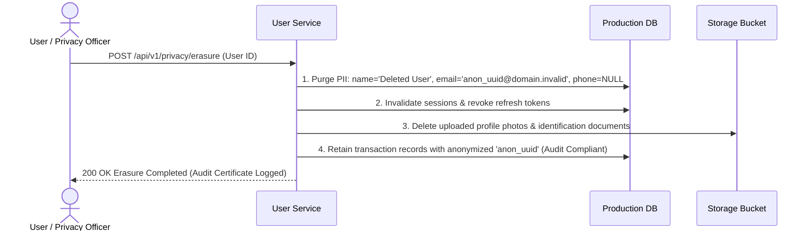

# Data Privacy, Retention & Sanitization Playbook
## GDPR / CCPA Compliance, PII Anonymization & Staging Data Masking

Managing customer Personally Identifiable Information (PII) properly is critical for client compliance and privacy regulations. 

This playbook provides architectural patterns for PII encryption, Right-to-be-Forgotten workflows, and safe data sanitization when copying production data to staging environments.

---

## 1. PII Data Classification Matrix

| Classification Level | Definition & Examples | Storage & Encryption Standard | Logging & Telemetry Policy |
|---|---|---|---|
| **Level 1: Highly Sensitive** | Passwords, auth tokens, credit card CVV, private keys | Hashed via Argon2id or NEVER stored (tokenized via Stripe) | **STRICTLY FORBIDDEN IN LOGS** |
| **Level 2: Confidential PII** | Full name, phone number, physical address, national ID | Encrypted at-rest (AES-256); decrypted in-memory only | Masked in logs (e.g., `+1-***-***-8821`) |
| **Level 3: Internal Business** | User IDs, order IDs, SKUs, inventory counts, timestamps | Standard database storage with TLS in-transit | Permitted in structured JSON logs |
| **Level 4: Public** | Product catalog titles, public documentation | Public CDN cache | Permitted |

---

## 2. The Right-to-be-Forgotten (User Erasure Workflow)

Under GDPR Article 17, when a customer requests account deletion:
*Financial and audit records cannot simply be dropped due to legal accounting retention laws.* Instead, apply the **Pseudonymization & Hard Purge Pattern**:



---

## 3. Production-to-Staging Data Sanitization Script

*Never copy raw production customer data directly into Staging or local dev environments!*

Run this SQL masking script during the database replica synchronization:
```sql
-- Anonymize Users Table
UPDATE users
SET 
    email = 'user_' || id || '@staging.domain.invalid',
    password_hash = '$argon2id$v=19$m=65536,t=3,p=4$anonymized_staging_hash',
    phone = '+1-555-' || LPAD((FLOOR(RANDOM() * 10000))::TEXT, 4, '0'),
    full_name = 'Test User ' || id;

-- Truncate active session tokens and password resets
TRUNCATE TABLE user_sessions;
TRUNCATE TABLE password_reset_tokens;

-- Mask shipping addresses
UPDATE shipping_addresses
SET 
    street = (FLOOR(RANDOM() * 999))::TEXT || ' Staging Sandbox Lane',
    postal_code = '00000';
```
