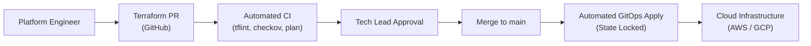

# Infrastructure as Code (IaC) & GitOps Standards

> **Technical Standard**  
> **Audience:** DevOps Engineers, Cloud Architects, SREs, Platform Engineers  
> **Tooling Baseline:** Terraform / OpenTofu, AWS/GCP, ArgoCD / Flux, GitHub Actions

---

## 1. Principles of Infrastructure as Code

1. **Zero ClickOps in Production:** Manual changes in cloud provider consoles (AWS Management Console, GCP Console) are strictly prohibited. Every cloud resource is declared in version-controlled IaC.
2. **Immutability & Declarative State:** Changes are applied by altering declarative code, not by patching long-lived snowflake instances.
3. **State File Safety & Locking:** Remote state storage (S3 + DynamoDB state locking or Terraform Cloud) with server-side encryption and versioning is mandatory. Local `.tfstate` files are forbidden.
4. **Drift Detection:** Nightly automated CI jobs execute `tofu plan -detailed-exitcode` to detect and alert on unauthorized console drift.



---

## 2. Directory Layout & Environment Isolation

We employ strict separation of state between environments (Dev, Staging, Prod) to prevent accidental blast radius spillover:

```text
infrastructure/
├── modules/                      # Reusable, versioned modules
│   ├── vpc/
│   │   ├── main.tf
│   │   ├── variables.tf
│   │   └── outputs.tf
│   ├── ecs-cluster/
│   ├── rds-postgres/
│   └── s3-secure-bucket/
└── environments/                 # Independent state per environment
    ├── dev/
    │   ├── backend.tf            # s3://tf-state-dev/dev.tfstate
    │   ├── main.tf
    │   ├── terraform.tfvars
    │   └── variables.tf
    ├── staging/
    │   ├── backend.tf
    │   ├── main.tf
    │   └── terraform.tfvars
    └── prod/
        ├── backend.tf            # s3://tf-state-prod/prod.tfstate
        ├── main.tf
        ├── terraform.tfvars
        └── outputs.tf
```

---

## 3. Mandatory Security & Static Analysis (CI Gates)

Every IaC Pull Request runs an automated 4-stage validation before a plan comment is posted:

```yaml
# .github/workflows/terraform-ci.yml
name: Terraform Lint & Security Gate
on: [pull_request]

jobs:
  validate:
    runs-on: ubuntu-latest
    steps:
      - uses: actions/checkout@v4
      
      - name: Setup OpenTofu
        uses: opentofu/setup-opentofu@v1
        
      - name: Format Check
        run: tofu fmt -check -recursive
        
      - name: TFLint (Syntax & Deprecations)
        uses: terraform-linters/setup-tflint@v4
        with:
          tflint_version: latest
      - run: tflint --init && tflint -f compact
      
      - name: Checkov / Trivy (Security & Compliance)
        run: |
          docker run --rm -v $(pwd):/tf bridgecrew/checkov \
            -d /tf/infrastructure --framework terraform --soft-fail
```

---

## 4. GitOps Delivery Standards (Kubernetes / ArgoCD)

For containerized microservices running on Kubernetes (EKS / GKE):

1. **Repository Separation:**
   - **Application Repo:** Contains application source code, Dockerfile, unit tests, and Helm chart templates.
   - **Config / GitOps Repo:** Contains environment-specific values (`values-dev.yaml`, `values-prod.yaml`) managed exclusively by GitOps controllers (ArgoCD / Flux).
2. **Automated Promotion Flow:**
   - Merge to `main` builds a container image tagged with the Git SHA (`app:sha-abcdef1`).
   - CI commits the new SHA into `infrastructure-gitops/apps/billing/values-staging.yaml`.
   - ArgoCD detects the Git commit and reconciles the cluster state within 60 seconds.
   - Automated PVT smoke tests run in staging. Upon success, an automated PR is created to promote to production.
3. **Rollback Standard:**
   - Rollback is performed via `git revert <commit-sha>`. ArgoCD immediately converges the cluster to the previous healthy container image.

---

## 5. Secret Management Rules in IaC

- **Plaintext Secrets Forbidden:** Never commit database passwords, API tokens, or private keys to Terraform code or variables files.
- **Dynamic Secret Retrieval:** Reference secrets at runtime via cloud providers:
  ```hcl
  data "aws_secretsmanager_secret_version" "db_password" {
    secret_id = "prod/rds/master-password"
  }
  ```
- **Kubernetes Secret Management:** Use **External Secrets Operator (ESO)** or **Sealed Secrets** to synchronize secrets directly from AWS Secrets Manager or HashiCorp Vault into Kubernetes namespaces.
