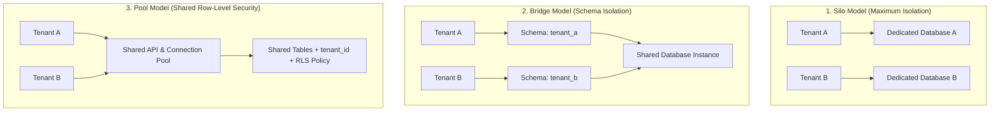

# Multi-Tenant SaaS Data Isolation & Security Standard

> **Architecture Standard & Implementation Guide**  
> **Audience:** System Architects, Backend Engineers, DevOps, Security Officers  
> **Applicability:** All multi-tenant SaaS applications, microservices, and databases.

---

## 1. Architectural Models of Multi-Tenancy

Selecting the right multi-tenancy model balances **isolation rigor**, **infrastructure cost**, and **operational complexity**:



| Dimension | Silo (Separate DBs) | Bridge (Separate Schemas) | Pool (Row-Level Security) |
| :--- | :--- | :--- | :--- |
| **Isolation Rigor** | Highest (Hard network boundary) | Medium (Logical namespace) | Software-enforced (Postgres RLS) |
| **Infrastructure Cost** | High (Idle capacity per tenant) | Medium | Lowest (Shared compute/storage) |
| **Operational Scalability**| Complex migrations (>500 DBs) | Migration overhead at scale | Simple (Single schema migration) |
| **Target Workload** | Regulated enterprise / banking | Mid-market SaaS | High-scale B2B / B2C prototypes & MVPs |

---

## 2. The Pool Model: PostgreSQL Row-Level Security (RLS) Standard

For high-velocity prototypes and MVPs, the **Pool Model with PostgreSQL Row-Level Security** is the mandatory default standard:

### A. Database Table Definition
Every multi-tenant table **must** include a non-nullable `tenant_id` column indexed with foreign key to `tenants`:

```sql
-- 1. Create table with tenant foreign key
CREATE TABLE orders (
    id UUID PRIMARY KEY DEFAULT gen_random_uuid(),
    tenant_id UUID NOT NULL REFERENCES tenants(id) ON DELETE CASCADE,
    customer_name TEXT NOT NULL,
    total_amount NUMERIC(12, 2) NOT NULL,
    created_at TIMESTAMPTZ DEFAULT NOW()
);

-- 2. Index tenant_id for high-performance filtering
CREATE INDEX idx_orders_tenant_id ON orders(tenant_id);

-- 3. Enable and enforce Row-Level Security
ALTER TABLE orders ENABLE ROW LEVEL SECURITY;
ALTER TABLE orders FORCE ROW LEVEL SECURITY;

-- 4. Create RLS Policy using current session parameter
CREATE POLICY tenant_isolation_policy ON orders
    FOR ALL
    USING (tenant_id = NULLIF(current_setting('app.current_tenant_id', true), '')::UUID)
    WITH CHECK (tenant_id = NULLIF(current_setting('app.current_tenant_id', true), '')::UUID);
```

### B. Application Middleware Context Injection
Every database transaction executed by the application backend must set the tenant session context immediately upon checkout from the connection pool:

```typescript
// middleware/tenantContext.ts
import { Request, Response, NextFunction } from 'express';
import { db } from '../db';

export async function withTenantContext(req: Request, res: Response, next: NextFunction) {
  const tenantId = req.user?.tenantId; // Extracted from validated JWT

  if (!tenantId) {
    return res.status(403).json({ error: 'Tenant context missing from authorization token' });
  }

  // Wrap downstream execution in a dedicated transaction with tenant_id set
  try {
    await db.tx(async (client) => {
      // Set session variable scoped to this transaction only (LOCAL)
      await client.query("SET LOCAL app.current_tenant_id = $1", [tenantId]);
      req.db = client;
      next();
    });
  } catch (err) {
    next(err);
  }
}
```

> [!CAUTION]
> Always use `SET LOCAL` (transaction-scoped) rather than `SET SESSION`. `SET SESSION` contaminates pooled database connections in PgBouncer, causing catastrophic cross-tenant data leaks!

---

## 3. Cross-Tenant Leakage Prevention & Automated Tests

To prevent regressions, CI/CD must execute automated **cross-tenant isolation test suites**:

```typescript
// tests/tenantIsolation.spec.ts
import { test, expect } from '@playwright/test';

test('Tenant A must never access Tenant B resources', async () => {
  // 1. Create order under Tenant B
  const orderB = await createOrderForTenant('tenant-b-uuid', { total: 100 });

  // 2. Attempt to query orderB using Tenant A's authenticated JWT
  const response = await apiRequestAsTenant('tenant-a-jwt', `/api/v1/orders/${orderB.id}`);

  // 3. Must return HTTP 404 Not Found (or 403 Forbidden)
  expect(response.status).toBe(404);
  expect(response.data).toBeNull();
});
```

---

## 4. Noisy Neighbor Defense & Resource Throttling

1. **Per-Tenant Rate Limiting:** Enforce a sliding-window rate limit (e.g. 500 requests/minute per tenant) using Redis token buckets.
2. **Database Query Timeout:** Set `statement_timeout = '15s'` to prevent a single runaway tenant query from starving shared database resources.
3. **Dedicated Read Replicas:** High-volume analytics or batch export queries are routed to dedicated read replicas, keeping the primary writer available for transactional traffic.
