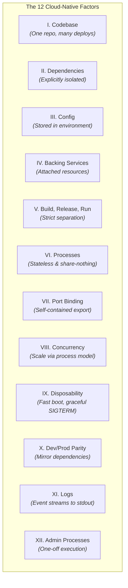
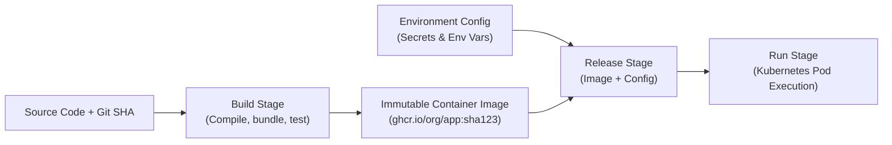

# Cloud-Native 12-Factor App & Configuration Standards

> **Architecture Standard & Engineering Playbook**  
> **Audience:** Software Engineers, Solution Architects, DevOps/SREs  
> **Target Standard:** Modernized Twelve-Factor App Methodology for Cloud-Native & Kubernetes Workloads

---

## 1. Executive Summary & Core Philosophy

To achieve extreme prototype development velocity without building brittle, unmaintainable software, all application services must adhere strictly to the **12-Factor App methodology**.

These factors ensure applications are portable across local Docker environments, staging clusters, and production Kubernetes/cloud infrastructure with zero code changes:



---

## 2. The 12 Factors Implementation Standards

### Factor I: One Codebase, Multiple Deploys
- A single Git repository per service.
- Multiple deployments (Local, Development, Staging, Production) are generated from the same codebase, differentiated only by environment configuration.

### Factor II: Explicitly Declared & Isolated Dependencies
- Every dependency is declared in a manifest with strict cryptographic checksums (`package-lock.json`, `poetry.lock`, `go.sum`).
- Build steps run hermetically; system-wide global packages are prohibited.

### Factor III: Store Config in the Environment
- Zero configuration values or secrets hardcoded in application source code.
- Applications read configuration exclusively from environment variables (e.g., `DATABASE_URL`, `REDIS_HOST`, `PORT`, `LOG_LEVEL`).
- Default values in code are permitted only for non-sensitive local development defaults (`PORT=8000`).

### Factor IV: Treat Backing Services as Attached Resources
- Databases (Postgres), caches (Redis), message queues (RabbitMQ/SQS), and mail servers are treated as loosely coupled network resources accessed via URLs.
- The application makes no distinction between a local Dockerized database and an Amazon RDS Aurora cluster.

### Factor V: Strictly Separate Build, Release, and Run

- It is impossible to make code changes at runtime; every change requires a new build and release.

### Factor VI: Execute the App as Stateless, Share-Nothing Processes
- Application processes persist zero state to the local filesystem or local process memory between requests.
- All persistent state is offloaded to backing datastores (PostgreSQL, S3, Redis).
- Any process can crash, restart, or scale to zero without data loss.

### Factor VII: Export Services via Port Binding
- The application is completely self-contained and binds directly to a network port specified by the `$PORT` environment variable.
- Routing and TLS termination are handled upstream by the Ingress Controller / Application Load Balancer.

### Factor VIII: Concurrency via the Process Model
- Applications scale horizontally by launching additional process replicas (Kubernetes Pods / ECS Tasks), not by inflating thread counts on a monolithic single server.

### Factor IX: Disposability (Fast Startup & Graceful Shutdown)
- **Fast Startup:** Target container startup time `< 3 seconds` to enable rapid autoscaling during traffic spikes.
- **Graceful SIGTERM Handling:** When receiving a `SIGTERM` signal (e.g. during a Kubernetes rolling update):
  1. Stop accepting new incoming HTTP connections immediately.
  2. Complete all in-flight HTTP requests within a grace period (e.g., 20 seconds).
  3. Close database and Redis connection pools cleanly.
  4. Exit with status code `0`.

```typescript
// example: gracefulShutdown.ts
process.on('SIGTERM', async () => {
  logger.info('Received SIGTERM: Initiating graceful shutdown...');
  server.close(async () => {
    logger.info('HTTP server closed. Disconnecting database pools...');
    await db.destroy();
    await redis.quit();
    logger.info('Cleanup complete. Process exiting gracefully.');
    process.exit(0);
  });
});
```

### Factor X: Dev/Prod Parity
- Minimize gaps between development and production.
- Use Docker Compose locally to run the exact same PostgreSQL and Redis versions that execute in production.
- Never use SQLite in development and PostgreSQL in production.

### Factor XI: Treat Logs as Event Streams
- Applications never write log files to disk, rotate logs, or manage log directories.
- All logs are emitted directly as unbuffered JSON streams to `stdout` and `stderr`.
- The execution environment (FluentBit, Datadog Agent, CloudWatch) captures, buffers, and forwards the stream to centralized storage.

### Factor XII: Admin Processes as One-Off Tasks
- Database migrations (`prisma migrate`, `alembic upgrade`, `flyway migrate`) run as ephemeral, isolated one-off jobs (e.g., Kubernetes `Job`) prior to container rollout, never as startup hooks inside long-running application pods.
