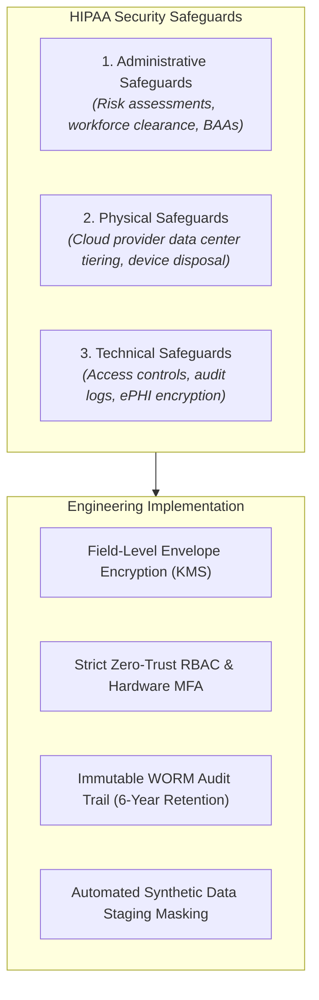

# HIPAA Compliance & ePHI Protection Playbook

> **Standard Operating Procedure (SOP)**  
> **Audience:** Architects, Software Engineers, DevOps/SREs, Data Engineers, Compliance Officers  
> **Applicability:** All workloads, databases, APIs, and logs that ingest, process, store, or transmit Electronic Protected Health Information (ePHI).

---

## 1. Statutory Context & The HIPAA Security Rule

The Health Insurance Portability and Accountability Act (HIPAA) Security Rule (45 CFR Part 160 and Part 164, Subparts A and C) mandates three categories of safeguards:



---

## 2. The 18 HIPAA Identifiers (Safe Harbor De-Identification)

Under §164.514(b)(2), health information is de-identified **only** if all 18 identifiers of the individual or of relatives, employers, or household members are removed:

1. Names.
2. All geographic subdivisions smaller than a state (street, city, county, ZIP code).
3. All elements of dates (birth date, admission date, discharge date, date of death, and all ages over 89).
4. Telephone numbers.
5. Fax numbers.
6. Electronic mail addresses.
7. Social Security numbers.
8. Medical record numbers.
9. Health plan beneficiary numbers.
10. Account numbers.
11. Certificate/license numbers.
12. Vehicle identifiers and serial numbers (including license plates).
13. Device identifiers and serial numbers.
14. Web Universal Resource Locators (URLs).
15. Internet Protocol (IP) address numbers.
16. Biometric identifiers (finger and voice prints).
17. Full-face photographic images and comparable images.
18. Any other unique identifying number, characteristic, or code.

---

## 3. Mandatory Technical Safeguards (§164.312)

### A. Access Control (§164.312(a)(1))
- **Unique User Identification:** Shared operational accounts (e.g. `admin`, `dev-team`) are prohibited. Every engineer accesses resources through individual IdP accounts.
- **Emergency Access Procedure ("Break-Glass"):** Secondary break-glass AWS account with alerted access (Slack + PagerDuty notification triggered immediately on authentication).
- **Automatic Logoff:** All clinical/administrative web sessions terminate after 15 minutes of inactivity.

### B. Transmission & Storage Cryptography (§164.312(a)(2)(iv) & §164.312(e))
- **At-Rest:** All databases containing ePHI (PostgreSQL, DynamoDB, Redis) use AES-256 with customer-managed keys (CMK) in AWS KMS. Column-level encryption is required for social security and insurance numbers.
- **In-Transit:** Minimum TLS 1.3 for external APIs; TLS 1.2+ mandatory for intra-service communication. HTTP Strict Transport Security (`HSTS`) headers enforced with `max-age=63072000; includeSubDomains; preload`.

### C. Audit Controls & Log Integrity (§164.312(b))
- **Immutable Log Storage:** All application access logs to ePHI are streamed to an S3 bucket configured with **Object Lock in Compliance Mode** (WORM - Write Once, Read Many).
- **Mandatory Retention:** All audit logs must be retained for a minimum of **6 years** from the date of creation (§164.316(b)(2)(i)).
- **Log Payload Hygiene:** ePHI is strictly forbidden in application logs, URLs, query parameters, and exception stack traces.

---

## 4. Business Associate Agreement (BAA) Verification

No infrastructure service, third-party SaaS, or API vendor may touch ePHI without an executed BAA on file:

| Service / Vendor | Status | Permitted Usage | BAA Requirement |
| :--- | :--- | :--- | :--- |
| **AWS / GCP / Azure** | ✅ Certified | Core compute, DBs, and managed storage. | Enforce HIPAA eligible services only. BAA signed in console. |
| **Datadog / New Relic** | ⚠️ Scoped | APM & infrastructure metrics only. | Ensure log filters strip ePHI before ingestion. |
| **Sentry (Crash Reporting)** | ⚠️ Scoped | Client exception tracking. | PII/ePHI scrubber rules enabled. |
| **Twilio / SendGrid** | ⚠️ Scoped | SMS / Email reminders. | BAA required if message body contains appointment or patient details. |
| **OpenAI / Claude APIs** | ⚠️ Strict | Clinical text processing or summarization. | Zero Data Retention (ZDR) enterprise agreement with signed BAA. |

---

## 5. Developer Pre-Commit & CI Sanitization Check

Add this sanitization check to CI pipelines handling healthcare applications:

```bash
#!/usr/bin/env bash
# Verify that test fixtures do not contain realistic SSN or Medical Record Numbers
echo "🔍 Scanning repository test fixtures for unmasked SSN or MRN patterns..."

if git grep -E '[0-9]{3}-[0-9]{2}-[0-9]{4}' -- 'tests/' 'fixtures/'; then
  echo "❌ ERROR: Detected potential Social Security Number in test files!"
  echo "Use synthetic masked values (e.g., '000-00-0000') per HIPAA Safe Harbor."
  exit 1
fi

echo "✅ HIPAA fixture sanitization checks passed."
```

