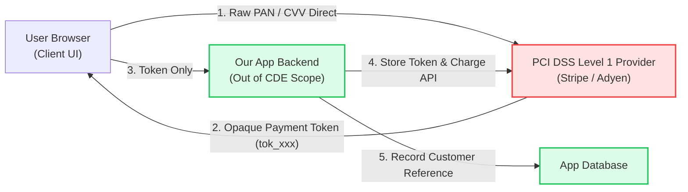

# PCI DSS v4.0 Compliance & CDE Isolation Checklist

> **Standard Operating Procedure (SOP)**  
> **Audience:** Payment Engineers, Architects, DevOps, Security Engineers  
> **Standard:** Payment Card Industry Data Security Standard (PCI DSS) v4.0 (Self-Assessment Questionnaire D / Merchant & Service Provider)

---

## 1. Scope Reduction Principle: Out-of-Scope Architecture

The golden rule of high-velocity fintech engineering is to **minimize or eliminate the Cardholder Data Environment (CDE)** using tokenization and hosted payment fields (e.g. Stripe Elements, Adyen Drop-in, Braintree Hosted Fields).

> [!IMPORTANT]
> **Strict Prohibition:** Under NO circumstances may Primary Account Numbers (PAN), full magnetic stripe data, CAV2/CVC2/CVV2/CID codes, or PIN blocks ever be received, stored, logged, or processed in our application servers or databases.

---

## 2. PCI DSS v4.0 12 Principal Requirements Matrix

| Requirement | Focus Area | Engineering Enforcement | Verification Artifact |
| :--- | :--- | :--- | :--- |
| **Req 1** | Network Security Controls | Zero-trust security groups; deny-all ingress by default; public access restricted to port 443. | Terraform VPC / Security Group code review. |
| **Req 2** | Secure Configurations | Hardened OS images (CIS Benchmarks); default passwords disabled. | Packer base image build logs. |
| **Req 3** | Protect Stored Account Data | Only token references (`tok_...`) stored. Truncated PAN displays (last 4 digits only). | Schema inspection & automated tokenization tests. |
| **Req 4** | Protect Data in Transit | Strong cryptography (TLS 1.3 enforced, deprecated ciphers blocked). | Qualys SSL Labs Grade A+ scan report. |
| **Req 5** | Malicious Software Defense | Endpoint protection on developer workstations; automated container image malware scanning. | Trivy container vulnerability scan in CI. |
| **Req 6** | Secure Systems & Software | OWASP Top 10 mitigation; pre-merge code review; dependency vulnerability remediation within 30 days. | GitHub PR approvals & Dependabot status. |
| **Req 7** | Need-to-Know Access | Strict RBAC; database access restricted to dedicated service accounts. | IAM policy reviews. |
| **Req 8** | User Identification & Auth | Multi-Factor Authentication (MFA) required for all systems; password complexity enforced. | Okta/Google Workspace enforced policies. |
| **Req 9** | Physical Access Restriction | Outsourced to compliant hyperscale cloud provider (AWS/GCP/Azure). | AWS SOC 2 / PCI Attestation of Compliance (AoC). |
| **Req 10** | Log Tracking & Monitoring | All API events, authentication attempts, and authorization changes logged to immutable SIEM. | Centralized CloudWatch / Datadog audit logs. |
| **Req 11** | Regular Security Testing | Quarterly external ASV (Approved Scanning Vendor) network vulnerability scans; annual penetration test. | ASV Passing Scan Certificate & Pen Test report. |
| **Req 12** | Information Security Policies | Annual acceptable use policy sign-off; formal incident response plan tested annually. | Employee policy acknowledgments. |

---

## 3. Pre-Deployment PCI Code Review Checklist

Run through this checklist for any Pull Request touching billing, checkout, or customer financial account models:

- [ ] **No Raw Card Storage:** Ensure database schemas have no columns named `card_number`, `pan`, `cvv`, `cvc`, or `expiration_date`.
- [ ] **Display Masking:** Any card representation shows only the last 4 digits (e.g., `•••• •••• •••• 4242`).
- [ ] **Hosted Field Integration:** Card input forms use iframe-isolated components provided directly by the payment processor.
- [ ] **Log Redaction:** All HTTP request headers and body loggers specifically filter `authorization`, `credit_card`, `token`, and `cvv` keys.
- [ ] **TLS & HTTPS Headers:** HSTS header is configured with a minimum `max-age` of 1 year.
- [ ] **Content Security Policy (CSP):** `script-src` and `connect-src` headers explicitly whitelist the payment gateway domain only.

