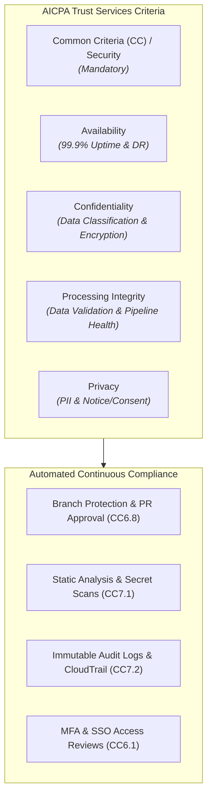

# SOC 2 Type II Readiness & Continuous Compliance Guide

> **Standard Operating Procedure (SOP)**  
> **Audience:** Tech Leads, DevOps/SREs, Security Officers, Compliance Managers  
> **Objective:** Maintain continuous SOC 2 Type II audit readiness across the 5 Trust Services Criteria (TSC) without slowing down sprint delivery or feature velocity.

---

## 1. Executive Overview & Trust Services Criteria (TSC)

SOC 2 Type II evaluates an organization's controls over an observation window (typically 3, 6, or 12 months). Rather than an annual snapshot (Type I), Type II requires **continuous operational evidence**.



---

## 2. Core Control Mapping to SDLC Workflows

| Control Ref | TSC Description | SDLC Implementation / Enforcement | Evidence Collection Artifact |
| :--- | :--- | :--- | :--- |
| **CC6.1** | Logical Access Management | IdP (Okta/Google Workspace) with enforced hardware MFA. Role-Based Access Control (RBAC) via least-privilege groups. | Quarterly User Access Review (UAR) sign-off logs. |
| **CC6.2** | User Registration & Offboarding | Offboarding within 24 hours of HR notification. Automated IdP de-provisioning hook. | Offboarding ticket paired with IdP termination timestamp. |
| **CC6.6** | Perimeter & Network Security | Zero-trust private subnets, egress filtering, Cloudflare WAF, and mTLS between microservices. | Terraform IaC configs and AWS Security Group audit logs. |
| **CC6.8** | Software Change Management | Protected `main` branch: minimum 1 peer review, automated CI green status, and signed Git commits required. | GitHub PR merge logs with reviewer approvals and SHA. |
| **CC7.1** | Vulnerability Management | Daily automated SAST, DAST, and container vulnerability scanning. Dependabot / Snyk alerting. | Vulnerability scan reports and SLA remediation tickets. |
| **CC7.2** | Infrastructure Monitoring & Alerts | Centralized SIEM / Datadog log stream. Alert paging via PagerDuty for critical anomalies. | PagerDuty incident logs and quarterly alert drill reports. |
| **CC8.1** | Business Continuity & DR | Annual PitR and cross-region failover drill. Automated nightly snapshots with 35-day retention. | [Disaster Recovery Audit Certificate](../ops/DISASTER_RECOVERY_AND_BACKUP_DRILL_SOP.md). |

---

## 3. The 4 Golden Rules of Continuous Audit Readiness

### Rule 1: No Unreviewed Code Ever Lands in Production (CC6.8)
- Every PR touching production repositories **must** have:
  1. At least 1 code review approval by a non-author Tech Lead or Senior Engineer.
  2. Passing CI test suite (Unit, Integration, Security SAST).
  3. No bypass permissions granted even to repository admins.
- *Evidence Export:* CI pipeline persists PR metadata:
  ```bash
  gh pr list --state merged --json number,title,mergedAt,reviews,author \
    --jq '.[] | {pr: .number, author: .author.login, merged: .mergedAt, reviewers: [.reviews[].author.login]}' > audit-pr-evidence.json
  ```

### Rule 2: Least-Privilege & JIT (Just-In-Time) Access (CC6.1 / CC6.3)
- No developer has standing SSH or AWS `AdministratorAccess` in production.
- Access to production environments requires:
  1. Time-bound (max 4 hours) temporary privilege escalation via AWS IAM Identity Center or Teleport.
  2. Linked PagerDuty active incident or Jira change ticket ID.
  3. Automatic session recording and revocation upon expiry.

### Rule 3: Automated Cryptographic Enforcement (CC6.7)
- **In-Transit:** TLS 1.3 mandatory across all public entry points; TLS 1.2+ internal mTLS. Cleartext HTTP (port 80) redirects permanently (301) to HTTPS.
- **At-Rest:** AES-256 or AWS KMS customer-managed keys (CMK) for all databases, S3 buckets, and persistent volumes. Unencrypted storage creation blocked via AWS Organization SCPs.

### Rule 4: Quarterly Access Reviews (CC6.2 / CC6.3)
- On the 1st business day of every quarter:
  1. Security Lead exports user access lists from GitHub, AWS, Google Cloud, and Datadog.
  2. Engineering Director reviews and flags stale users, contractors with ended contracts, and elevated permissions.
  3. Action taken within 48 hours; certified sign-off logged in compliance repository.

---

## 4. Auditor Evidence Gathering Checklist

```markdown
### SOC 2 Observation Period Evidence Package

#### 1. People & HR Controls
- [ ] Background checks for all new hires during observation period.
- [ ] Signed Employee Information Security Policy & Code of Conduct acknowledgments.
- [ ] Annual Security Awareness Training completion certificate (100% completion rate).

#### 2. Change Management
- [ ] Population sample of 25 PRs merged during the audit period showing peer approvals.
- [ ] Production deployment logs showing automated release pipelines (no manual SSH deploys).
- [ ] Emergency change logs showing retroactive ticket creation and sign-off.

#### 3. Security & Infrastructure
- [ ] Quarterly third-party penetration testing report and remediation verification.
- [ ] Weekly vulnerability scan history with zero unpatched Criticals (>14 days) or Highs (>30 days).
- [ ] AWS IAM credential report confirming MFA is enabled on 100% of console users.
- [ ] Configuration of AWS CloudTrail logs streamed to an immutable S3 bucket with Object Lock enabled.

#### 4. Availability & Operations
- [ ] Uptime calculation report for SLA compliance (Target: ≥99.9%).
- [ ] Incident response post-mortem reports for any Sev-1/Sev-2 incidents during the period.
- [ ] Annual Disaster Recovery and Database Restore drill sign-off document.
```

---

## 5. Automated Evidence Collection Script

Place this script in `scripts/collect-soc2-evidence.sh` to extract compliance artifacts on demand:

```bash
#!/usr/bin/env bash
# ==============================================================================
# Automated SOC 2 Compliance Evidence Collector
# ==============================================================================
set -euo pipefail

OUTPUT_DIR="./dist/soc2-evidence-$(date +%F)"
mkdir -p "$OUTPUT_DIR"

echo "📦 Gathering SOC 2 Type II audit evidence into $OUTPUT_DIR..."

# 1. Collect Git Branch Protection Settings
echo "--> Collecting GitHub branch protection evidence..."
gh api repos/:owner/:repo/branches/main/protection > "$OUTPUT_DIR/github-branch-protection.json" 2>/dev/null || echo "Branch protection query skipped (requires gh auth)"

# 2. Collect Last 50 Merged PR Approvals
echo "--> Collecting Pull Request peer review evidence..."
gh pr list --state merged --limit 50 --json number,title,author,mergedAt,reviews \
  > "$OUTPUT_DIR/github-pr-approvals.json" 2>/dev/null || echo "PR history query skipped"

# 3. Collect Dependency Vulnerability State
echo "--> Collecting security scan summary..."
if command -v npm &>/dev/null && [ -f "package.json" ]; then
  npm audit --json > "$OUTPUT_DIR/npm-vulnerability-audit.json" || true
fi

# 4. Package Evidence Archive
tar -czf "$OUTPUT_DIR.tar.gz" -C "$(dirname "$OUTPUT_DIR")" "$(basename "$OUTPUT_DIR")"
echo "✅ SOC 2 evidence package generated: $OUTPUT_DIR.tar.gz"
```
