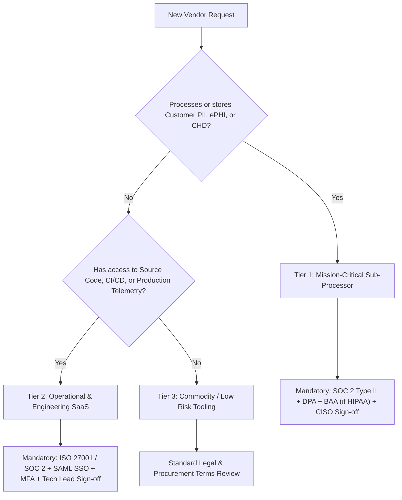
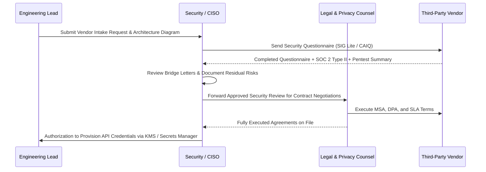

# Third-Party Vendor Risk Management & Sub-Processor Policy

> **Compliance Standard & Operating Policy**  
> **Audience:** CISO, Legal Counsel, Technical Architects, Procurement, DevOps/SREs  
> **Target Frameworks:** SOC 2 Type II (CC9.2), ISO/IEC 27001:2022 (Control 5.19–5.23), GDPR (Art. 28), NIST SP 800-161 (C-SCRM)  
> **Classification:** Internal Policy / Customer-Auditable Baseline  

---

## 1. Executive Summary & Purpose

Modern software architectures rely extensively on third-party cloud infrastructure, SaaS dependencies, managed APIs (e.g. LLM providers, payment gateways, authentication providers), and external contractors. 

This policy establishes mandatory governance, risk classification, security due diligence, contractual data protection safeguards, and continuous monitoring procedures for all external vendors and sub-processors handling customer data or integrated into production delivery pipelines.

---

## 2. Vendor Criticality & Risk Tiering Matrix

All external vendors and service providers must be evaluated and categorized into one of three risk tiers prior to contract execution or technical integration:

| Risk Tier | Definition | Scope of Access | Examples | Minimum Mandatory Safeguards |
| :--- | :--- | :--- | :--- | :--- |
| **Tier 1 (Mission-Critical / PII Custodian)** | Vendors that host, process, or transmit Customer Personal Data (PII/ePHI/CHD) or whose outage directly halts core business operations. | Direct access to production database, production compute, customer tokens, or API credentials. | AWS, Google Cloud, Azure, OpenAI/Anthropic, Stripe, Datadog, Auth0. | • SOC 2 Type II (Clean Opinion, < 12 mo old) • Signed Data Processing Addendum (DPA) & EU SCCs • Annual penetration test summary report • Formal Business Continuity & DR proof (RTO < 4h) • 24-hour breach notification SLA |
| **Tier 2 (Operational / Internal Tooling)** | Vendors supporting internal business operations, code repositories, or communications that do not store production customer database records. | Access to source code, internal communications, CI/CD telemetry, or customer ticket history. | GitHub, Jira/Confluence, Slack, PagerDuty, Sentry. | • SOC 2 Type II or ISO 27001 certification • SSO / SAML integration with mandatory MFA • Role-Based Access Control (RBAC) • Annual security re-assessment |
| **Tier 3 (Commodity / Low Risk)** | Standard off-the-shelf software or services with zero access to source code, production networks, or confidential customer data. | No network connectivity to customer data or internal infrastructure. | Figma, Canva, Zoom, Google Workspace (standard office documents). | • Standard commercial Terms of Service review • Corporate SSO enforcement • Standard license compliance review |

---

## 3. Pre-Contract Due Diligence & Technical Requirements

Before any Tier 1 or Tier 2 vendor is onboarded:

### 3.1 Security & Compliance Artifacts
1. **Audit Reports:** Current SOC 2 Type II report (spanning at least 6 months within the prior 12 months) or ISO/IEC 27001:2022 certificate with Statement of Applicability.
2. **Penetration Testing:** Executive summary of an external third-party penetration test conducted within the last 12 months, confirming all Critical/High vulnerabilities have been remediated.
3. **Data Residency & Cross-Border Transfers:** Verification that vendor cloud storage regions comply with customer contractual data sovereignty requirements (e.g. EU-only processing for GDPR).

### 3.2 Contractual & Legal Safeguards
1. **Data Processing Addendum (DPA):** Incorporating Standard Contractual Clauses (EU SCCs) or UK International Data Transfer Addendum where applicable.
2. **Security Breach Notification SLA:** Mandatory written notification to our Security Incident Response Team within **24 hours** (Tier 1) or **48 hours** (Tier 2) of confirmed or suspected data compromise.
3. **Sub-Processor Transparency:** Vendor must provide at least 30 days prior written notice before onboarding any downstream sub-processor with customer opt-out rights.
4. **Audit Rights:** Contractual right to review vendor compliance documentation annually or conduct technical assessments upon material security incidents.
5. **Data Return & Secure Disposal:** Contractual obligation to return or cryptographically destroy all customer data within 30 days of contract termination, accompanied by a formal Certificate of Destruction.

---

## 4. Vendor Onboarding Lifecycle & Review Workflow

---

## 5. Annual Re-Assessment & Continuous Monitoring

1. **Annual Audit Cadence:**
   - Every Tier 1 vendor must be re-evaluated every 12 months by the Security Team.
   - Re-assessment verifies updated SOC 2 reports, fresh pentest summaries, updated business continuity exercise records, and ongoing compliance.
2. **Continuous Threat Monitoring:**
   - Security team monitors public CVE feeds, vendor security bulletins, and Dark Web credential breach repositories for third-party exposures.
   - Any high-severity vendor breach triggers an immediate emergency review per our [Incident War Room Communications Playbook](../ops/INCIDENT_WAR_ROOM_COMMUNICATIONS_PLAYBOOK.md).
3. **Disaster Recovery & Redundancy:**
   - For all Tier 1 vendors whose downtime impacts customer SLOs, engineering leads must document an alternative fallback provider or degraded operating mode (e.g. fallback LLM endpoints, multi-region database failover).

---

## 6. Vendor Offboarding & Cryptographic De-provisioning

When terminating a contract with any Tier 1 or Tier 2 vendor:

1. **Immediate Credential Revocation:**
   - Revoke all API keys, OAuth tokens, and service account credentials associated with the vendor across AWS Secrets Manager, GitHub Secrets, and production environments.
   - Terminate all vendor SSO accounts and SAML directory integrations.
2. **Data Extraction & Migration:**
   - Extract all historical customer records, configuration assets, and operational logs to internal secure cloud storage.
3. **Cryptographic Erasure & Destruction Proof:**
   - Request written confirmation and formal Certificate of Destruction verifying that all primary data, secondary backups, and staging copies have been purged in compliance with NIST SP 800-88 Rev. 1 (Guidelines for Media Sanitization).
4. **Sub-Processor Register Update:**
   - Remove the vendor from the public/customer-facing Sub-Processor Register within 10 business days.

---

## 7. Related Framework Standards & Templates

- [Third-Party Vendor Security Assessment Template](../../templates/THIRD_PARTY_VENDOR_SECURITY_ASSESSMENT.md)
- [Data Classification & Inventory Matrix](../../templates/DATA_CLASSIFICATION_AND_INVENTORY_MATRIX.md)
- [Secret Management & DLP Policy](../security/SECRET_MANAGEMENT_AND_DLP_POLICY.md)
- [SOC 2 Type II Readiness Guide](SOC2_TYPE_II_READINESS_GUIDE.md)
- [Incident War Room Communications Playbook](../ops/INCIDENT_WAR_ROOM_COMMUNICATIONS_PLAYBOOK.md)
