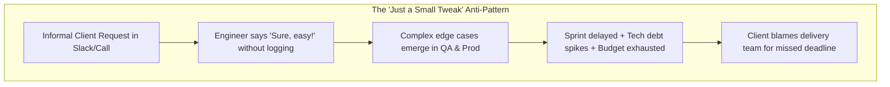
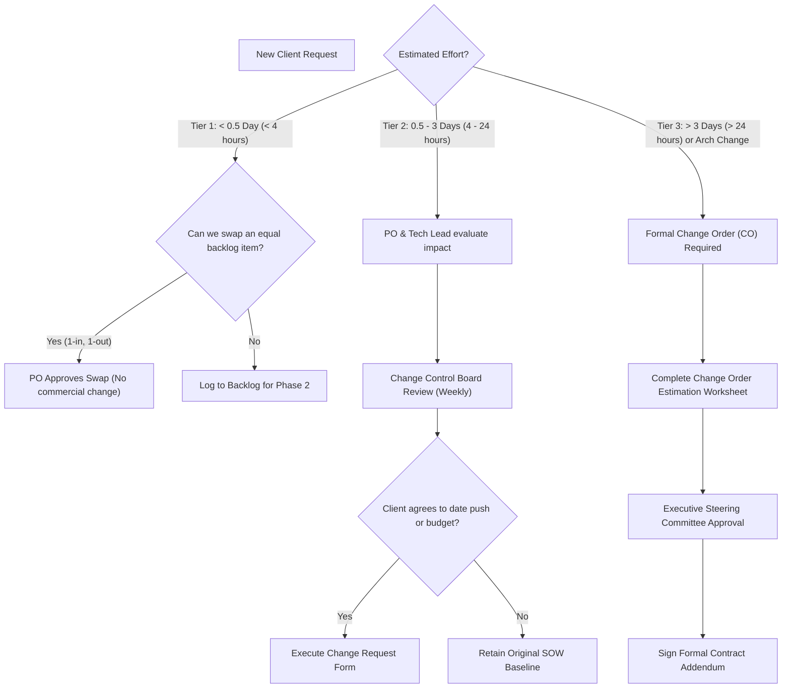

# Scope Creep, Budget & Change Control Playbook

> **Governance Playbook**  
> **Audience:** Product Owners, Project Managers, Tech Leads, Account Directors, Client Sponsors  
> **Objective:** Maintain rapid prototype/MVP delivery velocity while proactively protecting commercial budgets, project timelines, and team morale against scope creep.

---

## 1. The Scope Creep Trap in Fast-Paced Delivery

In agile prototype development, teams iterate rapidly. However, without strict scope boundaries, informal client requests ("Can we just add this one small dropdown?") compound into massive delivery delays, unbudgeted engineering hours, and strained client relationships.



### The Iron Triangle of Project Management
Every project is governed by the Triple Constraint: **Scope, Timeline, and Budget/Resources**, with **Quality** held constant:

$$\text{Scope} \times \text{Quality} = \text{Time} \times \text{Cost}$$

> [!IMPORTANT]
> If the client increases **Scope**, exactly one of two things must happen:
> 1. **Time increases** (Target launch date moves out), OR
> 2. **Cost increases** (Additional engineering resources funded via a formal Change Order), OR
> 3. **Existing scope of equal effort is descheduled** (1-in, 1-out trade-off).

---

## 2. Early Warning Indicators of Scope Creep

| Signal Ref | Warning Symptom | Root Cause | Immediate Intervention |
| :--- | :--- | :--- | :--- |
| **SIG-01** | Client requests architectural changes during sprint demos. | Loose Gate 0 / Gate 1 scoping; undefined acceptance criteria. | PO halts sprint backlog mutation; defers item to next release backlog or formal Change Request. |
| **SIG-02** | Engineers work on undocumented Jira tasks or side tasks. | Developer desire to please client directly in Slack. | Tech Lead enforces DoD: No code merged without an approved Jira ticket linked to PR. |
| **SIG-03** | Sprint velocity drops while ticket count remains constant. | Unestimated hidden complexity inside user stories. | Retro review; re-spike story; split into smaller testable increments. |
| **SIG-04** | Client disputes whether a feature is a "bug" or a "feature request". | Ambiguous PRD acceptance criteria. | Consult the signed [Project Charter & SOW](../../templates/PROJECT_CHARTER_AND_SOW.md); if not explicitly listed in signed specs, it is a Change Request. |

---

## 3. The 3-Tier Change Governance Protocol

When a client or stakeholder proposes a new capability, use the tiered governance protocol:



---

## 4. The "1-In, 1-Out" Scope Trade-off Technique

To say "No" constructively without sounding defensive, practice the **1-In, 1-Out Trade-off Rule**:

> *"We can absolutely include this new Payment Split feature in our upcoming release! Because our sprint capacity is fully allocated to deliver on your launch date of Oct 15th, which of these two existing features would you like to deschedule to Phase 2 to make room: the CSV Bulk Export, or the Custom Email Notification Template?"*

This puts the prioritization decision back in the client's hands and reinforces that velocity is finite.

---

## 5. Commercial Engagement Model Guardrails

### Model A: Fixed-Price / Fixed-Scope Contracts
- **Rule:** Every deviation from the signed [SOW](../../templates/PROJECT_CHARTER_AND_SOW.md) must be billed via a formal [Change Order Estimation Worksheet](../../templates/CHANGE_ORDER_ESTIMATION_WORKSHEET.md).
- **Contingency Reserve:** Always budget a 15%–20% scope contingency reserve during initial scoping.
- **Defect vs Enhancement Definition:** A defect is strictly defined as "Code that fails to execute in accordance with the signed SAD and PRD specifications." Any request for UI styling changes or workflow alterations not documented in the SAD is an Enhancement.

### Model B: Time & Materials (T&M) / Dedicated Pods
- **Rule:** Client pays for sprint capacity (velocity), not fixed scope.
- **PO Accountability:** Product Owner produces a 2-week burn-up chart and provides weekly budget burn vs milestone completion reporting.
- **Budget Burn Alert:** If 70% of the financial budget is burned while milestone completion is < 50%, an immediate executive alignment meeting is triggered.

---

## 6. Pre-Packaged Client Communication Templates

### Template 1: Pushing Back on Informal Slack Requests
```text
Hi [Client Name],

Thanks for sharing that idea regarding [Feature Name]! It would definitely enhance [user persona's] workflow.

Because our engineering team is laser-focused on hitting our Gate 3 UAT milestone for [Milestone Name] by [Date], this item falls outside our current SOW baseline. 

I’ve logged this into our Phase 2 backlog. If you'd like to prioritize this for the current release instead, we can discuss swapping it during tomorrow's backlog review or preparing a brief Change Order estimate. Let me know what you prefer!

Best,
[Product Owner / PM Name]
```

### Template 2: Formal Change Order Notification
```text
Hi [Client Sponsor Name],

Following our discussion regarding the addition of [Major Feature Name], our technical team has completed the architectural and effort impact assessment.

To incorporate this capability without compromising system security or testing rigor:
- Additional Effort: [e.g., 64 Engineering Hours]
- Budget Adjustment: [e.g., $9,600 USD]
- Target Go-Live Impact: [e.g., Extends launch from Nov 1 to Nov 8]

Attached is the formal Change Order Form for your review and digital signature. Upon receipt, we will schedule the work into Sprint [N].

Warm regards,
[Project Director / Account Lead]
```
