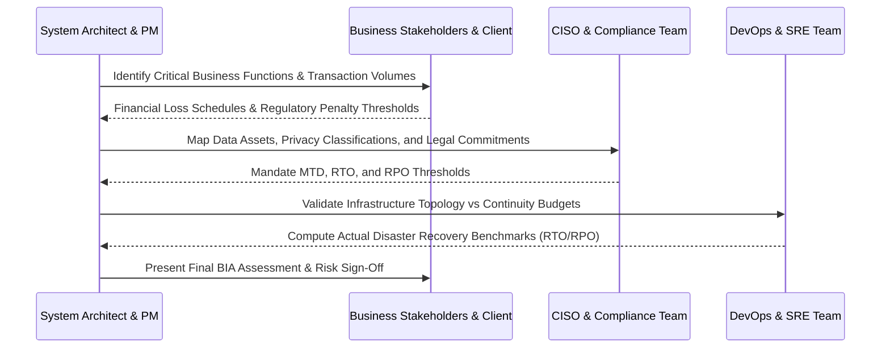
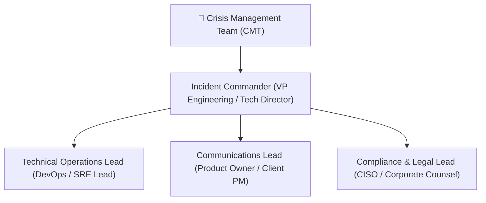

# Business Continuity Management & Business Impact Analysis (BIA) Policy

> **Operational Resilience & Continuity Standard**  
> **Audience:** Business Continuity Managers, Crisis Management Team (CMT), Tech Leads, VP of Engineering, CISO  
> **Target Frameworks:** ISO 22301:2019 (BCMS), SOC 2 Type II (CC9.1), FFIEC BCP Handbook, NIST SP 800-34 Rev. 1  
> **Classification:** Enterprise Operational Standard / Customer-Auditable Baseline  

---

## 1. Executive Summary & Objectives

Business disruptions can arise from datacenter infrastructure failures, cyberattacks (e.g. ransomware, DDoS), cloud vendor outages, severe weather, or critical personnel unavailability. 

This policy establishes the formal requirements for conducting **Business Impact Analyses (BIA)**, categorizing Critical Business Functions (CBFs), setting binding recovery metrics (RTO, RPO, MTD), and maintaining operational resilience across all client delivery platforms.

---

## 2. Core Continuity Metrics & Definitions

Understanding the temporal relationship between outage, data loss, and operational recovery is mandatory for all system architects:

1. **Recovery Point Objective (RPO):** The maximum acceptable age of data files or transactions lost from an outage. Dictates backup frequency and continuous replication topology.
2. **Recovery Time Objective (RTO):** The targeted duration of time within which technical systems and network applications must be fully restored after disruption notification.
3. **Work Recovery Time (WRT):** The duration required after system restoration to verify database integrity, rerun failed batches, reconnect API client integrators, and clear pending queues.
4. **Maximum Tolerable Downtime (MTD):** The absolute threshold of time beyond which irreversible financial catastrophe, regulatory sanction, or enterprise reputational collapse occurs (`MTD ≥ RTO + WRT`).

---

## 3. Critical Business Function (CBF) Classification Tiers

Every system, microservice, and customer-facing workflow must be formally audited and assigned a Criticality Tier:

| Tier | Criticality Category | Target RTO | Target RPO | Max Tolerable Downtime (MTD) | Architecture & Recovery Requirements |
| :--- | :--- | :--- | :--- | :--- | :--- |
| **Tier 0** | **Mission-Critical** (Live Transaction Ingress, Authentication, Order Routing) | **< 15 minutes** | **< 1 minute (Zero Data Loss)** | **< 1 hour** | • Multi-Region Active-Active or Hot Standby • Synchronous database replication (e.g. Aurora Global DB) • Automated DNS / Route 53 health failover • Fully redundant upstream ISP & transit |
| **Tier 1** | **Core Business** (Customer Dashboard, Payment Processing, Billing Webhooks) | **< 1 hour** | **< 15 minutes** | **< 4 hours** | • Multi-AZ automated failover with warm standby • Continuous WAL/PITR replication (5-minute RPO) • Automated container self-healing and pod auto-scaling |
| **Tier 2** | **Operational Support** (Reporting Portals, BI ETL, Asynchronous Email Notifications) | **< 4 hours** | **< 4 hours** | **< 24 hours** | • Multi-AZ deployment with cold standby in secondary region • Automated hourly snapshot backups stored in immutable S3 Glacier |
| **Tier 3** | **Non-Urgent / Internal** (Archival Logs, Internal Wikis, Developer Sandboxes) | **< 24 hours** | **< 24 hours** | **> 72 hours** | • Daily automated backups with 30-day retention • IaC Terraform recreate on demand from scratch |

---

## 4. Business Impact Analysis (BIA) Methodology

Project leads and architects must execute a formal BIA during **Gate 1 (Architecture & Design)** and refresh it annually:

### 4.1 Four-Pillar Impact Evaluation
For each hour of system unavailability, quantify:
1. **Financial Impact:** Direct lost revenue, SLA breach contractual penalty credits, idle contractor/labor overhead.
2. **Regulatory & Legal Impact:** Statutory reporting breaches (e.g. SEC 4-day disclosure, GDPR 72-hour notice, HIPAA fines, PCI DSS non-compliance).
3. **Operational Impact:** Queue congestion, manual workarounds capacity limits, supply-chain delivery bottlenecks.
4. **Reputational & Brand Impact:** Public customer churn, social media exposure, partner trust degradation.

---

## 5. Crisis Management Team (CMT) Structure & Escalation

When an incident exceeds or threatens to exceed 50% of the assigned RTO, the **Crisis Management Team (CMT)** is formally mobilized:

- **Incident Commander:** Holds single-threaded executive authority to order region failover, data restoration from cold backups, or temporary degraded operations mode.
- **Technical Operations Lead:** Executes technical playbooks per the [Operations Runbook](../../templates/OPERATIONS_RUNBOOK.md) and verifies telemetry health.
- **Communications Lead:** Broadcasts hourly transparent updates to executive sponsors and external clients per the [Incident War Room Communications Playbook](../ops/INCIDENT_WAR_ROOM_COMMUNICATIONS_PLAYBOOK.md).
- **Compliance & Legal Lead:** Manages regulatory notifications and insurer notifications (cyber-liability insurance claims).

---

## 6. Testing, Drills & Maintenance Schedule

Operational resilience cannot be assumed; it must be continuously proven:
1. **Automated DR Drills:** Point-in-time recovery and snapshot restoration must be executed at least semi-annually using `./scripts/sdlc-cli.sh dr-drill`.
2. **Chaos & Failover Injection:** Automated pod termination and simulated AZ failures must be verified quarterly per [Chaos Engineering & Failover Testing](../ops/CHAOS_ENGINEERING_AND_FAILOVER_TESTING.md).
3. **BIA Document Review:** The [Business Impact Analysis Template](../../templates/BUSINESS_IMPACT_ANALYSIS_BIA.md) must be reviewed upon any major architectural change, new external API integration, or at least every 12 months.

---

## 7. Related Framework Standards & Deliverables

- [Business Impact Analysis (BIA) Template](../../templates/BUSINESS_IMPACT_ANALYSIS_BIA.md)
- [Disaster Recovery & Backup Drill SOP](DISASTER_RECOVERY_AND_BACKUP_DRILL_SOP.md)
- [Operations Runbook (Day-2 Playbook)](../../templates/OPERATIONS_RUNBOOK.md)
- [SLO & Error Budget Policy](SLO_AND_ERROR_BUDGET_POLICY.md)
- [Incident War Room Communications Playbook](INCIDENT_WAR_ROOM_COMMUNICATIONS_PLAYBOOK.md)
