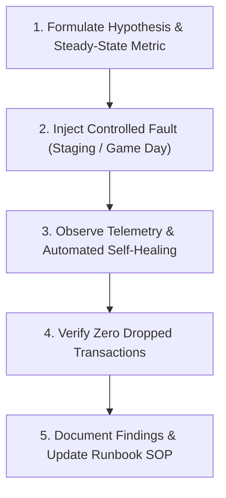

# Chaos Engineering & Resilience Testing Playbook
## Controlled Fault Injection, Failover Verification & Circuit Breaker Certification

Before any product is deployed to production or handed over to the Operations / SRE team, its resilience under adverse conditions must be empirically validated. 

This playbook provides structured **Chaos Engineering Experiments** to prove that component failures, network latency, and third-party outages do not cause catastrophic system collapse.

---

## 1. Resilience Architecture Principles
1. **Graceful Degradation:** A failure in a non-critical downstream component (e.g., analytics, email notifications) must never block core transaction flows (e.g., order placement).
2. **Circuit Breakers (Fail Fast):** Outbound calls to third-party APIs must use circuit breakers (resilience4j, opossum, pybreaker) that trip after 5 consecutive failures, returning cached or fallback responses within 50ms rather than hanging indefinitely.
3. **Automated Recovery:** Kubernetes / ECS container orchestrators must automatically detect failed tasks and replace them without manual human intervention.

---

## 2. Standard Pre-Production Chaos Experiments



### Experiment 1: Sudden Container Kill (High-Load Pod Crash)
- **Objective:** Verify that Kubernetes / ECS auto-replaces crashed pods and the Load Balancer drains traffic without 502 Bad Gateway errors.
- **Fault Injection:**
  ```bash
  # Terminate active API pod under simulated 50 req/sec load
  kubectl delete pod -n staging -l app=wholesale-api --now
  ```
- **Expected Outcome:**
  - In-flight requests handled by surviving replicas.
  - New pod scheduled and passes `/health/ready` within 25 seconds.
  - Error rate remains < 0.1%.

### Experiment 2: Aurora PostgreSQL Primary Multi-AZ Failover
- **Objective:** Verify that database failover completes with sub-minute downtime and connection pools re-establish automatically.
- **Fault Injection:**
  ```bash
  aws rds reboot-db-instance \
      --db-instance-identifier staging-postgres-db \
      --force-failover
  ```
- **Expected Outcome:**
  - Standby replica promoted to primary within 35 seconds.
  - Application connection pool (PgBouncer) reconnects automatically.
  - Pending orders queued in SQS without transaction loss.

### Experiment 3: Third-Party Webhook Latency Injection (Circuit Breaker Test)
- **Objective:** Verify that a 10-second hang in a third-party warehouse ERP does not lock backend API threads.
- **Fault Injection:** Configure mock ERP server to introduce an artificial 10,000ms delay.
- **Expected Outcome:**
  - API HTTP client times out at 3,000ms (configured statement timeout).
  - Circuit breaker trips to `OPEN` state after 5 failed calls.
  - Orders are committed locally and routed to the Dead Letter Queue (DLQ) for asynchronous retry once ERP recovers.

---

## 3. Chaos Resilience Sign-Off Certificate

Record experiment outcomes prior to Gate 3 / Gate 4 clearance:

```markdown
# Chaos Engineering Resilience Certification

| Experiment | Target SLO | Actual Result | Status |
|---|---|---|---|
| **EXP-01: Pod Termination** | 0 Dropped Requests | 0 HTTP 5xx errors observed | **PASSED** |
| **EXP-02: DB Multi-AZ Failover** | Recovery < 60s | Standby promoted in 32s | **PASSED** |
| **EXP-03: Webhook Circuit Breaker**| Fallback < 50ms | Breaker tripped; 0 thread locks | **PASSED** |

**Certified By:** Lead SRE & Tech Lead &nbsp;&nbsp;&nbsp;&nbsp; **Date:** YYYY-MM-DD
```

