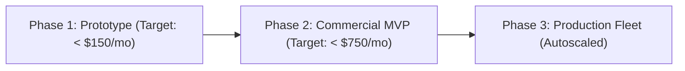

# Cloud Cost & FinOps Governance Framework
## Cost Predictability, Automated Shutdowns & Resource Tagging for Prototypes & Production

In fast-paced prototype and product development, unmanaged cloud resources (forgotten RDS instances, oversized clusters, orphaned EBS volumes) quickly lead to budget blowouts. 

This framework establishes a lean **FinOps Operating Model** to keep cloud infrastructure costs predictable and transparent for internal leadership and clients.

---

## 1. Cloud Cost Allocation by Project Lifecycle Phase

| Lifecycle Phase | Cost Optimization Strategy | Hosting Recommendation |
|---|---|---|
| **Phase 1: Prototype / POC** | Scale-to-zero compute; serverless databases; ephemeral staging environments. | Vercel / Railway / AWS App Runner / Neon Serverless Postgres. |
| **Phase 2: MVP / Pilot** | Right-sized single-AZ RDS; scheduled auto-shutdown on weeknights; containerized ECS tasks. | AWS ECS Fargate (1-2 tasks) + RDS `db.t4g.small` + ElastiCache `cache.t4g.micro`. |
| **Phase 3: Enterprise Production** | 1-Year or 3-Year Savings Plans / Reserved Instances; Multi-AZ; autoscaling compute fleets. | Multi-AZ Aurora PostgreSQL + EKS / ECS Auto-scaling + CloudFront CDN caching. |

---

## 2. Mandatory Cloud Resource Tagging Standard

Every cloud resource (EC2, RDS, S3, ECS, Lambda) must carry the following tags in Terraform:

| Tag Key | Description | Example Values |
|---|---|---|
| `Project` | Name of the project or prototype | `b2b-wholesale-portal` |
| `Environment` | Stage of execution | `development` \| `staging` \| `production` |
| `Owner` | Technical lead or team email | `devops-team@company.com` |
| `CostCenter` | Client billing code or internal department | `CLIENT-ACME-042` |
| `AutoShutdown` | Whether the resource can be powered off at night | `true` (non-prod) \| `false` (prod) |

---

## 3. Automated Non-Production Nightly Shutdown

Non-production environments (Dev & Staging) run only during business hours (08:00 to 20:00 local time Monday through Friday), saving **up to 65% on cloud compute bills**.

### AWS Scheduled Event (EventBridge + Lambda):
- **Shutdown Cron:** `0 20 ? * MON-FRI *` (Scales ECS service to 0 replicas; stops dev RDS instances).
- **Startup Cron:** `0 7 ? * MON-FRI *` (Restarts dev RDS instances; scales ECS service to 1 replica).

---

## 4. Anomaly Detection & Budget Alerting Thresholds

- **Hard Budget Alerts:** Configured via AWS Budgets or GCP Billing alerts:
  - **80% of Forecasted Budget Consumed:** Notification sent to `#finops-alerts` Slack channel.
  - **100% of Forecasted Budget Consumed:** PagerDuty alert to DevOps Lead; review active instances.
- **Orphaned Resource Cleanup (Weekly Automated Audit):**
  - Delete unattached EBS volumes older than 7 days.
  - Expire un-tagged container images in ECR older than 14 days.
  - Purge orphaned S3 staging multipart uploads older than 3 days.
