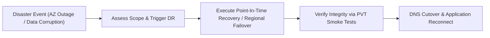

# Disaster Recovery (DR) & Backup Drill Operating Procedure (SOP)

| SOP Metadata | Details |
|---|---|
| **Document ID** | SOP-OPS-003 |
| **Owner** | Lead DevOps / Cloud SRE |
| **Applicability** | Production & Staging Databases, Object Storage, and Container Fleets |
| **Drill Cadence** | Bi-Annually (or prior to Enterprise Production Go-Live) |
| **Target Standards** | Recovery Time Objective (RTO) < 30 Mins \| Recovery Point Objective (RPO) < 5 Mins |

---

## 1. Disaster Recovery Objectives & Classification



- **RTO (Recovery Time Objective):** Maximum acceptable duration between declaration of disaster and operational restoration (< 30 minutes).
- **RPO (Recovery Point Objective):** Maximum acceptable age of data that must be recovered (< 5 minutes of transactional history).

---

## 2. Step-by-Step Point-in-Time Database Restore Drill

### Step 2.1: Pre-Drill Notification
- Schedule drill during a maintenance window or execute against a dedicated staging drill environment.
- Record baseline timestamp `$DRILL_START_TIME` (UTC).

### Step 2.2: Execute Point-in-Time Recovery via AWS CLI
```bash
# 1. Capture target recovery timestamp (5 minutes prior to drill start)
TARGET_TIME=$(date -u -v-5M +"%Y-%m-%dT%H:%M:%SZ")

echo "Initiating PITR to timestamp: $TARGET_TIME"

# 2. Restore PostgreSQL instance from continuous WAL archive
aws rds restore-db-instance-to-point-in-time \
    --source-db-instance-identifier prod-postgres-db \
    --target-db-instance-identifier prod-postgres-dr-drill-instance \
    --restore-time "$TARGET_TIME" \
    --db-instance-class db.t4g.medium \
    --db-subnet-group-name prod-db-subnets \
    --vpc-security-group-ids sg-01928374abcd \
    --no-multi-az
```

### Step 2.3: Monitor Restore Progress
```bash
aws rds wait db-instance-available \
    --db-instance-identifier prod-postgres-dr-drill-instance

echo "✅ Database restored and available."
```

### Step 2.4: Validate Data Integrity & Transaction Continuity
1. Connect via read-only bastion host.
2. Query the latest transactional timestamp:
   ```sql
   SELECT id, created_at, status 
   FROM orders 
   ORDER BY created_at DESC 
   LIMIT 5;
   ```
3. Calculate actual variance:
   $$\text{Actual RPO} = \text{Drill Trigger Time} - \text{Latest Recovered Transaction Time}$$
4. Confirm $\text{Actual RPO} \le 5\text{ minutes}$.

---

## 3. Disaster Recovery Drill Sign-Off Certificate

Use this template to record drill results for client security auditors and compliance officers:

```markdown
# Disaster Recovery Drill Compliance Certificate

| Drill Parameter | Value |
|---|---|
| **Drill Date & Time** | YYYY-MM-DD HH:MM UTC |
| **Drill Lead (SRE)** | [Name / Lead Cloud Engineer] |
| **Client Audit Observer** | [Client IT Representative] |
| **Target Database / System** | PostgreSQL 16 (AWS RDS Aurora) |

### Drill Results:
- **Time Drill Initiated:** HH:MM:SS UTC
- **Time Database Restored & Available:** HH:MM:SS UTC
- **Actual RTO Achieved:** [e.g., 18 Minutes, 22 Seconds] (Target: < 30 Mins) -> **PASSED**
- **Actual RPO Achieved:** [e.g., 2 Minutes, 15 Seconds] (Target: < 5 Mins) -> **PASSED**
- **Data Integrity Verification:** Synthetic PVT tests passed on restored replica -> **PASSED**

### Signatures:

**Lead SRE / Disaster Recovery Officer:**
Signature: ________________________________  Date: YYYY-MM-DD

**Client IT / Security Auditor:**
Signature: ________________________________  Date: YYYY-MM-DD
```
