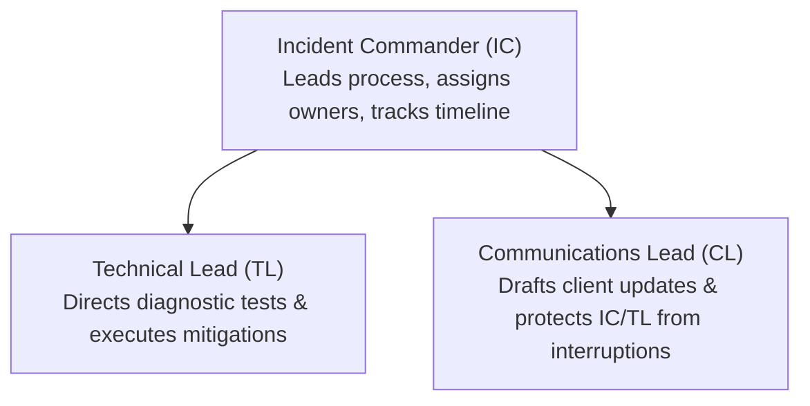

# Incident War Room & Crisis Communications Playbook
## High-Severity Incident Response Protocols (P1 & P2 Outages)

When a P1 (Critical) or P2 (Major) outage occurs, chaotic communication causes more client distress than the outage itself. This playbook establishes clear war room roles, status broadcast cadences, and copy-paste communication templates.

---

## 1. War Room Incident Roles (The Command Triad)



1. **Incident Commander (IC):** Focuses exclusively on process, timeline, and mitigation decisions. Ensures the war room doesn't devolve into debate.
2. **Technical Lead (TL):** Coordinates hands-on triage, log inspection, database queries, and code rollbacks.
3. **Communications Lead (CL):** Owns status updates to clients and executive leadership every 30 minutes, shielding the engineers from interruption.

---

## 2. Standard Client Status Broadcast Templates

### Status 1: Investigating (Within 15 Mins of Detection)
```markdown
**Status: INVESTIGATING**
**Incident Ref:** [INC-XXXX]
**Impact:** We are actively investigating an elevated error rate affecting [API / Checkout / Dashboard]. Some requests may experience intermittent failures or timeouts.
**Action:** Our engineering on-call and operations teams are actively diagnosing root causes in a dedicated response bridge.
**Next Update:** Within 30 minutes.
```

### Status 2: Identified & Mitigating (Root Cause Discovered)
```markdown
**Status: IDENTIFIED & MITIGATING**
**Incident Ref:** [INC-XXXX]
**Update:** The cause of the degraded performance has been identified as [brief non-technical reason, e.g., elevated database query latency following a upstream cloud provider network hiccup].
**Action:** Our team is currently [restarting affected container tasks / failing over to secondary database replica / rolling back recent patch].
**Next Update:** Within 30 minutes.
```

### Status 3: Monitoring & Recovery (Mitigation Applied)
```markdown
**Status: MONITORING**
**Incident Ref:** [INC-XXXX]
**Update:** A mitigation has been deployed. Production telemetry indicates error rates have returned to normal baseline (<0.1%) and transactions are processing successfully.
**Action:** We are closely monitoring system health for 30 minutes before declaring full resolution.
**Next Update:** Full resolution confirmation within 30 minutes.
```

### Status 4: Resolved (Service Fully Restored)
```markdown
**Status: RESOLVED**
**Incident Ref:** [INC-XXXX]
**Resolution:** The incident is fully resolved as of [HH:MM UTC]. All services are operating normally.
**Follow-Up:** A formal Blameless Root Cause Analysis (RCA) and preventative action plan will be published within 48 hours.
```
