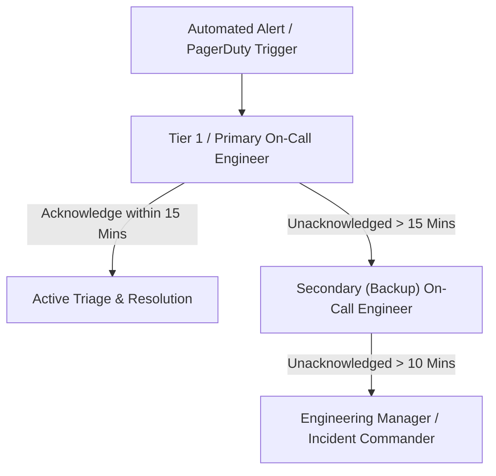

# On-Call Shift Operations & Escalation Standard (SOP)
## Sustainable 24/7 Operations, Shift Handoffs & Alert Fatigue Prevention

High-reliability software requires dependable on-call coverage without burning out engineers. This operating standard defines our on-call rotation schedules, escalation timelines, handoff protocols, and rest policies.

---

## 1. On-Call Roles & Rotation Architecture

### 1.1 The Primary On-Call
- **Responsibility:** First responder for all high-priority alerts (P1 & P2).
- **Shift Duration:** 1 week rotation (starting Monday 10:00 AM local time).
- **Tooling:** PagerDuty mobile app with critical alert override enabled; dedicated laptop and hotspot.

### 1.2 The Secondary (Backup) On-Call
- **Responsibility:** Automatically paged if the Primary fails to acknowledge within **15 minutes**, or if the Primary requests assistance during a complex incident.

---

## 2. Paging Alert Severity & Response Windows

| Pager Level | Trigger Condition | Response SLA | Target Channels |
|---|---|---|---|
| **High Urgency (P1/P2)** | Production 5xx > 1%, DB connection pool exhausted, API down | **< 15 Mins** | Push Notification + SMS + Automated Phone Call |
| **Low Urgency (P3/P4)** | Staging container restart, disk warning at 75%, non-critical queue lag | **Next Business Day** | Slack `#ops-warnings` only (No night pages) |

---

## 3. The Weekly Shift Handoff Meeting (30 Mins, Mondays)

Every Monday at 10:00 AM, outgoing and incoming engineers conduct a formal handoff:
1. **Incident Review:** Walk through any incidents that occurred during the prior week.
2. **Action Item Audit:** Verify that all blameless post-mortem action items have Jira tickets.
3. **Flaky Alert Audit:** Identify any false-positive alerts that paged without actionable need.
4. **Tool Verification:** Outgoing engineer confirms the incoming engineer's PagerDuty schedule is active and test page is successfully received.

---

## 4. Engineer Well-Being & Sleep-Rest Policy
- **Night-Time Incident Rest:** If an on-call engineer is paged between **00:00 and 06:00** and spends > 1 hour resolving an incident:
  - The engineer is **relieved of normal sprint duties until 13:00** the following day.
  - The Secondary on-call covers active daytime monitoring.
- **Alert Fatigue Cap:** If an on-call engineer receives **> 3 false alarms in a 24-hour window**, the alert threshold is immediately raised, or the alert is downgraded to business-hours Slack notification pending review.

