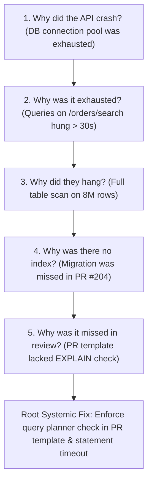

# Incident Post-Mortem & CAPA Governance Operating Standard
## Blameless Root Cause Analysis, 5-Whys Methodology & Preventative Action Lifecycle

When production outages occur, simply fixing the immediate symptom is insufficient. True operational reliability requires identifying systemic, cultural, and architectural causes. 

This standard establishes our **Blameless Post-Mortem & CAPA Lifecycle**, ensuring lessons learned from incidents are converted into tracked engineering deliverables.

---

## 1. The Post-Mortem Golden Rules
1. **Blameless Culture:** We assume that engineers made the best decisions possible given the information, tools, and constraints they had at the time. Never blame an individual; fix the system that allowed the mistake to cause an outage.
2. **Mandatory Threshold:** A formal post-mortem is **mandatory** for:
   - Any Severity 1 (Critical) incident.
   - Any Severity 2 (Major) incident lasting > 60 minutes.
   - Any incident involving data loss, data corruption, or security exposure.
3. **The 48-Hour Rule:** The post-mortem document must be drafted and the review meeting held within **48 business hours** of incident resolution while details are fresh.

---

## 2. The 5-Whys Root Cause Analysis (RCA) Methodology

To find the true systemic root cause, probe past the surface symptom by asking "Why?" five consecutive times:

---

## 3. Corrective and Preventative Action (CAPA) Lifecycle

Every post-mortem must output concrete, assignable CAPA action items categorized into three tiers:

| CAPA Category | Definition | Target Resolution Window | Example |
|---|---|---|---|
| **Tier 1: Ingress Mitigation** | Immediate safeguard to prevent identical failure | **< 3 Days** | Add WAF rate limit or statement timeout (max 5s) |
| **Tier 2: Code / Architecture Fix** | Permanent architectural resolution | **Current Sprint (<= 14 Days)** | Add missing composite index; implement circuit breaker |
| **Tier 3: Process & Observability**| Process improvement or new telemetry alert | **Next Sprint Backlog** | Update PR checklist; add Datadog p99 query alert |

### CAPA Status Tracking:
- `PROPOSED`: Drafted during post-mortem meeting.
- `COMMITTED`: Jira/Linear ticket created and prioritized into the sprint backlog.
- `VERIFIED_IN_STAGING`: Fix tested under simulated load in staging.
- `CLOSED_IN_PROD`: Deployed to production and verified in operational telemetry.
