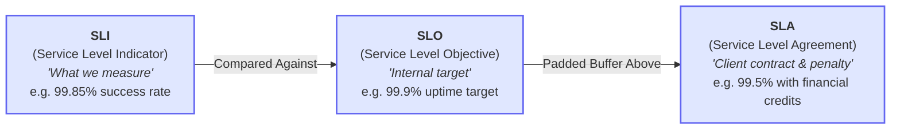
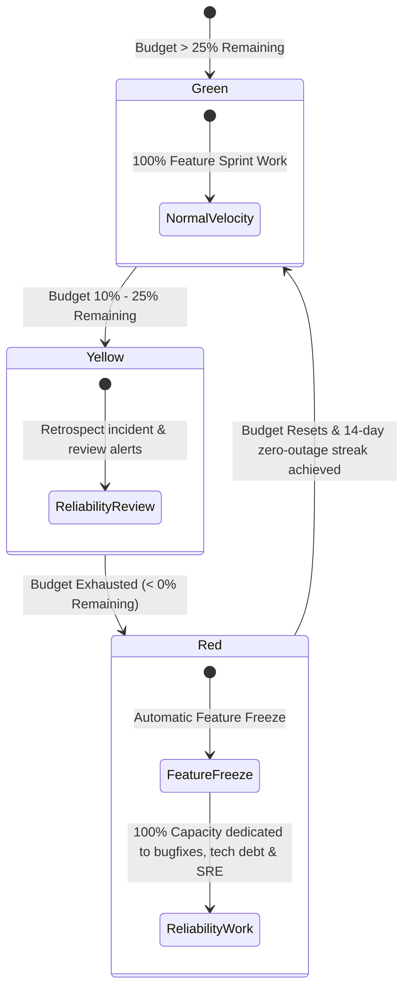

# Service Level Objectives (SLO) & Error Budget Policy

> **Operational Policy & SRE Standard**  
> **Audience:** DevOps Engineers, SREs, Tech Leads, Engineering Directors, Product Owners  
> **Objective:** Balance feature delivery speed with production reliability using quantifiable Error Budgets and automated policy enforcement.

---

## 1. Terminology: SLI vs SLO vs SLA

- **SLI (Indicator):** A carefully defined metric that measures service health (e.g. ratio of HTTP 2xx/3xx requests to total requests over a 30-day rolling window).
- **SLO (Objective):** The internal engineering target (e.g. 99.9% availability). Violating an SLO triggers internal operational interventions, but **not** client penalties.
- **SLA (Agreement):** The legal commitment made to clients in contracts. SLAs are intentionally set lower than SLOs (e.g. 99.5%) to provide a protective safety buffer.

---

## 2. Core Service Level Objectives Table

| Tier | Workload / Service Type | Target Availability (SLO) | Allowed Downtime / Month | Target P95 Latency | Error Budget (30-day) |
| :--- | :--- | :--- | :--- | :--- | :--- |
| **Tier 1** | Critical User Ingress & Auth | **99.95%** | 21.9 minutes | < 180 ms | 0.05% of requests |
| **Tier 2** | Core Business APIs & DBs | **99.90%** | 43.8 minutes | < 350 ms | 0.10% of requests |
| **Tier 3** | Background Workers & Reporting | **99.50%** | 3.65 hours | < 2,000 ms | 0.50% of requests |
| **Tier 4** | Internal Admin & Staging | **99.00%** | 7.30 hours | Best effort | 1.00% of requests |

---

## 3. Error Budget Calculation & Burn Rate

The **Error Budget** is the allowable failure rate over a rolling 30-day window:

$$\text{Error Budget} = 100\% - \text{SLO}$$

For a Tier 2 service with 10,000,000 requests/month and a 99.9% SLO:
- **Total Allowed Failed Requests:** $10,000,000 \times 0.001 = 10,000\text{ errors}$
- **Burn Rate 1.0:** Burns the entire error budget over exactly 30 days.
- **Burn Rate 14.4:** Burns 2% of the error budget in 1 hour (Requires immediate PagerDuty page).

### Multi-Window Multi-Burn-Rate Alerting Rules (Google SRE Standard)

| Severity | Burn Rate | % Budget Consumed | Short Window | Long Window | Paging Channel |
| :--- | :--- | :--- | :--- | :--- | :--- |
| **Page (Sev-1)** | 14.4x | 2% | 5 minutes | 1 hour | PagerDuty (Wake on-call) |
| **Page (Sev-2)** | 6.0x | 5% | 30 minutes | 6 hours | PagerDuty (Business hours) |
| **Ticket (Sev-3)**| 1.0x | 10% | 2 hours | 3 days | Jira/Linear backlog ticket |

---

## 4. The Error Budget Policy: Automated Consequences

When an application burns through its Error Budget in a rolling 30-day period, the following engineering policies automatically engage:

### Policy Rules Under Feature Freeze (Red State)
1. **Halting Feature Merges:** No new business features or non-critical UI improvements may be deployed to production.
2. **Reliability Backlog Prioritization:** 100% of development capacity in the upcoming sprint is redirected to:
   - Root cause analysis & CAPA implementation for recent outages.
   - Test automation, resilience enhancements, and circuit breakers.
   - Infrastructure autoscaling and database query optimization.
3. **Freeze Lift Criteria:** The freeze is lifted only when:
   - All open Sev-1/Sev-2 CAPA action items are deployed and verified.
   - The system achieves a consecutive **14-day zero-Sev-1 streak**.
   - Engineering Director and Product Owner formally sign the unfreeze memo.

---

## 5. Client Reporting & Transparency

In client-facing monthly steering meetings:
1. Provide the **Monthly SLO Compliance Dashboard** showing actual SLI performance vs target.
2. Display the **Error Budget Consumption Chart**.
3. If an SLA breach occurs, present the completed [Post-Mortem & CAPA Report](../ops/POST_MORTEM_AND_CAPA_GOVERNANCE.md) along with corrective actions taken before the client asks.

