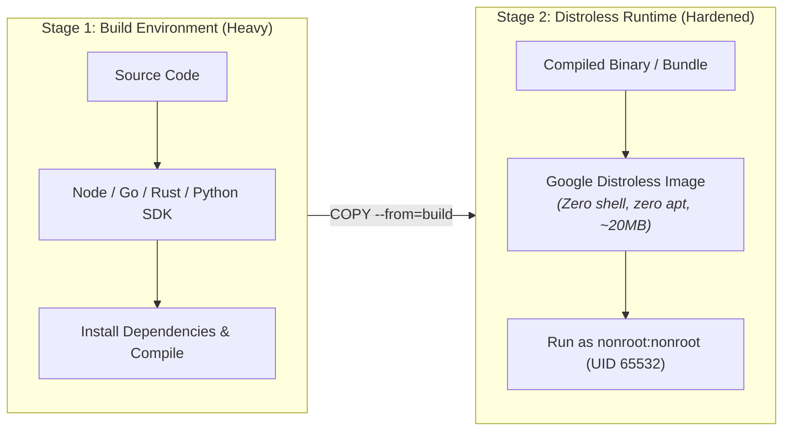

# Container Hardening & Distroless Base Standards

> **Security Standard & SRE Playbook**  
> **Audience:** DevOps Engineers, Backend Developers, Cloud Architects, Security Officers  
> **Target Standard:** CIS Docker & Kubernetes Benchmarks, NIST SP 800-190 (Application Container Security)

---

## 1. Executive Summary & Attack Surface Minimization

Standard Linux container images (Ubuntu, Debian, even full Alpine) bundle hundreds of unnecessary binaries (`curl`, `wget`, `bash`, `apt`, `apk`) that attackers exploit during remote code execution (RCE) attacks.

By adopting **Multi-Stage Docker builds with Distroless Base Images**, we eliminate package managers, shells, and system compilers from the final production container:



---

## 2. Standard Hardened Multi-Stage Dockerfile Pattern

```dockerfile
# ------------------------------------------------------------------------------
# STAGE 1: Dependency Installation & Compilation
# ------------------------------------------------------------------------------
FROM node:20-alpine AS builder
WORKDIR /app

# Install dependencies using pinned lockfile without executing arbitrary scripts
COPY package*.json ./
RUN npm ci --ignore-scripts

# Copy application source and build production bundle
COPY . .
RUN npm run build && npm prune --production

# ------------------------------------------------------------------------------
# STAGE 2: Hardened Distroless Production Runtime
# ------------------------------------------------------------------------------
FROM gcr.io/distroless/nodejs20-debian12:nonroot
WORKDIR /app

# Copy production dependencies and compiled artifacts
COPY --from=builder /app/node_modules ./node_modules
COPY --from=builder /app/dist ./dist
COPY --from=builder /app/package.json ./package.json

# Enforce non-root execution (UID 65532 is built-in nonroot user)
USER nonroot:nonroot

# Expose service port (ports > 1024 do not require root privileges)
EXPOSE 8080
ENV PORT=8080 NODE_ENV=production

ENTRYPOINT ["/nodejs/bin/node", "dist/main.js"]
```

---

## 3. Kubernetes Pod Security Context Standards

Every production deployment manifest must enforce a strict, restricted **Pod Security Context**:

```yaml
apiVersion: apps/v1
kind: Deployment
metadata:
  name: api-service
spec:
  template:
    spec:
      securityContext:
        runAsNonRoot: true
        runAsUser: 65532
        runAsGroup: 65532
        fsGroup: 65532
        seccompProfile:
          type: RuntimeDefault
      containers:
        - name: api-service
          image: ghcr.io/org/api-service:v1.0.0
          securityContext:
            allowPrivilegeEscalation: false
            readOnlyRootFilesystem: true
            capabilities:
              drop:
                - ALL
          volumeMounts:
            # Ephemeral writable storage mounted to /tmp if app requires local scratch space
            - mountPath: /tmp
              name: tmp-volume
      volumes:
        - name: tmp-volume
          emptyDir: {}
```

---

## 4. Automated Container Image Scanning in CI/CD

Integrate **Trivy** into GitHub Actions to reject container images containing Critical or High CVEs:

```yaml
# .github/workflows/container-scan.yml
name: Container Vulnerability Scan
on: [pull_request]

jobs:
  scan:
    runs-on: ubuntu-latest
    steps:
      - uses: actions/checkout@v4
      - name: Build Container Image
        run: docker build -t app:test .

      - name: Run Trivy Scanner
        uses: aquasecurity/trivy-action@master
        with:
          image-ref: 'app:test'
          format: 'table'
          exit-code: '1' # Fail CI if Critical CVEs found
          ignore-unfixed: true
          severity: 'CRITICAL,HIGH'
```

---

## 5. Pre-Deployment Container Hardening Checklist

- [ ] Container image executes as an unprivileged user (UID ≠ 0).
- [ ] Base image is Distroless or hardened Alpine (no `curl`, `wget`, or interactive bash in prod).
- [ ] Root filesystem is mounted as read-only (`readOnlyRootFilesystem: true`).
- [ ] All Linux kernel capabilities dropped (`drop: ["ALL"]`).
- [ ] Privilege escalation disabled (`allowPrivilegeEscalation: false`).
- [ ] Trivy vulnerability scan passes with zero unpatched Criticals.

