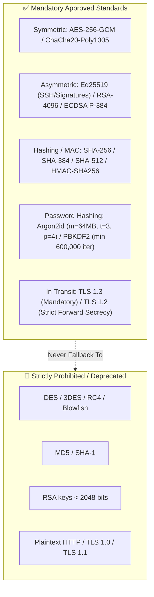
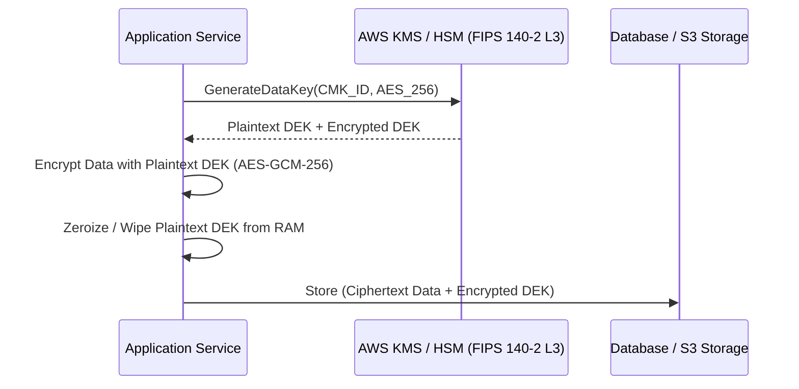

# Cryptography & Key Management Policy

> **Security Standard & Cryptographic Baseline**  
> **Audience:** Architects, Software Engineers, DevOps/SREs, Cryptographers, CISO  
> **Target Standard:** NIST SP 800-57 (Key Management), NIST SP 800-175B, FIPS 140-2 / 140-3, PCI DSS Req 3 & 4

---

## 1. Cryptographic Algorithms Baseline

All systems, APIs, microservices, databases, and message brokers must strictly adhere to the approved cryptographic algorithms matrix:

---

## 2. Key Hierarchy & Envelope Encryption Pattern

To protect sensitive datasets at scale without exposing master encryption keys:
1. **Customer Master Key (CMK):** Generated and retained exclusively inside an HSM (AWS KMS / Cloud HSM) certified to **FIPS 140-2 Level 3**. Private key material never leaves the HSM.
2. **Data Encryption Key (DEK):** Generated dynamically by the HSM using the CMK. The plaintext DEK encrypts the data payload (e.g. database column or file).
3. **Encrypted DEK (Ciphertext):** Stored alongside the encrypted ciphertext. Plaintext DEK is wiped from application memory immediately after use.

---

## 3. Key Lifecycle Management & Rotation Cadence

| Key Type | Generation Standard | Storage Mechanism | Mandatory Rotation Cadence |
| :--- | :--- | :--- | :--- |
| **KMS Customer Master Keys (CMK)** | Cloud HSM (FIPS 140-2 Level 3) | AWS KMS / Vault HSM backend | Automated annual (365 days) |
| **TLS / SSL Certificates** | RSA-2048 / ECDSA P-256 | AWS Certificate Manager (ACM) | Automated 90 days (Let's Encrypt / ACM) |
| **SSH Host & Developer Keys** | Ed25519 (`ssh-keygen -t ed25519`) | Hardware Security Keys (YubiKey) | Semi-annual (180 days) |
| **Database Encryption Keys** | AES-256 | AWS KMS Customer Managed | Automated annual |
| **JWT Signing Keys** | Ed25519 / RS256 | JWKS endpoint with automated rotation | 90 days (with 7-day dual-verification window) |

---

## 4. Cryptographic Erasure ("Crypto-Shredding") for GDPR

When a customer exercises their **Right to be Forgotten (GDPR Art. 17)** or contract termination requires immediate data purging:
1. If data is commingled in immutable backups or multi-tenant tables, standard SQL `DELETE` does not purge historical snapshots immediately.
2. **Crypto-Shredding Protocol:**
   - Every tenant or user has a unique user-level encryption key (UEK) managed in KMS or Vault.
   - Upon receiving an erasure request, the user's UEK is permanently destroyed from the key store.
   - Without the UEK, all historical database rows and immutable backup snapshots become mathematically irrecoverable ciphertext, satisfying legal erasure requirements immediately.

---

## 5. Pre-Deployment Cryptographic Verification Checklist

- [ ] All public endpoints strictly enforce TLS 1.3 (or TLS 1.2 with forward secrecy cipher suites).
- [ ] No weak ciphers (`RC4`, `3DES`, `CBC` mode ciphers) enabled on load balancers.
- [ ] Passwords stored using Argon2id or bcrypt (cost factor ≥ 12); raw MD5/SHA-256 hashing strictly blocked.
- [ ] Database storage encrypted using customer-managed keys (CMK), not default shared keys.
- [ ] Encryption keys cataloged in the [Cryptographic Inventory Matrix](../../templates/CRYPTOGRAPHIC_INVENTORY_AND_KEY_MANAGEMENT_PLAN.md).
