# Secrets Management & Data Loss Prevention (DLP) Policy

> **Security Standard & Operational Procedure**  
> **Audience:** All Developers, DevOps Engineers, Cloud Architects, Security Officers  
> **Objective:** Guarantee zero plaintext credentials in source control, enforce automated credential rotation, and define an emergency response protocol for compromised secrets.

---

## 1. Zero Plaintext Secret Rule

> [!CAUTION]
> **Strict Absolute Prohibition:** Storing database passwords, API tokens, private keys, client secrets, or sensitive certificates in source code, configuration files, environment files (`.env`), or Git history is strictly prohibited.

```mermaid
flowchart LR
    Dev["Developer Terminal"]
    PreCommit["Pre-Commit Hook<br/>(Gitleaks / detect-secrets)"]
    GitHub["Remote GitHub Repo"]
    SecretManager["AWS Secrets Manager / Vault"]
    App["Production Container Runtime"]

    Dev -- "git commit" --> PreCommit
    PreCommit -- "Blocked if Secret Detected" --> Dev
    PreCommit -- "Clean Commit Allowed" --> GitHub
    GitHub -- "Deploy via OIDC (No Static AWS Keys)" --> App
    App -- "Fetch Credential at Runtime" --> SecretManager
```



---

## 2. Secrets Management Hierarchy & Injection Standards

| Secret Classification | Storage Standard | Injection Mechanism | Rotation Cadence |
| :--- | :--- | :--- | :--- |
| **Cloud Provider Credentials** | AWS IAM Roles / Workload Identity | OpenID Connect (OIDC) federation with GitHub Actions / Kubernetes IRSA | Ephemeral (1 hour token validity) |
| **Database Passwords** | AWS Secrets Manager / HashiCorp Vault | External Secrets Operator (ESO) synced directly to Kubernetes in-memory secrets | Automated 60–90 days |
| **Third-Party API Keys** | AWS Secrets Manager | Injected as environment variables at container launch via ECS/K8s task definition | Automated 90 days |
| **Client TLS / SSL Certs** | AWS Certificate Manager (ACM) | Attached directly to Application Load Balancers (ALBs) | Automated auto-renewal via DNS validation |

---

## 3. Automated Local Pre-Commit Enforcement

All developer workstations must execute the automated secret scan hook prior to creating Git commits:

```bash
# Verify Gitleaks local scanner
gitleaks detect --source . --verbose

# Pre-commit hook definition (.pre-commit-config.yaml)
repos:
  - repo: https://github.com/gitleaks/gitleaks
    rev: v8.18.2
    hooks:
      - id: gitleaks
```

Our unified `./scripts/sdlc-cli.sh hooks` script installs this protection automatically into `.git/hooks/pre-commit`.

---

## 4. Emergency Credential Compromise SOP (The 4-Step Playbook)

If an API key, database credential, or token is accidentally committed to a repository (even if unpushed or immediately deleted in a subsequent commit):

### Step 1: Immediate Revocation (Killswitch) — `< 15 Minutes`
- **Do NOT merely delete the commit or force-push.** Assume the credential has already been scraped by automated botnets.
- Log in to the issuing service (e.g. AWS Console, Stripe Dashboard, GitHub Settings) and immediately **revoke/deactivate** the specific key.

### Step 2: Invalidate Sessions & Audit Logs — `< 30 Minutes`
- Query cloud audit logs (AWS CloudTrail, Datadog SIEM, Google Cloud Audit Logs) for the compromised Access Key ID:
  ```bash
  aws cloudtrail lookup-events \
    --lookup-attributes AttributeKey=AccessKeyId,AttributeValue=AKIAEXAMPLEKEY \
    --start-time $(date -u -v-2H +%s)
  ```
- Inspect for unauthorized IAM policy alterations, new EC2/S3 resources, or database queries.

### Step 3: Issue New Credentials & Deploy — `< 1 Hour`
- Generate a new secret in AWS Secrets Manager or Vault.
- Trigger an automated rolling deployment of the application workload to pick up the new secret without downtime.

### Step 4: Git History Purge & Post-Mortem — `< 24 Hours`
- Use `git-filter-repo` or BFG Repo-Cleaner to permanently scrub the secret from the repository commit tree and reflog:
  ```bash
  git filter-repo --replace-text <(echo 'compromised_secret_string==>REDACTED')
  git push origin --force --all
  ```
- Complete a formal [Post-Mortem & CAPA Report](../ops/POST_MORTEM_AND_CAPA_GOVERNANCE.md) to document root cause and strengthen pre-commit barriers.
