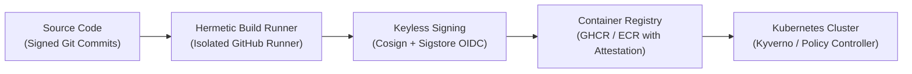

# Supply Chain Security & SLSA Framework Standard

> **Security Standard & Architecture Playbook**  
> **Audience:** DevOps/SREs, Security Engineers, Tech Leads, Cloud Architects  
> **Target Framework:** Google / OpenSSF SLSA (Supply-chain Levels for Software Artifacts) v1.0 & Sigstore

---

## 1. Executive Summary & The Supply Chain Threat Model

Modern software applications consist of up to 80% open-source third-party dependencies and container base images. Attackers target developer pipelines directly through malicious upstream packages, credential hijacking in CI runners, and tampering with built artifacts before deployment.



---

## 2. SLSA Levels 1–3 Implementation Matrix

| SLSA Level | Core Requirement | How We Enforce in CI/CD | Verification Mechanism |
| :--- | :--- | :--- | :--- |
| **SLSA 1** | Build process is automated and produces verifiable provenance. | GitHub Actions workflow compiles the build without manual developer terminal intervention. | Generated SLSA provenance predicate (`attestation.json`). |
| **SLSA 2** | Build runs on a hosted service; provenance is cryptographically signed by the builder. | GitHub Actions OIDC generates keyless Sigstore signatures; runner identity verified. | `cosign verify` validates signer identity against repository workflow. |
| **SLSA 3** | Hardened build platform; hermetic builds prevent network tampering during compilation. | Build environment runs in isolated container; external dependencies pinned by SHA-256 hash. | Build runner cannot mutate workflow parameters; isolated cache. |

---

## 3. Dependency Pinning & Lockfile Integrity

- **Strict Lockfile Check:** Package managers must verify exact dependency hashes. Unpinned ranges (`^`, `~`, `latest`) in lockfiles are blocked in CI.
  ```bash
  # Node.js: Enforce immutable lockfile
  npm ci --ignore-scripts
  
  # Python: Enforce pinned hash verification
  pip install --require-hashes -r requirements.txt
  
  # Go: Enforce module sum verification
  go mod verify
  ```
- **Automated Dependency Auditing:** Dependabot / Snyk triggers daily vulnerability scans; any High/Critical CVE blocks PR merges automatically.

---

## 4. Keyless Container Signing with Cosign & GitHub Actions

We employ **Sigstore Cosign** with GitHub Actions OIDC tokens for keyless cryptographic signing:

```yaml
# .github/workflows/build-and-sign.yml
name: Secure Build, Attest & Sign
on:
  push:
    tags: ['v*']

permissions:
  contents: read
  packages: write
  id-token: write # Required for Sigstore keyless OIDC signing

jobs:
  build-and-sign:
    runs-on: ubuntu-latest
    steps:
      - uses: actions/checkout@v4

      - name: Install Cosign
        uses: sigstore/cosign-installer@v3.5.0

      - name: Build & Push Container Image
        id: build-image
        uses: docker/build-push-action@v5
        with:
          push: true
          tags: ghcr.io/${{ github.repository }}:${{ github.ref_name }}

      - name: Sign Container Image (Keyless OIDC)
        run: |
          cosign sign --yes \
            ghcr.io/${{ github.repository }}:${{ github.ref_name }}

      - name: Generate and Attach SLSA Provenance
        run: |
          cosign attest --yes \
            --predicate <(echo '{"builder":{"id":"https://github.com/'${{ github.repository }}'"}}') \
            --type slsaprovenance \
            ghcr.io/${{ github.repository }}:${{ github.ref_name }}
```

---

## 5. Kubernetes Admission Controller Verification (Zero-Trust Deployments)

In production Kubernetes clusters, the admission controller (Kyverno or Sigstore Policy Controller) blocks any container image that lacks a valid signature from our repository:

```yaml
# kyverno-verify-signature.yaml
apiVersion: kyverno.io/v1
kind: ClusterPolicy
metadata:
  name: verify-image-signature
spec:
  validationFailureAction: Enforce
  rules:
    - name: verify-signature-rule
      match:
        resources:
          kinds:
            - Pod
      verifyImages:
        - imageReferences:
            - "ghcr.io/my-org/*"
          attestors:
            - entries:
                - keyless:
                    issuer: "https://token.actions.githubusercontent.com"
                    subject: "https://github.com/my-org/my-app/.github/workflows/build-and-sign.yml@refs/heads/main"
```

Any untrusted, unsigned, or tampered image is immediately rejected at the Kubernetes API level with an explicit admission error.

