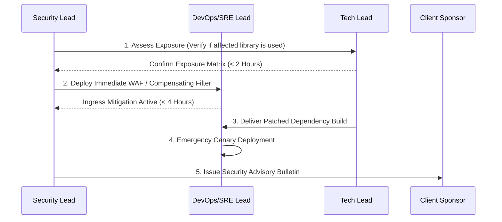

# Vulnerability Management & Responsible Disclosure SOP

| Policy Metadata | Details |
|---|---|
| **Document Owner** | Cloud Security Lead / DevSecOps |
| **Applicability** | All microservices, libraries, prototypes, and client deliverables |
| **Review Cadence** | Quarterly |
| **Classification** | Public / Client Accessible |

---

## 1. Vulnerability Severity Tiers & Remediation SLAs

All discovered vulnerabilities (via automated SAST/SCA scanners, pen-testing, or client security audits) must be remediated within the following strict Service Level Agreements:

| Severity (CVSS v3) | CVSS Score Range | Examples | Remediation SLA (Production) | Remediation SLA (Active Sprint) |
|---|---|---|---|---|
| **Critical** | 9.0 - 10.0 | Remote Code Execution (RCE), unauthenticated SQL injection, exposed root keys | **< 24 Hours** | Immediate Hotfix |
| **High** | 7.0 - 8.9 | Privilege escalation, broken authentication (BOLA/IDOR), stored XSS | **< 7 Days** | Current Sprint |
| **Medium** | 4.0 - 6.9 | CSRF on non-sensitive state, missing rate limits, permissive CORS | **< 30 Days** | Next Sprint Backlog |
| **Low** | 0.1 - 3.9 | Informational headers, verbose error messages, software version disclosure | **< 90 Days** | Backlog Triage |

---

## 2. Automated Vulnerability Scanning in CI/CD Pipeline

To ensure vulnerabilities are caught before client UAT:
1. **Static Application Security Testing (SAST):**
   - Scans proprietary code on every Pull Request using SonarQube / Semgrep / CodeQL.
   - PR builds fail automatically if any new Critical/High vulnerability is detected.
2. **Software Composition Analysis (SCA):**
   - Snyk / Dependabot runs continuous checks on all third-party dependencies (`package.json`, `requirements.txt`, `go.mod`).
   - Automated PRs are submitted within 12 hours of an upstream security advisory.
3. **Container Image Scanning:**
   - Docker container images scanned via Trivy during build before pushing to Amazon ECR.

---

## 3. Incident Response Protocol for Zero-Day Disclosures

When a zero-day vulnerability affecting our stack is publicly disclosed (e.g., Log4Shell, OpenSSL flaw):

---

## 4. Responsible Disclosure Policy
If external researchers or clients discover a potential security flaw:
- **Contact:** `security@company.com`
- **PGP Encryption Key:** Key ID `0x948172BC` available on key servers.
- **Commitment:** We acknowledge receipt within **24 hours** and provide status updates every **48 hours** until full resolution.

