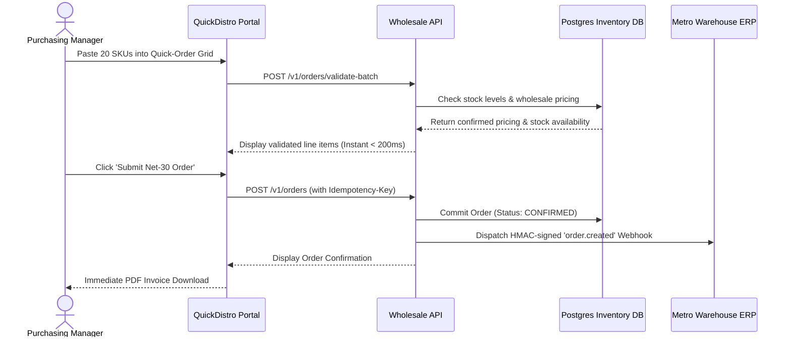

# Product Requirements Document (PRD)

| Metadata | Details |
|---|---|
| **Project Name** | QuickDistro - B2B Wholesale Portal |
| **Product Owner** | Sarah Jenkins (s.jenkins@distrocorp.com) |
| **Technical Lead** | Alex Rivera (a.rivera@engineering.io) |
| **Client / Stakeholder** | Metro Wholesale Distribution Network |
| **Status** | `Approved (Signed Off)` |
| **Target Release Date** | 2026-12-15 |
| **Last Updated** | 2026-11-10 |

---

## 1. Executive Summary & Problem Statement
- **Problem Statement:** Metro Wholesale's 2,500 retail partners currently place weekly stock replenishment orders via phone calls, fragmented emails, and manual PDF order forms. This manual process causes a 12% order entry error rate, delays warehouse fulfillment by up to 36 hours, and costs over $18,000/month in manual order clerical labor.
- **Target Audience / Personas:**
  1. *Retail Store Purchasing Managers:* Ordering bulk stock weekly under tight schedule constraints.
  2. *Metro Warehouse Dispatchers:* Approving fulfillment batches and generating pick-lists.
- **Value Proposition & Business Goals:**
  - Reduce average order placement time from 25 minutes to under 3 minutes via rapid CSV/SKU quick-order entry.
  - Eliminate clerical data-entry errors by integrating directly with Metro's warehouse inventory database.
  - Achieve 90% digital order adoption across the top 500 retail partners within 60 days of launch.

---

## 2. Project Scope (MoSCoW Framework)

### 2.1 Must-Have (P0 - MVP Scope for Dec 15 Release)
- [x] **REQ-001 (Wholesale SKU Quick-Order):** Bulk SKU-and-quantity entry grid allowing purchasers to add up to 50 items simultaneously with real-time stock availability verification.
- [x] **REQ-002 (Idempotent Checkout & Credit Terms):** Net-30 enterprise credit line checkout with idempotency key protection against duplicate order submission.
- [x] **REQ-003 (Warehouse Webhook Dispatch):** Outbound HMAC-signed webhook event sent to Metro's legacy ERP upon order confirmation.
- [x] **REQ-004 (CSV Order Import):** Upload standard distributor CSV template with auto-column matching and instant line-item error validation.

### 2.2 Should-Have (P1 - Fast Follow v1.1)
- [ ] **REQ-005 (Back-In-Stock SMS Alerts):** Automated Twilio SMS trigger when an out-of-stock SKU replenishes.
- [ ] **REQ-006 (One-Click Reorder):** Re-populate cart directly from prior month's invoice.

### 2.3 Could-Have (P2 - Backlog)
- [ ] **REQ-007 (Custom Volume Discounts):** Dynamic tier pricing rules configured per distributor contract tier.

### 2.4 Out of Scope (Explicitly Excluded from MVP)
- Consumer retail credit card checkout (Net-30 invoiced accounts only).
- Native iOS/Android mobile apps (Responsive web application only).
- Direct courier dispatch label printing (Handled by existing warehouse WMS).

---

## 3. User Personas & Core User Journeys

### Persona: Marcus Vance (Independent Supermarket Purchasing Lead)
- **Context:** Places weekly inventory orders worth $15,000–$35,000 every Monday morning across 80+ distinct SKUs.
- **Goal:** Rapid bulk SKU entry without clicking through multiple catalog product pages.

### Primary User Flow (Step-by-Step)


---

## 4. Functional Requirements & Acceptance Criteria (Gherkin Format)

### Feature 1: Bulk SKU Quick-Order Entry
```gherkin
Scenario: Successful bulk SKU addition
  Given an authenticated retail distributor with credit status "ACTIVE"
  When the user pastes 10 valid SKUs with quantities into the quick-order grid
  And clicks "Validate Order Items"
  Then the system displays the unit price, line totals, and stock status for all 10 items
  And calculates the aggregate wholesale invoice total within 500 milliseconds

Scenario: Out of stock SKU validation
  Given a SKU has zero remaining inventory in the warehouse
  When the user adds this SKU to the quick-order grid
  Then the line item displays an amber warning "Backorder Available (Ships in 5 Days)"
  And prevents submission unless the user toggles "Allow Split Shipment"
```

---

## 5. Non-Functional Requirements (NFRs)

| Attribute | Specification | Measurement Target |
|---|---|---|
| **API Latency** | Bulk SKU validation (50 items) | p95 < 250ms under 200 concurrent users |
| **Availability** | Production uptime | >= 99.5% during business hours (06:00 - 20:00 EST) |
| **Security** | Authentication & Encryption | JWT RS256, TLS 1.3 in-transit, AES-256 at-rest |
| **Compliance** | Accounting Auditability | Immutable append-only audit trail for all order state transitions |
| **Disaster Recovery** | Point-in-Time Recovery | RTO < 30 mins, RPO < 5 mins |

---

## 6. Approvals & Stage Gate 0 Sign-Off

| Stakeholder Role | Name | Status | Date |
|---|---|---|---|
| **Product Owner** | Sarah Jenkins | Approved | 2026-11-10 |
| **Technical Lead** | Alex Rivera | Approved | 2026-11-10 |
| **Client Executive Sponsor** | David Chen (VP Operations, Metro Wholesale) | Approved (Signed SOW attached) | 2026-11-10 |
