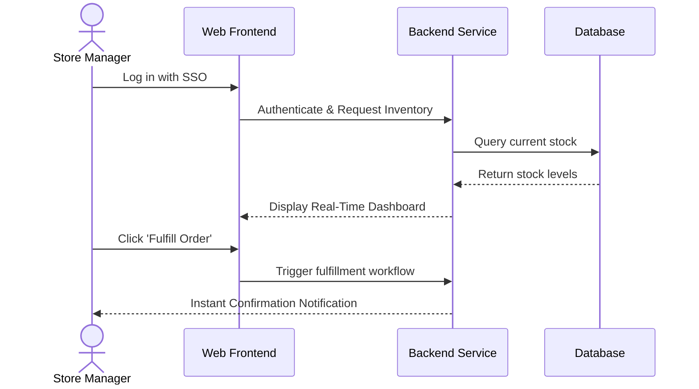

# Product Requirements Document (PRD)

| Metadata | Details |
|---|---|
| **Project Name** | [Project / Prototype Name] |
| **Product Owner** | [Name / Email] |
| **Technical Lead** | [Name / Email] |
| **Client / Stakeholder** | [Client Name / Organization] |
| **Status** | `Draft` \| `In Review` \| `Approved` \| `Deprecated` |
| **Target Release Date** | YYYY-MM-DD |
| **Last Updated** | YYYY-MM-DD |

---

## 1. Executive Summary & Problem Statement
- **Problem Statement:** What specific problem or pain point does this product/prototype solve?
- **Target Audience / Personas:** Who is using this product (e.g., End-Consumer, Operations Admin, Corporate Analyst)?
- **Value Proposition & Business Goals:** What measurable business outcome is expected (e.g., reduce manual effort by 60%, achieve 5,000 monthly active users)?

---

## 2. Project Scope (MoSCoW Framework)

### 2.1 Must-Have (P0 - Prototype / MVP Minimum Scope)
*Features required for product to function and receive client sign-off:*
- [ ] **REQ-001:** [Feature description with expected user journey]
- [ ] **REQ-002:** [Feature description with expected user journey]

### 2.2 Should-Have (P1 - High Value for Fast Follow-Up)
*Important features that can be worked around if time is constrained:*
- [ ] **REQ-003:** [Feature description]

### 2.3 Could-Have (P2 - Nice to Have)
*Features to include only if time and budget permit:*
- [ ] **REQ-004:** [Feature description]

### 2.4 Out of Scope (Won't Have in this Milestone)
*Explicitly excluded to protect timeline and prevent scope creep:*
- [Feature X: e.g., Multi-currency support, custom theme builder]

---

## 3. User Personas & Core User Journeys

### Persona A: [e.g., Store Manager]
- **Role & Goals:** Needs to see inventory in real time and fulfill orders rapidly.
- **Pain Points:** Current manual entry causes 15% error rate.

### Primary User Flow (Step-by-Step)


---

## 4. Functional Requirements & Acceptance Criteria (Gherkin Format)

### Feature 1: [Feature Title]
**Description:** As a `[Persona]`, I want to `[Action]`, so that `[Benefit]`.

**Acceptance Criteria:**
```gherkin
Scenario: Successful login and dashboard retrieval
  Given a user with role "Store Manager" has valid credentials
  When the user submits the login form
  Then the system issues a secure JWT token
  And redirects the user to the "/dashboard" route
  And displays the inventory summary within 1.5 seconds

Scenario: Invalid credentials
  Given a user enters an incorrect password
  When the user submits the login form
  Then an error message "Invalid credentials provided" is shown
  And the account is locked after 5 consecutive failed attempts
```

---

## 5. Non-Functional Requirements (NFRs)

| Category | Requirement Specification | Measurement Metric |
|---|---|---|
| **Performance** | API endpoint response time | 95% of requests < 300ms under 500 concurrent users |
| **Availability** | Production uptime | >= 99.9% excluding scheduled maintenance |
| **Security** | Authentication & Encryption | OAuth 2.0 / OIDC, TLS 1.3 in-transit, AES-256 at-rest |
| **Compliance** | Data protection | GDPR / SOC 2 Type II compliance |
| **Scalability** | Peak load handling | System automatically scales up at 70% CPU/Memory threshold |
| **Observability** | Centralized logging & tracing | All logs exported as structured JSON with correlation IDs |

---

## 6. Assumptions, Risks & Dependencies
- **Assumptions:** Client will provide test API credentials for Third-Party Service X by Week 2.
- **Risks & Mitigation:**
  - *Risk:* External SMS gateway rate limiting during peak hours.
  - *Mitigation:* Implement asynchronous queue (SQS / RabbitMQ) with exponential backoff.
- **Dependencies:** Integration with client's Active Directory (Azure AD).

---

## 7. Sign-Off & Approvals

| Stakeholder Role | Name | Signature / Approval Status | Date |
|---|---|---|---|
| **Product Manager** | | [Approved / Pending] | YYYY-MM-DD |
| **Technical Lead** | | [Approved / Pending] | YYYY-MM-DD |
| **Client Sponsor** | | [Approved / Pending] | YYYY-MM-DD |
| **Operations Lead** | | [Approved / Pending] | YYYY-MM-DD |

