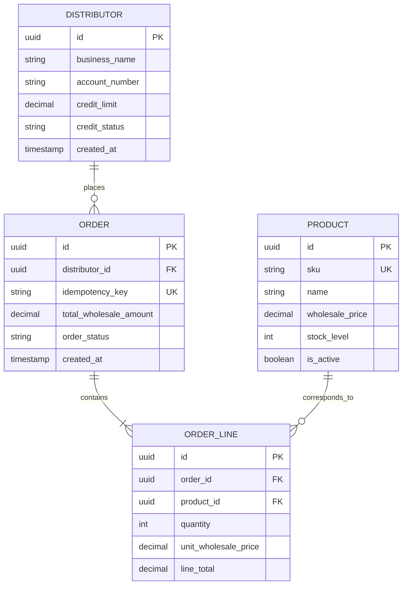

# System Architecture Document (SAD)
## QuickDistro B2B Wholesale Portal - Technical Specification

| Architecture Metadata | Details |
|---|---|
| **System Name** | QuickDistro Backend & Web App |
| **System Architect** | Alex Rivera (Lead Solutions Architect) |
| **Version** | 1.0 (Production Candidate) |
| **Target Cloud** | AWS (us-east-1) / Docker Containers on ECS Fargate |
| **Stage Gate Alignment** | Gate 1 (Architecture & Security Review) |
| **Approval Date** | 2026-11-10 |

---

## 1. Architectural Strategy & Design Principles
1. **Contract-First API:** The OpenAPI 3.0 specification (`docs/api/openapi.yaml`) defines all endpoints before code is written, enabling frontend and ERP teams to develop concurrently against Prism mock servers.
2. **Idempotent Order Ingress:** All write endpoints require client-generated UUID `Idempotency-Key` headers stored in Redis with 24-hour TTL to prevent double billing or duplicate order placement.
3. **Stateless Compute:** Backend microservices run as containerized stateless tasks on AWS ECS Fargate, scaling horizontally based on CPU/memory utilization.
4. **Resilient Outbound Webhooks:** Webhooks to Metro's legacy ERP are queued in AWS SQS with exponential backoff and Dead Letter Queue (DLQ) safeguards.

---

## 2. System Context & Container Architecture (C4 Model)

```mermaid
graph TD
    Client["Retail Purchasing Manager (Web Browser)"] -->|HTTPS / TLS 1.3| CDN["CloudFront Edge / WAF"]
    CDN --> ALB["AWS Application Load Balancer"]
    
    subgraph VPC Private Subnet (10.0.0.0/16)
        ALB --> API_Tasks["Wholesale API Service (FastAPI / Python 3.12)"]
        API_Tasks --> RedisCluster[("ElastiCache Redis 7 (Session, Cache, Idempotency)")]
        API_Tasks --> RDS_Master[("RDS Aurora PostgreSQL 16 (Multi-AZ)")]
        RDS_Master -.-> RDS_Replica[("Read Replica (Catalog Queries)")]
        API_Tasks --> SQS_Queue["AWS SQS (Webhook Event Queue)"]
        SQS_Queue --> DispatchWorker["Background Dispatch Worker"]
    end

    subgraph External Client Infrastructure
        DispatchWorker -->|HMAC-SHA256 Signed HTTP POST| MetroERP["Metro Legacy Warehouse ERP"]
    end
```

---

## 3. Database Schema Design (PostgreSQL 16)



---

## 4. Security & Compliance Controls
- **Authentication:** JWT Bearer tokens signed with RS256 private keys; 15-minute expiration; rotated refresh tokens stored in HttpOnly cookies.
- **Tenant Data Isolation:** PostgreSQL Row-Level Security (RLS) ensures distributors can only query orders matching their authenticated `distributor_id`.
- **Secrets Management:** Zero secrets in code or git; database credentials and webhook signing keys injected at container runtime via AWS Secrets Manager.
- **Audit Logging:** Append-only table `order_audit_events` records timestamp, user ID, IP address, and old/new status for all order modifications.

---

## 5. Operations Telemetry & Target SLOs
- **Target Availability:** 99.5% uptime during business hours.
- **Target Latency:** p95 < 250ms for SKU verification queries.
- **Health Probes:**
  - `GET /health/live`: Process responsive (returns 200 OK).
  - `GET /health/ready`: Database pool and Redis cluster connected (returns 200 OK).
- **Log Format:** Single-line structured JSON logs including `trace_id`, `request_id`, `distributor_id`, and `duration_ms`.
