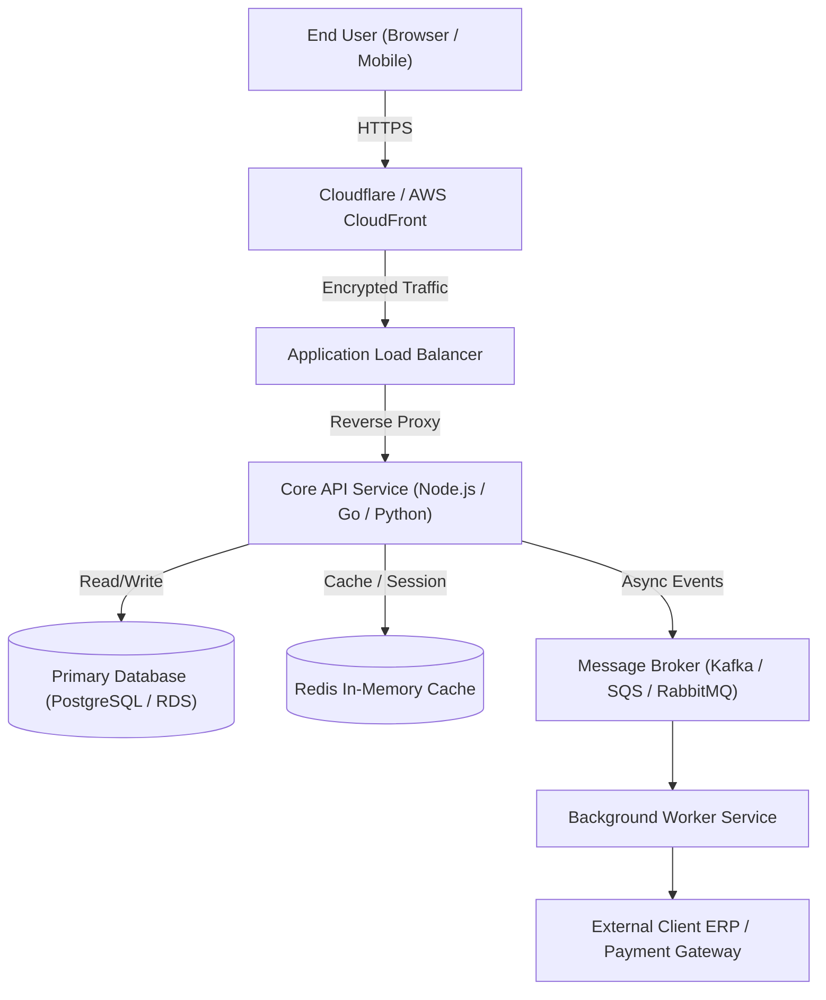
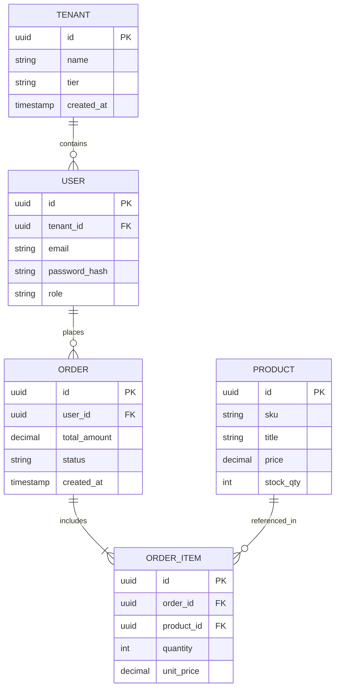

# System Architecture Document (SAD)
## High-Level & Low-Level Technical Specification

| Document Metadata | Value |
|---|---|
| **System Name** | [System / Service Name] |
| **Architect / Author** | [Lead Architect / Tech Lead] |
| **Version** | 1.0 |
| **Status** | `Draft` \| `Under Review` \| `Approved` |
| **Target Infrastructure** | [AWS / GCP / Azure / Kubernetes / On-Premise] |
| **Last Reviewed Date** | YYYY-MM-DD |

---

## 1. Architectural Principles & Tenets
1. **Cloud-Native & Modular:** Loosely coupled services designed for horizontal scalability and independent containerized deployment.
2. **Security by Design:** Zero-trust network segmentation, least-privilege IAM, all traffic encrypted in-transit (TLS 1.3) and at-rest (AES-256).
3. **Observability First:** Standardized structured JSON logging, distributed tracing (OpenTelemetry), and unified telemetry exports.
4. **Documentation as Code:** System models and API contracts defined in version control.

---

## 2. High-Level Architecture (C4 Model: System Context & Containers)

### 2.1 System Context Diagram (Level 1)

### 2.2 Container & Technology Stack Breakdown (Level 2)

| Tier / Component | Technology Selected | Rationale | Scaling Strategy |
|---|---|---|---|
| **Frontend Application** | Next.js / React, Tailwind CSS | Fast SSR/SSG rendering, SEO-friendly, component reusability | Hosted on Vercel / CloudFront edge nodes |
| **API Gateway / Core Backend** | Node.js (Fastify/NestJS) or Go | High I/O throughput, low latency, robust async ecosystem | Auto-scaled container tasks (ECS/EKS) 2-10 instances |
| **Primary Relational DB** | PostgreSQL 16 (AWS RDS Multi-AZ) | ACID compliance, robust JSONB support, row-level security | Read replicas + automated connection pooling (PgBouncer) |
| **Caching & Fast Session** | Redis 7 Cluster | Sub-millisecond latency for session state & query caching | Redis Sentinel / Cluster auto-failover |
| **Event Bus / Worker** | AWS SQS / RabbitMQ + Celery/BullMQ | Decouple heavy async processing from client request loop | Auto-scale workers based on Queue Depth |

---

## 3. Data Architecture & Schema Design (LLD)

### 3.1 Entity-Relationship Overview

### 3.2 Data Privacy & Retention
- **PII Storage:** Passwords hashed via Argon2id. Sensitive customer data (e.g., tax IDs, phone numbers) encrypted at application layer before persistence.
- **Backup & Retention Policy:** Automated hourly WAL snapshots; daily full snapshots retained for 30 days with automated cross-region replication for disaster recovery.

---

## 4. Security Architecture & Network Boundaries
- **Network Isolation:** Public subnet hosts ALB only. API pods and Databases reside in strict Private Subnets with no direct internet ingress. Outbound traffic routed through NAT Gateway.
- **Authentication & Authorization:** JWT tokens signed with RS256 private keys; Role-Based Access Control (RBAC) enforced via declarative route guards.
- **Secrets Management:** Zero environment variables containing raw credentials in git. Injected at container runtime via AWS Secrets Manager or HashiCorp Vault.

---

## 5. Non-Functional Specifications & Operations Telemetry
- **Target SLO:** 99.9% availability, < 250ms p95 latency.
- **Health Checks:**
  - Liveness probe: `GET /health/live` (Checks process responding)
  - Readiness probe: `GET /health/ready` (Verifies DB connection, Redis pool, downstream dependencies)
- **Log Standard:** JSON structured logging with fields: `timestamp`, `level`, `trace_id`, `span_id`, `service`, `message`, `http_status`.

---

## 6. Architecture Review & Sign-Off

| Reviewer Role | Name | Feedback / Decision | Date |
|---|---|---|---|
| **Enterprise / Lead Architect** | | Approved | YYYY-MM-DD |
| **Lead DevOps / SRE Engineer** | | Approved | YYYY-MM-DD |
| **Security Officer / CISO** | | Approved | YYYY-MM-DD |
| **Client Technical Lead** | | Approved | YYYY-MM-DD |

