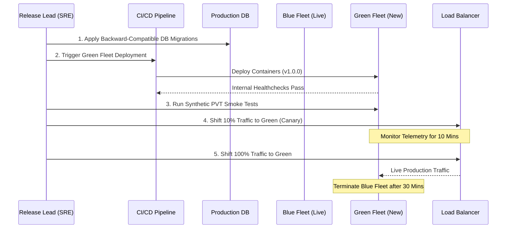

# Production Deployment & Rollback Guide

| Deployment Details | Value |
|---|---|
| **Release Version** | v[1.0.0] |
| **Release Coordinator** | [DevOps Lead / SRE] |
| **Tech Lead** | [Name] |
| **Scheduled Window** | YYYY-MM-DD HH:MM to HH:MM UTC |
| **Expected Downtime** | Zero Downtime (Blue/Green or Rolling Deployment) |
| **Communication War Room**| `#release-war-room` (Slack) / Zoom Link |

---

## 1. Pre-Deployment Checklist (T-2 Hours)

- [ ] **Gate 3 Approved:** Client UAT Sign-off certificate is signed and verified.
- [ ] **Release Branch Tagged:** Git tag `v1.0.0` pushed with signed commit.
- [ ] **Database Migration Dry-Run:** Migrations executed against staging replica; runtime verified to be < 60 seconds.
- [ ] **Secrets & Config Verified:** All required environment variables exist in Production Secrets Manager.
- [ ] **Stakeholder Notification:** Client, Support Desk, and Executive team notified of maintenance window.
- [ ] **On-Call Standby:** SRE, DBA, and Lead Backend Engineer present on the release call.

---

## 2. Step-by-Step Deployment Procedure



### Step 2.1: Database Migrations (Expand Phase)
*All database migrations must follow the Expand/Contract pattern so current running pods do not crash.*
```bash
# Run migration runner task
kubectl create job --from=cronjob/db-migrator db-migrate-v100 -n production
# Verify migration logs
kubectl logs job/db-migrate-v100 -n production --follow
```

### Step 2.2: Deploy Canary / Green Fleet
```bash
# Update image tag to v1.0.0
helm upgrade --install core-api ./charts/core-api \
    --namespace production \
    --set image.tag=v1.0.0 \
    --set canary.enabled=true \
    --set canary.weight=10
```

### Step 2.3: Production Verification Testing (PVT)
Run automated synthetic test suite against canary:
```bash
npm run test:pvt -- --env=production --target=canary
```
- [ ] Status code 200 on all core endpoints.
- [ ] Auth tokens validate properly.
- [ ] Synthetic order completed and immediately refunded.

### Step 2.4: Full Cutover
If canary metrics (error rate < 0.1%, latency p95 < 250ms) are healthy for 10 minutes:
```bash
helm upgrade --install core-api ./charts/core-api \
    --namespace production \
    --set image.tag=v1.0.0 \
    --set canary.enabled=false
```

---

## 3. Rollback Strategy & Abort Criteria

### 3.1 Objective Rollback Triggers (Immediate Abort)
Any ONE of the following conditions triggers an automatic and immediate rollback:
1. HTTP 5xx error rate exceeds **1.0%** of total traffic for **2 consecutive minutes**.
2. Service p95 latency spikes above **1,500ms**.
3. Database connection pool reaches **100% utilization**.
4. Critical PVT smoke test scenario fails (e.g., checkout or login completely blocked).

### 3.2 Rollback Execution Steps (< 3 Minutes)
```bash
# 1. Immediately revert Load Balancer traffic back to Blue fleet (previous release v0.9.9)
helm rollback core-api <PREVIOUS_REVISION_NUMBER> --namespace production

# 2. Verify previous pods are receiving traffic and healthy
kubectl get pods -n production -l app=core-api

# 3. If a DB rollback is strictly necessary (only if contract was broken):
kubectl create job --from=cronjob/db-rollback db-rollback-v100 -n production

# 4. Notify release war room of rollback
```

---

## 4. Post-Deployment Verification & Sign-Off (T+30 Mins)
- [ ] Real customer traffic flowing without elevated error rates.
- [ ] Background worker queues processing without lag.
- [ ] Datadog/CloudWatch APM dashboards green.
- [ ] Client Account Manager informed that deployment succeeded.
- [ ] Release War Room closed.

