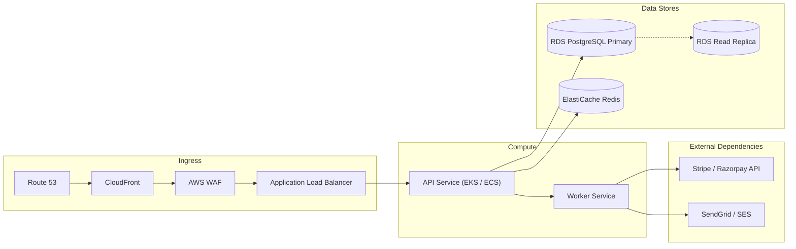

# Production Operations Runbook (Day-2 Playbook)

| Service Metadata | Details |
|---|---|
| **System / Service Name** | [System / Service Name] |
| **Tier / Criticality** | Tier 1 (Business Critical) |
| **Owner Team** | [SRE / Cloud Operations Team] |
| **Escalation Email / Slack** | `#ops-alerts` \| `ops-oncall@company.com` |
| **Primary Cloud Provider** | AWS (us-east-1) / Kubernetes |
| **Last Updated** | YYYY-MM-DD |

---

## 1. System Topology & Service Dependencies



### Key Service Contacts & Repositories:
- **Application Repo:** `https://github.com/organization/core-api`
- **Infrastructure as Code (Terraform):** `https://github.com/organization/infra-terraform`
- **Secrets Store:** AWS Secrets Manager (`prod/core-api/credentials`)
- **Container Registry:** Amazon ECR (`123456789.dkr.ecr.us-east-1.amazonaws.com/core-api`)

---

## 2. Health Check, Monitoring & Observability Endpoints

| Purpose | URL / Tool | Access Method | Expected Response / Status |
|---|---|---|---|
| **Liveness Check** | `GET https://api.domain.com/health/live` | Public / Pingdom | HTTP 200 `{"status": "ok"}` |
| **Readiness Check** | `GET https://api.domain.com/health/ready` | Internal VPC only | HTTP 200 `{"db": "connected", "redis": "connected"}` |
| **Central Dashboard** | `https://app.datadoghq.com/dashboard/xyz` | SSO Required | Real-time traffic, error rate, p95 latency |
| **Log Search** | `https://kibana.internal.net` / Datadog Logs | Cloud VPN | Structured logs filtered by `service:core-api` |
| **APM & Tracing** | `https://grafana.internal.net/explore` | Cloud VPN | OpenTelemetry distributed traces |

---

## 3. High-Priority Alert Thresholds & Automatic Triggers

| Alert Name | Condition | Severity | Notification Channel | Auto-Remediation |
|---|---|---|---|---|
| **HighErrorRate5xx** | HTTP 5xx > 1% of total traffic for 3 mins | P1 (Critical) | PagerDuty On-Call (Voice/SMS) | None (Requires investigation) |
| **HighP95Latency** | Latency p95 > 1000ms for 5 mins | P2 (Major) | Slack `#ops-alerts` + PagerDuty | Auto-scales +2 container tasks |
| **DBConnectionExhaustion**| Active DB pool > 85% capacity for 3 mins | P1 (Critical) | PagerDuty On-Call | None (Inspect slow queries) |
| **QueueBacklogGrowing** | Worker Queue Depth > 10,000 items | P2 (Major) | Slack `#ops-alerts` | Auto-scale worker pods to max 10 |
| **DiskUsageHigh** | EBS Volume usage > 80% | P3 (Minor) | Slack `#ops-alerts` | Terraform auto-expand volume |

---

## 4. Routine Maintenance & Standard Operating Procedures (SOPs)

### SOP-01: Rotating Application Secrets & API Keys
1. Generate new API secret in Third-Party Provider portal.
2. Update key in AWS Secrets Manager:
   ```bash
   aws secretsmanager update-secret --secret-id prod/core-api/credentials \
       --secret-string file://new_secrets.json
   ```
3. Trigger rolling restart of API container tasks to load new values:
   ```bash
   aws ecs update-service --cluster prod-cluster --service api-service --force-new-deployment
   ```
4. Verify `/health/ready` returns 200 and application logs confirm successful initialization.

### SOP-02: Flushing Application Cache Safely
*Do NOT execute `FLUSHALL` on production Redis as it causes a cache-stampede database spike.*
Instead, run targeted namespace invalidation:
```bash
redis-cli -h prod-redis.internal -p 6379 --scan --pattern "cache:v1:*" | xargs -L 100 redis-cli -h prod-redis.internal -p 6379 del
```

---

## 5. Backup, Restore & Disaster Recovery (DR)

### 5.1 Backup Policies
- **Database (RDS):** Automated daily snapshots retained for 30 days. Continuous WAL archive for Point-in-Time Recovery (PITR) up to 5 minutes ago.
- **Object Storage (S3):** Versioning enabled with cross-region replication to `us-west-2` bucket.

### 5.2 Point-In-Time Database Restore Procedure (RTO: 30 mins, RPO: 5 mins)
```bash
# 1. Restore snapshot to a new temporary RDS instance
aws rds restore-db-instance-to-point-in-time \
    --source-db-instance-identifier prod-postgres-db \
    --target-db-instance-identifier prod-postgres-restored-temp \
    --restore-time 2026-11-10T11:00:00Z \
    --db-subnet-group-name prod-db-subnets

# 2. Verify data integrity on the restored instance
# 3. Swap DNS CNAME endpoint in Route 53 or update AWS Secrets Manager to point to restored instance
```

---

## 6. Incident Troubleshooting Playbooks (Common Failure Scenarios)

### Playbook A: Spiking 502 / 504 Gateway Errors
1. **Check Container Status:**
   ```bash
   kubectl get pods -n production -l app=core-api
   ```
   *Look for `OOMKilled` or `CrashLoopBackOff`.*
2. **Inspect Memory / OOM:**
   If pods are memory spiking, increase container limit temporarily or scale replicas horizontally:
   ```bash
   kubectl scale deployment core-api --replicas=8 -n production
   ```
3. **Check Downstream Dependencies:**
   Verify if the database is locked or third-party payment gateway is timing out.

### Playbook B: Database Connection Pool Starvation
1. **Identify Long-Running Queries:**
   ```sql
   SELECT pid, now() - pg_stat_activity.query_start AS duration, query, state
   FROM pg_stat_activity
   WHERE state != 'idle' AND (now() - pg_stat_activity.query_start) > interval '10 seconds'
   ORDER BY duration DESC;
   ```
2. **Terminate Hanging Query Safely:**
   ```sql
   SELECT pg_cancel_backend(<pid>);
   -- If unresponsive:
   SELECT pg_terminate_backend(<pid>);
   ```
3. Check application logs for unclosed transactions or missing indexes.

