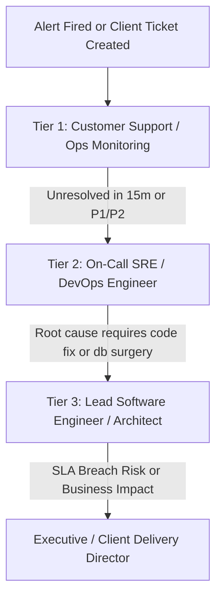

# Incident Management & SLA Escalation Matrix

| Metadata | Details |
|---|---|
| **System / Service** | [System / Service Name] |
| **Effective Date** | YYYY-MM-DD |
| **Document Version** | 1.0 |
| **Primary Contact** | `ops-support@company.com` \| Slack `#incident-management` |

---

## 1. Incident Severity Classification & SLA Commitments

| Severity Level | Definition & Operational Impact | Response Time (24x7) | Target Resolution / Workaround | Client Update Frequency | War Room Required? |
|---|---|---|---|---|---|
| **P1 - Critical** | **Total Outage:** Core service unavailable to all users; severe data loss; critical security breach. | **< 15 Mins** | **< 2 Hours** | Every 30 mins | **YES** (Instant bridge) |
| **P2 - Major** | **Degraded Service:** Core feature failing for subset of users; significant latency; workaround exists. | **< 30 Mins** | **< 4 Hours** | Every 2 hours | Optional |
| **P3 - Minor** | **Partial Defect:** Non-critical feature bug, minor user inconvenience, reporting glitch. | **< 4 Hours** | Next scheduled release / sprint | Weekly | No |
| **P4 - Low** | **General Query:** Documentation typo, minor UI cosmetic flaw, feature request. | **< 24 Hours** | Future backlog triage | Monthly | No |

---

## 2. Escalation Hierarchy & Response Ladder



### Escalation Contact Roster:
- **Tier 1 (Helpdesk / Triage):** Email: `support@domain.com` | Phone: `+1-800-XXX-XXXX`
- **Tier 2 (SRE On-Call):** PagerDuty Schedule: `https://company.pagerduty.com/schedules/ops`
- **Tier 3 (Dev Engineering On-Call):** Slack: `@dev-oncall` | Mobile: Escalated via PagerDuty
- **Executive Incident Commander:** [Name / VP of Engineering / Phone]

---

## 3. Incident Lifecycle Workflow

1. **Detection & Triage:** Incident is detected via automated alert or user report. Incident commander assigned.
2. **Containment & Mitigation:** Prioritize restoring service over finding root cause (e.g., restart service, roll back release, failover to replica, scale up pods).
3. **Resolution:** Service verified healthy via synthetic tests and error telemetry.
4. **Post-Mortem & Remediation:** RCA meeting scheduled within 48 hours for any P1/P2 incident.

---

## 4. Blameless Post-Mortem & RCA Template

Use this template for any P1 or P2 incident:

```markdown
# Incident Post-Mortem: [INC-XXXX] [Brief Description]

| Incident Details | Value |
|---|---|
| **Date of Incident** | YYYY-MM-DD |
| **Severity** | P1 - Critical |
| **Incident Commander** | [Name] |
| **Duration of Outage** | 42 minutes |
| **Impacted Users / Revenue** | ~3,500 checkout sessions / $12,000 delayed orders |

### 1. Executive Summary
Brief non-technical summary of what happened, why it happened, and how it was resolved.

### 2. Timeline (UTC)
- **14:02 UTC:** High 5xx alert triggered in Datadog.
- **14:05 UTC:** Tier 2 on-call engineer paged.
- **14:10 UTC:** War room opened; DB connection pool observed at 100%.
- **14:18 UTC:** Identified un-indexed query from new search feature causing lock contention.
- **14:26 UTC:** Query terminated; temporary index applied in production.
- **14:44 UTC:** DB connections returned to normal (< 25%); error rate dropped to 0%. War room stood down.

### 3. Root Cause Analysis ("5 Whys")
1. *Why did 500 errors spike?* Database exhausted all available connections.
2. *Why did connections exhaust?* Queries on `/api/v1/search` hung for >30 seconds.
3. *Why did they hang?* The query performed a full sequential scan on a 5M row table.
4. *Why was there no index?* The index was missed in the migration script.
5. *Why was it missed?* The PR query review checklist did not require `EXPLAIN ANALYZE` output for new queries.

### 4. Preventative Action Items (Corrective & Preventative Actions - CAPA)
| Action Item | Type | Owner | Target Date | Jira Ticket |
|---|---|---|---|---|
| Enforce `EXPLAIN ANALYZE` check in PR template for queries | Process | Tech Lead | YYYY-MM-DD | DEV-2041 |
| Add DB query statement timeout (max 5s) | Preventative | DBA | YYYY-MM-DD | INFRA-882 |
| Create alerting on query execution time > 2s | Observability | SRE Lead | YYYY-MM-DD | OPS-441 |
```

