# Business Impact Analysis (BIA) & Continuity Profile

> **Document Status:** Operational Resilience Baseline  
> **System Name:** [System Name] &bull; **System Owner:** [Owner Name & Title]  
> **Assigned Criticality Tier:** [ ] Tier 0 (Mission-Critical) &nbsp; [ ] Tier 1 (Core Business) &nbsp; [ ] Tier 2 (Operational Support) &nbsp; [ ] Tier 3 (Non-Urgent)  
> **Target Compliance Standard:** ISO 22301:2019, SOC 2 Type II (CC9.1), FFIEC BCP, NIST SP 800-34  
> **Assessment Date:** YYYY-MM-DD &bull; **Next Review Cadence:** YYYY-MM-DD (Annual)  

---

## 1. System Identification & Business Scope

| System Attribute | System Profile Specifications |
| :--- | :--- |
| **System Name & Code** | [e.g. Core-Transactional-Platform (CTP)] |
| **Business Function Summary** | [Brief summary of primary value proposition, transaction ingress, or user workflows] |
| **Primary User Base** | [ ] B2B Enterprise Clients &nbsp; [ ] Direct Consumers (B2C) &nbsp; [ ] Internal Operations / Backoffice |
| **Peak Transaction Volume** | [e.g. 2,500 req/sec &bull; $500,000 processed hourly] |
| **Estimated Outage Cost** | Direct Loss: **$[Amount]/hour** &bull; Contractual SLA Penalties: **$[Amount]/hour** |

---

## 2. Critical Business Functions (CBFs) & Disruption Impact

Analyze the financial, operational, regulatory, and reputational impact over progressive time increments:

| CBF ID | Critical Business Function | Operational Dependencies | Financial Impact @ 1h | Financial Impact @ 4h | Financial Impact @ 24h | Regulatory / Legal Penalty | Max Tolerable Downtime (MTD) |
| :--- | :--- | :--- | :--- | :--- | :--- | :--- | :--- |
| **CBF-01** | Real-Time Payment Ingress & Order Placement | Aurora RDS, Redis Cache, Stripe API | $50,000 | $250,000 | $2,000,000 | Contractual SLA credits (5% monthly bill) | **2 Hours** |
| **CBF-02** | User Authentication & OAuth Authorization | Auth0 / Okta, DynamoDB Session Store | $20,000 | $100,000 | $800,000 | Customer churn & public SLA breach | **4 Hours** |
| **CBF-03** | Nightly Financial Settlement & Reconciliation | Read Replicas, S3 Export, Batch Worker | $0 (deferred) | $5,000 | $250,000 | Statutory clearing house late-filing fines | **12 Hours** |
| **CBF-04** | Client Analytical Reporting & BI Export | Snowflake Data Warehouse, Metabase | $0 | $0 | $15,000 | Minor customer dissatisfaction (Low) | **48 Hours** |

---

## 3. Recovery Objectives & Technical Validation

Establish and validate mandatory temporal recovery boundaries:

```mermaid
gantt
    title Outage & Recovery Timeline (Tier 1 Target)
    dateFormat  X
    axisFormat %s min

    section Disaster
    Outage Occurs (T=0) :milestone, m1, 0, 0
    Data Loss Window (RPO = 5m) :crit, done, -5, 0

    section Recovery
    Technical Recovery (RTO = 30m) :active, 0, 30
    Work Recovery & Verification (WRT = 30m) :30, 60
    Maximum Tolerable Downtime (MTD = 120m) :crit, 0, 120
```

| Recovery Metric | Target Threshold | Actual Demonstrated Benchmark | Verification Evidence & Method | Technical Strategy & Safeguards |
| :--- | :--- | :--- | :--- | :--- |
| **Recovery Point Objective (RPO)** | **< 5 Minutes** | **1 min 42 sec** | Automated PITR drill via `./scripts/sdlc-cli.sh dr-drill` | Aurora continuous automated storage volume replication across 3 AZs. |
| **Recovery Time Objective (RTO)** | **< 30 Minutes** | **14 min 18 sec** | Standby instance promotion & Route 53 DNS swap drill | Automated CloudWatch synthetic failure detection + multi-AZ warm standby. |
| **Work Recovery Time (WRT)** | **< 30 Minutes** | **18 min 05 sec** | Automated database integrity check & replay queue runner | Idempotent message deduplication in SQS & synthetic PVT smoke validation. |
| **Maximum Tolerable Downtime (MTD)** | **< 2 Hours** | **32 min 23 sec (Total)** | Sum of Actual RTO + Actual WRT | Well within the 120-minute contractual threshold. |

---

## 4. Single Points of Failure (SPOF) & Dependency Resilience

| Component / Third-Party Vendor | Dependency Type | Redundancy Topology | Failover Protocol | Residual Risk / Mitigation |
| :--- | :--- | :--- | :--- | :--- |
| **Primary Relational DB** | Infrastructure | Multi-AZ with synchronous standby | Automated RDS failover (< 60s) | Minor momentary connection drop; application auto-retries. |
| **OpenAI / LLM Provider** | External API | Multi-provider fallback (Claude 3.5 / Gemini) | Automated circuit breaker swap | Fallback prompt formats may yield minor latency variance. |
| **Payment Gateway (Stripe)** | External API | Primary gateway with standby queue | Asynchronous queue with offline capture | Transactions above $5,000 held for retry verification. |
| **Cloud Provider Region (AWS)** | Cloud Platform | Primary `us-east-1`, warm standby `us-west-2` | Manual DNS failover via Route 53 Arc | Cross-region replication egress bandwidth cost ($150/mo). |

---

## 5. Crisis Management Team (CMT) Roster

| CMT Role | Designated Lead | Primary Contact | Secondary Standby Contact |
| :--- | :--- | :--- | :--- |
| **Incident Commander** | VP of Engineering | [Phone / PagerDuty] | Director of Technology |
| **Technical Ops Lead** | DevOps / SRE Lead | [Phone / PagerDuty] | Senior Infrastructure Engineer |
| **Client Communications Lead** | Product Owner / PM | [Phone / Slack] | Customer Success Director |
| **Compliance & Legal Delegate** | CISO / Corporate Counsel | [Phone / Email] | External Legal Counsel |

---

## 6. Executive & Governance Sign-Off

The undersigned executives have evaluated the financial exposure schedules, regulatory requirements, technical architecture recovery metrics, and residual continuity risks. The defined RTO, RPO, and continuity topology are hereby approved.

| Governance Role | Representative Name | Digital Signature | Approval Date |
| :--- | :--- | :--- | :--- |
| **Business Unit Sponsor / Client Sponsor** | [Name] | [Signed] | YYYY-MM-DD |
| **Principal Systems Architect** | [Name] | [Signed] | YYYY-MM-DD |
| **Head of SRE & Operations** | [Name] | [Signed] | YYYY-MM-DD |
| **Chief Information Security Officer (CISO)** | [Name] | [Signed] | YYYY-MM-DD |

---

## 7. Related Framework Standards & Operational Playbooks

- [Business Continuity & BIA Policy](../docs/ops/BUSINESS_CONTINUITY_AND_BIA_POLICY.md)
- [Disaster Recovery & Backup Drill SOP](../docs/ops/DISASTER_RECOVERY_AND_BACKUP_DRILL_SOP.md)
- [Operations Runbook (Day-2 Playbook)](OPERATIONS_RUNBOOK.md)
- [SLO & Error Budget Policy](../docs/ops/SLO_AND_ERROR_BUDGET_POLICY.md)
- [Incident War Room Communications Playbook](../docs/ops/INCIDENT_WAR_ROOM_COMMUNICATIONS_PLAYBOOK.md)
