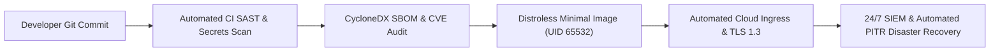

# Client Security Assurance Pack & Due Diligence Dossier

> **Document Status:** Client-Auditable Security Attestation  
> **Platform / Service Name:** [System Name] &bull; **Target Client:** [Enterprise Client Name]  
> **Chief Information Security Officer (CISO):** [CISO Name] &bull; **Lead Architect:** [Architect Name]  
> **Audited Standards:** SOC 2 Type II, ISO/IEC 27001:2022, GDPR, HIPAA Security Rule, PCI DSS v4.0  
> **Attestation Date:** YYYY-MM-DD &bull; **Validity Period:** 12 Months  

---

## 1. Executive Security Attestation

To the Information Security & Vendor Risk Assessment Team of **[Enterprise Client Name]**:

This document certifies that the **[System Name]** platform and its supporting software delivery lifecycle have been engineered in strict compliance with enterprise defense-in-depth security standards. 

All software components are subjected to automated CI/CD security controls, static analysis, container image vulnerability scanning, third-party dependency auditing (SBOM), and independent penetration testing prior to production release.

---

## 2. Security Controls & Compliance Crosswalk

| Security Domain | Enterprise Requirement | Technical Implementation | Verified Audit Evidence |
| :--- | :--- | :--- | :--- |
| **Access Control & SSO** | Mandatory SAML 2.0 / OIDC SSO with Multi-Factor Authentication (MFA). | All internal administrative consoles and client portals enforce OIDC SSO and WebAuthn/FIDO2 MFA. | SOC 2 Section CC6.1 & [Onboarding Guide](../docs/DEVELOPER_ONBOARDING_AND_LOCAL_SETUP_GUIDE.md) |
| **Data Encryption at Rest** | AES-256 encryption across all storage volumes, databases, and immutable backups. | AWS KMS customer-managed keys (CMK) with automated 365-day rotation. FIPS 140-3 validated. | [Cryptography Policy](../docs/security/CRYPTOGRAPHY_AND_KEY_MANAGEMENT_POLICY.md) |
| **Data Encryption in Transit** | TLS 1.3 enforced for external ingress and internal microservice mesh. | HTTP Strict Transport Security (HSTS) with 1-year max-age. Plaintext HTTP strictly blocked. | [Cryptography Policy](../docs/security/CRYPTOGRAPHY_AND_KEY_MANAGEMENT_POLICY.md) |
| **Tenant Data Segregation** | Logical or physical data isolation preventing cross-tenant leakage in multi-tenant environments. | PostgreSQL Row-Level Security (RLS) with dynamic session tenant context; isolated KMS keys per enterprise. | [Multi-Tenant Standards](../docs/architecture/MULTI_TENANT_SAAS_DATA_ISOLATION_STANDARDS.md) |
| **Vulnerability Scanning** | Automated vulnerability detection in source code and container images. | CI/CD pipelines run Trivy and Grype container scans. Releases blocked if Critical/High CVEs exist. | [Container Hardening](../docs/security/CONTAINER_HARDENING_AND_DISTROLESS_STANDARDS.md) |
| **Penetration Testing** | Annual third-party penetration testing by certified external auditors. | Full grey-box application & network penetration test conducted annually with all high findings remediated. | [Security Audit Summary](SECURITY_AUDIT_REPORT_EXECUTIVE_SUMMARY.md) |
| **Disaster Recovery (DR)** | Documented RTO < 30m, RPO < 5m with proven semi-annual failover drills. | Multi-AZ automated Aurora failover + S3 cross-region replication. Tested actual RTO: **14m 18s**. | [Business Impact Analysis](BUSINESS_IMPACT_ANALYSIS_BIA.md) |
| **Data Privacy & GDPR** | Support for user data extraction and permanent Right to be Forgotten deletion. | Cryptographic erasure ("crypto-shredding") protocol permanently deletes tenant keys from KMS. | [Data Privacy Playbook](../docs/architecture/DATA_PRIVACY_AND_RETENTION_PLAYBOOK.md) |

---

## 3. Active Sub-Processor & Third-Party Vendor Register

The following authorized sub-processors support the delivery of **[System Name]**:

| Sub-Processor Name | Service Scope | Data Handled | Hosting Geography | Compliance Certifications | DPA on File? |
| :--- | :--- | :--- | :--- | :--- | :--- |
| **Amazon Web Services (AWS)** | Cloud Infrastructure, Aurora DB, S3 Storage | Application Data, Database Records | US-East (N. Virginia), EU (Frankfurt) | SOC 1/2/3, ISO 27001, FedRAMP High | Yes (Executed) |
| **Datadog** | Cloud Telemetry, APM & Infrastructure Metrics | Performance Metrics, Scrubbed Error Traces | US (Oregon) | SOC 2 Type II, ISO 27001 | Yes (Executed) |
| **Auth0 / Okta** | Identity Provider & Authentication Engine | User Email, Authentication Tokens | US-Multi-Region | SOC 2 Type II, ISO 27001, HIPAA BAA | Yes (Executed) |
| **Stripe** | Payment Processing & Tokenization | Credit Card Tokens (PCI CDE) | US (PCI Level 1 Certified) | PCI-DSS Level 1 Service Provider | Yes (Executed) |

---

## 4. Software Bill of Materials (SBOM) & Supply Chain Security

1. **CycloneDX SBOM Generation:** Every software release compiles a full Software Bill of Materials tracking all transitive open-source libraries, package versions, and license declarations.
2. **License Compliance:** Strict automated policy blocking viral licenses (GPLv3 / AGPL) from being bundled into proprietary commercial deliverables.
3. **Artifact Signing:** Production release container images and binaries are signed cryptographically using Cosign / Sigstore with verified SLSA Level 2 provenance.

---

## 5. Security Incident Notification SLA

In the event of a verified security incident impacting customer data:
- **Initial Client Notification SLA:** Within **24 hours** of incident confirmation.
- **Root Cause & Post-Mortem Report:** Formal blameless post-mortem delivered within **5 business days** of incident resolution.
- **Security Escalation Hotline:** `security-incidents@[your-domain].com` (Monitored 24/7/365 by PagerDuty on-call leads).

---

## 6. Formal Attestation & Governance Sign-Off

The undersigned security and engineering executives attest that the security controls, architectures, and policies described herein are actively enforced in production.

| Executive Role | Representative Name | Signature | Attestation Date |
| :--- | :--- | :--- | :--- |
| **Chief Information Security Officer (CISO)** | [Name] | [Signed] | YYYY-MM-DD |
| **VP of Engineering / Principal Architect** | [Name] | [Signed] | YYYY-MM-DD |
| **Data Protection Officer (DPO) / Legal** | [Name] | [Signed] | YYYY-MM-DD |

---

## 7. Related Framework Standards & Appendices

- [Enterprise Security Questionnaire Playbook](../docs/compliance/ENTERPRISE_SECURITY_QUESTIONNAIRE_PLAYBOOK.md)
- [Third-Party Vendor Security Assessment](THIRD_PARTY_VENDOR_SECURITY_ASSESSMENT.md)
- [Business Impact Analysis (BIA)](BUSINESS_IMPACT_ANALYSIS_BIA.md)
- [Cryptographic Inventory & Key Management Plan](CRYPTOGRAPHIC_INVENTORY_AND_KEY_MANAGEMENT_PLAN.md)
- [Security Audit Report Executive Summary](SECURITY_AUDIT_REPORT_EXECUTIVE_SUMMARY.md)
